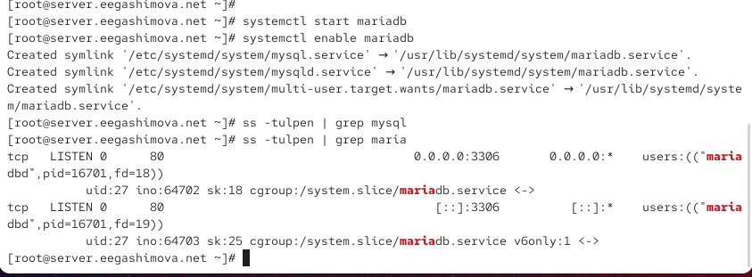
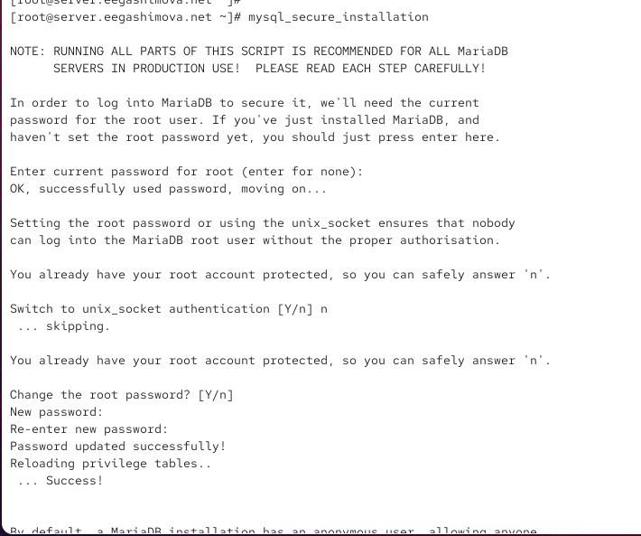
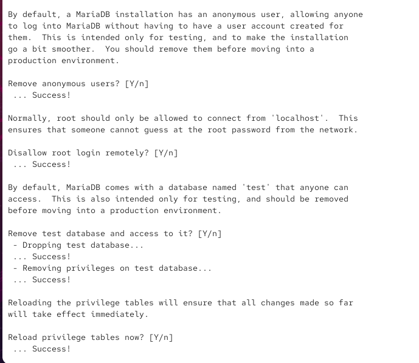
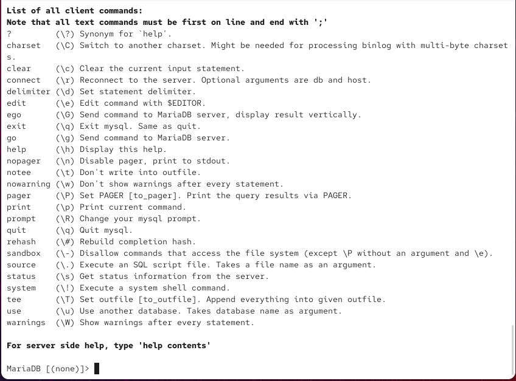
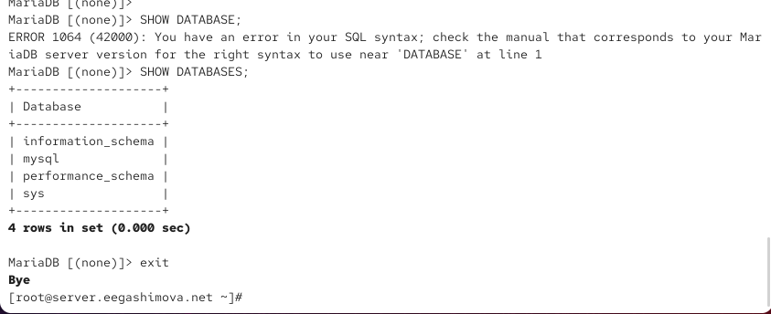
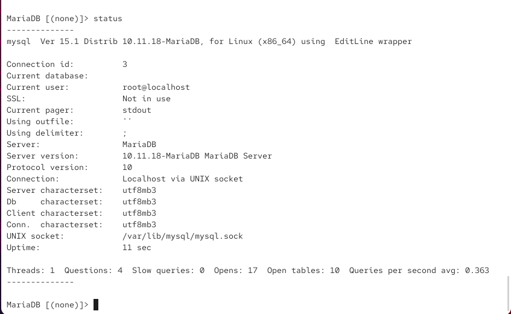
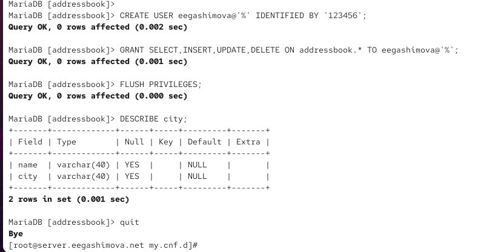
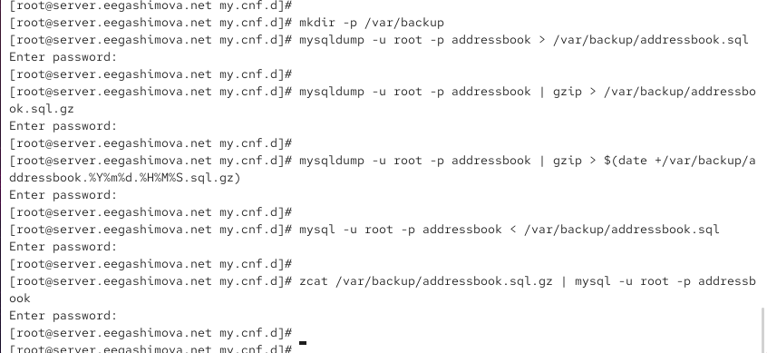
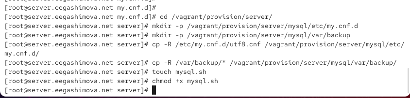

---
## Author
author:
  name: Гашимова Эсма Эльшан кызы
  email: 1132247520@rudn.ru
  affiliation:
    - name: Российский университет дружбы народов
      country: Российская Федерация
      postal-code: 117198
      city: Москва
      address: ул. Миклухо-Маклая, д. 6

## Title
title: Лабораторная работа №6
subtitle: Установка и настройка системы управления базами данных MariaDB
license: CC BY
date: today
date-format: "YYYY-MM-DD"
---

# Цели и задачи работы

## Цель лабораторной работы

Установить и настроить систему управления базами данных MariaDB.

Также необходимо настроить кодировку UTF-8, создать тестовую базу данных, выполнить резервное копирование и сохранить настройки в проекте Vagrant.

# Процесс выполнения лабораторной работы

## Установка MariaDB

{ #fig:001 width=70% height=70% }

## Запуск службы MariaDB

{ #fig:002 width=70% height=70% }

## Настройка безопасности MariaDB

{ #fig:003 width=70% height=70% }

## Применение параметров безопасности

{ #fig:004 width=70% height=70% }

## Просмотр справки MariaDB

{ #fig:005 width=70% height=70% }

## Просмотр доступных баз данных

{ #fig:006 width=70% height=70% }

## Проверка статуса MariaDB

{ #fig:007 width=70% height=70% }

## Настройка кодировки UTF-8

{ #fig:008 width=70% height=70% }

## Создание базы данных addressbook

{ #fig:009 width=70% height=70% }

## Создание пользователя и назначение прав

{ #fig:010 width=70% height=70% }

## Проверка базы данных

{ #fig:011 width=70% height=70% }

## Резервное копирование

{ #fig:012 width=70% height=70% }

## Подготовка файлов для Vagrant

{ #fig:013 width=70% height=70% }

## Скрипт автоматической настройки

{ #fig:014 width=70% height=70% }

# Результаты работы

## Установка MariaDB

На виртуальной машине `server` были установлены пакеты:

```text
mariadb
mariadb-server
```

Служба MariaDB была запущена и добавлена в автозагрузку.

## Настройка кодировки

В каталоге `/etc/my.cnf.d` был создан файл:

```text
utf8.cnf
```

В нём была задана кодировка UTF-8 для клиента и сервера MariaDB.

## Заполнение таблицы

В таблицу `city` были добавлены записи:

```text
Иванов  Москва
Петров  Сочи
Сидоров Дубна
```

После выполнения запроса:

```sql
SELECT * FROM city;
```

данные были успешно выведены на экран.

## Создание пользователя

Для работы с базой данных был создан пользователь `eegashimova`.

Ему были выданы права на выполнение операций:

```text
SELECT
INSERT
UPDATE
DELETE
```

## Резервное копирование

Резервная копия базы данных была создана командой:

```bash
mysqldump -u root -p addressbook > /var/backup/addressbook.sql
```

Также была создана сжатая резервная копия с помощью `gzip`.

## Восстановление базы данных

Восстановление базы данных было выполнено командой:

```bash
mysql -u root -p addressbook < /var/backup/addressbook.sql
```
Восстановление из сжатой копии было выполнено с помощью `zcat`.

## Вывод

В ходе лабораторной работы была установлена и настроена MariaDB.

Была настроена кодировка UTF-8, создана база данных `addressbook`, добавлена таблица `city` и внесены тестовые данные.

Также были созданы резервные копии базы данных и проверено восстановление данных.

В завершение был подготовлен скрипт автоматической установки и настройки MariaDB для использования в Vagrant.