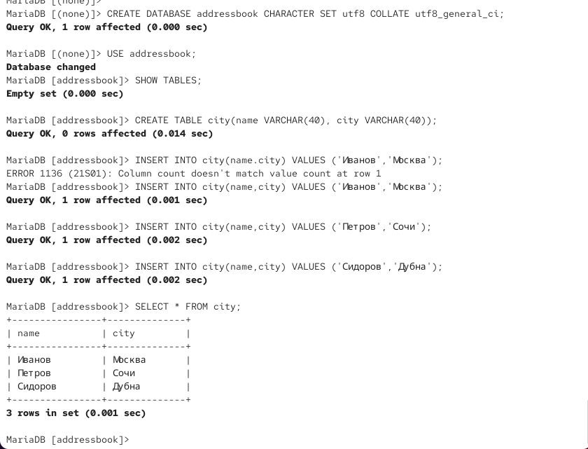
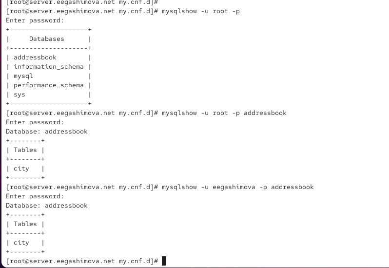
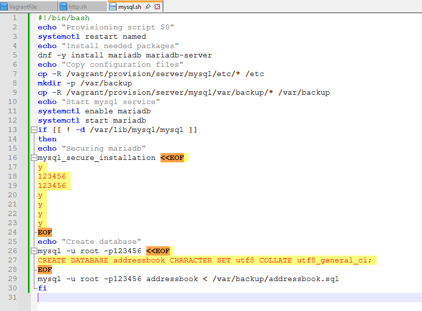

---
## Author
author:
  name: Гашимова Эсма Эльшан кызы
  email: 1132247520@rudn.ru
  affiliation:
    - name: Российский университет дружбы народов
      country: Российская Федерация
      postal-code: 117198
      city: Москва
      address: ул. Миклухо-Маклая, д. 6

## Title
title: "Отчёт по лабораторной работе №6"
subtitle: "Установка и настройка системы управления базами данных MariaDB"
license: "CC BY"
---

# Цель работы

Приобретение практических навыков по установке и конфигурированию системы управления базами данных на примере программного обеспечения MariaDB.

# Выполнение лабораторной работы

## Установка MariaDB

На виртуальной машине `server` перехожу в режим суперпользователя и устанавливаю необходимые для работы системы управления базами данных MariaDB пакеты:

```bash
dnf -y install mariadb mariadb-server
```

В результате устанавливаются серверная и клиентская части MariaDB, а также необходимые зависимости и дополнительные компоненты. После завершения установки просматриваю содержимое каталога `/etc/my.cnf.d/` и основной конфигурационный файл `/etc/my.cnf` (см. рис. [@fig-001]).

{ #fig-001 width=70% }

В каталоге `/etc/my.cnf.d/` присутствуют следующие конфигурационные файлы:

```text
auth_gssapi.cnf
client.cnf
enable_encryption.preset
mariadb-server.cnf
mysql-clients.cnf
provider_bzip2.cnf
provider_lz4.cnf
provider_lzo.cnf
provider_snappy.cnf
spider.cnf
```

Файл `auth_gssapi.cnf` относится к настройке механизма аутентификации GSSAPI.

Файл `client.cnf` содержит параметры, используемые клиентскими программами MariaDB.

Файл `enable_encryption.preset` содержит предварительно подготовленные параметры, связанные с включением шифрования.

Файл `mariadb-server.cnf` предназначен для параметров серверной части MariaDB.

Файл `mysql-clients.cnf` содержит настройки клиентских утилит MySQL и MariaDB.

Файлы `provider_bzip2.cnf`, `provider_lz4.cnf`, `provider_lzo.cnf` и `provider_snappy.cnf` относятся к провайдерам различных алгоритмов сжатия.

Файл `spider.cnf` содержит параметры, связанные с механизмом хранения Spider.

Основной конфигурационный файл `/etc/my.cnf` имеет следующее содержимое:

```ini
#
# This group is read both both by the client and the server
# use it for options that affect everything
#

[client-server]

#
# include all files from the config directory
#

!includedir /etc/my.cnf.d
```

Строки, начинающиеся с символа `#`, являются комментариями и не влияют непосредственно на работу MariaDB.

Комментарий `This group is read both both by the client and the server` указывает, что расположенная далее группа настроек считывается как клиентскими программами, так и сервером MariaDB.

Комментарий `use it for options that affect everything` поясняет, что в данной группе можно размещать параметры, которые должны применяться одновременно к клиентской и серверной частям.

Строка `[client-server]` открывает общую секцию параметров MariaDB, предназначенных для клиента и сервера.

Комментарий `include all files from the config directory` указывает, что далее подключаются дополнительные конфигурационные файлы.

Директива `!includedir /etc/my.cnf.d` подключает все подходящие конфигурационные файлы из каталога `/etc/my.cnf.d`. Благодаря этому настройки MariaDB можно разделять на несколько файлов вместо размещения всей конфигурации в `/etc/my.cnf`.

После установки запускаю службу MariaDB и включаю её автоматический запуск при загрузке операционной системы:

```bash
systemctl start mariadb
systemctl enable mariadb
```

Команда `systemctl start mariadb` запускает сервер базы данных в текущем сеансе.

Команда `systemctl enable mariadb` добавляет службу в автозагрузку. В результате создаются необходимые символические ссылки на unit-файл службы.

Для проверки сетевого порта, прослушиваемого сервером MariaDB, использую:

```bash
ss -tulpen | grep mysql
```

Поскольку имя процесса в выводе определяется как `mariadbd`, дополнительно выполняю:

```bash
ss -tulpen | grep maria
```

В результате видно, что процесс `mariadbd` прослушивает TCP-порт `3306` на IPv4- и IPv6-интерфейсах (см. рис. [@fig-002]).

{ #fig-002 width=70% }

Порт `3306` является стандартным TCP-портом, используемым MySQL и MariaDB. Наличие процесса `mariadbd` в состоянии `LISTEN` подтверждает успешный запуск сервера базы данных.

Далее запускаю встроенный сценарий первоначальной настройки безопасности MariaDB:

```bash
mysql_secure_installation
```

При первом запросе текущего пароля пользователя `root` базы данных нажимаю `Enter`, поскольку пароль ещё не был установлен. Отказываюсь от перехода на аутентификацию через `unix_socket`, после чего устанавливаю пароль пользователя `root` базы данных (см. рис. [@fig-003]).

{ #fig-003 width=70% }

На следующих этапах удаляю анонимных пользователей, запрещаю удалённый вход в MariaDB под пользователем `root`, удаляю тестовую базу данных и обновляю таблицы привилегий (см. рис. [@fig-004]).

{ #fig-004 width=70% }

Пункт `Remove anonymous users?` удаляет учётные записи, позволяющие подключаться к MariaDB без указания зарегистрированного пользователя.

Пункт `Disallow root login remotely?` запрещает подключение к учётной записи администратора MariaDB `root` с удалённых узлов.

Пункт `Remove test database and access to it?` удаляет созданную по умолчанию тестовую базу данных и связанные с ней разрешения.

Пункт `Reload privilege tables now?` повторно загружает таблицы привилегий, благодаря чему сделанные изменения начинают действовать сразу.

После настройки безопасности вхожу в интерактивную оболочку MariaDB с правами администратора:

```bash
mysql -u root -p
```

Параметр `-u root` указывает имя пользователя базы данных, а параметр `-p` предписывает запросить пароль интерактивно.

Для просмотра списка команд интерактивной оболочки выполняю:

```text
\h
```

MariaDB выводит перечень доступных клиентских команд, включая `help`, `exit`, `quit`, `status`, `use`, `source`, `system` и другие (см. рис. [@fig-005]).

{ #fig-005 width=70% }

Команда `help` или `\h` выводит справочную информацию.

Команды `exit` и `quit` используются для выхода из интерактивной оболочки.

Команда `status` отображает сведения о текущем соединении и сервере.

Команда `use` выбирает базу данных, с которой будут выполняться последующие запросы.

Команда `source` позволяет выполнить SQL-команды из указанного файла.

Команда `system` запускает команду оболочки операционной системы непосредственно из клиента MariaDB.

Для просмотра имеющихся баз данных выполняю SQL-запрос:

```sql
SHOW DATABASES;
```

Перед этим была допущена опечатка и введена команда `SHOW DATABASE;`, из-за чего сервер вернул ошибку синтаксиса `ERROR 1064`. После исправления команды запрос выполняется успешно (см. рис. [@fig-006]).

{ #fig-006 width=70% }

На данном этапе в системе присутствуют четыре базы данных:

```text
information_schema
mysql
performance_schema
sys
```

База данных `information_schema` предоставляет служебную информацию о базах, таблицах, столбцах, правах доступа и других объектах сервера.

База данных `mysql` содержит системные таблицы MariaDB, включая сведения об учётных записях и привилегиях.

База данных `performance_schema` используется для сбора информации о работе и производительности сервера.

База данных `sys` предоставляет представления, упрощающие анализ служебной и диагностической информации MariaDB.

Для выхода из интерактивной оболочки использую:

```text
exit
```

## Настройка кодировки символов

Повторно вхожу в MariaDB с правами администратора:

```bash
mysql -u root -p
```

До изменения кодировки выполняю команду:

```text
status
```

Она отображает текущие параметры клиентского соединения и сервера MariaDB (см. рис. [@fig-007]).

{ #fig-007 width=70% }

Вывод команды содержит следующую информацию.

Строка

```text
mysql  Ver 15.1 Distrib 10.11.18-MariaDB, for Linux (x86_64) using EditLine wrapper
```

показывает версию клиентской программы MariaDB, версию дистрибутива `10.11.18-MariaDB`, используемую архитектуру `x86_64` и библиотеку обработки командной строки.

Строка

```text
Connection id: 12
```

содержит идентификатор текущего соединения клиента с сервером MariaDB.

Строка

```text
Current database:
```

показывает текущую выбранную базу данных. Поскольку база ещё не выбрана, значение отсутствует.

Строка

```text
Current user: root@localhost
```

указывает, что подключение выполнено от имени администратора базы данных `root` локально.

Строка

```text
SSL: Not in use
```

показывает, что текущее локальное соединение не использует SSL/TLS.

Строка

```text
Current pager: stdout
```

означает, что результаты запросов непосредственно выводятся в стандартный поток вывода терминала.

Строка

```text
Using outfile: ''
```

показывает, что вывод результатов в отдельный файл не настроен.

Строка

```text
Using delimiter: ;
```

указывает, что символ `;` используется для завершения SQL-запросов.

Строка

```text
Server: MariaDB
```

указывает тип используемого сервера базы данных.

Строка

```text
Server version: 10.11.18-MariaDB MariaDB Server
```

показывает установленную версию сервера MariaDB.

Строка

```text
Protocol version: 10
```

содержит номер версии протокола взаимодействия между клиентом и сервером.

Строка

```text
Connection: Localhost via UNIX socket
```

означает, что клиент подключён к локальному серверу через UNIX-сокет, а не через сетевое TCP-соединение.

Строка

```text
Server characterset: latin1
```

показывает кодировку символов сервера по умолчанию. До внесения изменений используется `latin1`.

Строка

```text
Db characterset: latin1
```

показывает кодировку текущей базы данных по умолчанию. До настройки она также отображается как `latin1`.

Строка

```text
Client characterset: utf8mb3
```

определяет кодировку, используемую клиентом для передачи данных серверу.

Строка

```text
Conn. characterset: utf8mb3
```

показывает кодировку текущего соединения.

Строка

```text
UNIX socket: /var/lib/mysql/mysql.sock
```

указывает путь к UNIX-сокету, через который выполняется локальное подключение к серверу.

Строка

```text
Uptime: 7 min 48 sec
```

показывает время работы MariaDB с момента последнего запуска.

В заключительной строке отображается статистика работы сервера:

```text
Threads: 1  Questions: 24  Slow queries: 0  Opens: 20  Open tables: 13  Queries per second avg: 0.051
```

`Threads: 1` показывает количество активных потоков соединений.

`Questions: 24` показывает количество запросов, обработанных сервером.

`Slow queries: 0` означает, что медленных запросов за время работы сервера не зарегистрировано.

`Opens: 20` отображает количество операций открытия таблиц.

`Open tables: 13` показывает количество открытых в текущий момент таблиц.

`Queries per second avg: 0.051` показывает среднее количество запросов, обрабатываемых за секунду.

Для установки кодировки UTF-8 по умолчанию перехожу в каталог `/etc/my.cnf.d` и создаю дополнительный конфигурационный файл `utf8.cnf`:

```bash
cd /etc/my.cnf.d
touch utf8.cnf
```

В файл добавляю следующую конфигурацию:

```ini
[client]
default-character-set = utf8

[mysqld]
character-set-server = utf8
```

Секция `[client]` содержит параметры клиентских программ MariaDB.

Директива

```ini
default-character-set = utf8
```

устанавливает UTF-8 в качестве кодировки символов по умолчанию для клиентов MariaDB.

Секция `[mysqld]` содержит параметры серверного процесса MariaDB.

Директива

```ini
character-set-server = utf8
```

устанавливает UTF-8 в качестве кодировки символов по умолчанию на стороне сервера.

После изменения конфигурации перезапускаю службу:

```bash
systemctl restart mariadb
```

Затем снова подключаюсь к MariaDB и выполняю:

```text
status
```

Результат показан на рис. [@fig-008].

{ #fig-008 width=70% }

После перезапуска изменился идентификатор соединения: вместо `12` отображается `3`. Также значение `Uptime` уменьшилось до `11 sec`, что подтверждает недавний перезапуск службы MariaDB.

Главным изменением являются параметры кодировки. До настройки вывод содержал:

```text
Server characterset: latin1
Db characterset: latin1
Client characterset: utf8mb3
Conn. characterset: utf8mb3
```

После настройки вывод имеет вид:

```text
Server characterset: utf8mb3
Db characterset: utf8mb3
Client characterset: utf8mb3
Conn. characterset: utf8mb3
```

Следовательно, кодировка сервера и базы данных изменилась с `latin1` на UTF-8. В используемой версии MariaDB значение `utf8` отображается в статусе как `utf8mb3`.

## Создание базы данных addressbook

Вхожу в MariaDB с правами администратора:

```bash
mysql -u root -p
```

Создаю базу данных `addressbook`, указывая для неё кодировку UTF-8 и правило сравнения строк `utf8_general_ci`:

```sql
CREATE DATABASE addressbook CHARACTER SET utf8 COLLATE utf8_general_ci;
```

Перехожу к созданной базе данных:

```sql
USE addressbook;
```

Проверяю наличие таблиц:

```sql
SHOW TABLES;
```

Поскольку база данных только что создана, результатом является сообщение `Empty set`.

Далее создаю таблицу `city`, содержащую два текстовых поля `name` и `city` длиной до 40 символов:

```sql
CREATE TABLE city(name VARCHAR(40), city VARCHAR(40));
```

Заполняю таблицу сведениями о сотрудниках и городах:

```sql
INSERT INTO city(name,city) VALUES ('Иванов','Москва');
INSERT INTO city(name,city) VALUES ('Петров','Сочи');
INSERT INTO city(name,city) VALUES ('Сидоров','Дубна');
```

При первом вводе команды добавления Иванова была допущена ошибка: между именами столбцов `name` и `city` была поставлена точка вместо запятой. MariaDB вернула ошибку `ERROR 1136 (21S01): Column count doesn't match value count at row 1`. После исправления синтаксиса запись была успешно добавлена.

Для отображения содержимого таблицы выполняю:

```sql
SELECT * FROM city;
```

Результат создания базы, таблицы и заполнения данных представлен на рис. [@fig-009].

{ #fig-009 width=70% }

Запрос `SELECT * FROM city;` выбирает все столбцы и все строки таблицы `city`. В результате отображаются три добавленные записи:

```text
+---------+--------+
| name    | city   |
+---------+--------+
| Иванов  | Москва |
| Петров  | Сочи   |
| Сидоров | Дубна  |
+---------+--------+
```

Полученный результат подтверждает, что таблица создана успешно, кириллические данные сохраняются и отображаются корректно, а кодировка UTF-8 настроена правильно.

Для работы с базой данных создаю отдельного пользователя `eegashimova`, которому разрешено подключение с любого узла:

```sql
CREATE USER eegashimova@'%' IDENTIFIED BY '123456';
```

Символ `%` после знака `@` означает, что данная учётная запись не ограничена конкретным именем удалённого узла.

Предоставляю пользователю права на просмотр, добавление, изменение и удаление данных в базе `addressbook`:

```sql
GRANT SELECT,INSERT,UPDATE,DELETE ON addressbook.* TO eegashimova@'%';
```

Директива `SELECT` предоставляет право чтения данных.

Директива `INSERT` разрешает добавление новых записей.

Директива `UPDATE` разрешает изменение существующих записей.

Директива `DELETE` разрешает удаление записей.

Конструкция `addressbook.*` указывает, что перечисленные разрешения распространяются на все таблицы базы данных `addressbook`.

После назначения прав обновляю таблицы привилегий:

```sql
FLUSH PRIVILEGES;
```

Для просмотра структуры таблицы выполняю:

```sql
DESCRIBE city;
```

Результат представлен на рис. [@fig-010].

{ #fig-010 width=70% }

Команда `DESCRIBE city;` показывает два поля:

```text
+-------+-------------+------+-----+---------+-------+
| Field | Type        | Null | Key | Default | Extra |
+-------+-------------+------+-----+---------+-------+
| name  | varchar(40) | YES  |     | NULL    |       |
| city  | varchar(40) | YES  |     | NULL    |       |
+-------+-------------+------+-----+---------+-------+
```

Столбец `Field` содержит имена полей таблицы.

Столбец `Type` показывает тип данных. Оба поля имеют тип `VARCHAR(40)`.

Значение `YES` в столбце `Null` означает, что полям разрешено принимать значение `NULL`.

Пустой столбец `Key` показывает, что для полей не заданы первичный или другие ключи.

Значение `NULL` в столбце `Default` означает отсутствие явно заданного значения по умолчанию.

Пустой столбец `Extra` показывает отсутствие дополнительных свойств полей.

После завершения работы выхожу из MariaDB командой:

```text
quit
```

Далее из командной оболочки операционной системы просматриваю список баз данных:

```bash
mysqlshow -u root -p
```

В списке теперь присутствуют:

```text
addressbook
information_schema
mysql
performance_schema
sys
```

Затем просматриваю таблицы созданной базы с правами администратора:

```bash
mysqlshow -u root -p addressbook
```

и с использованием созданной учётной записи:

```bash
mysqlshow -u eegashimova -p addressbook
```

В обоих случаях отображается таблица `city`, что подтверждает существование базы данных и наличие у пользователя `eegashimova` права на её просмотр (см. рис. [@fig-011]).

{ #fig-011 width=70% }

## Создание и восстановление резервных копий

Для хранения резервных копий создаю каталог `/var/backup`:

```bash
mkdir -p /var/backup
```

Параметр `-p` позволяет создать каталог вместе с недостающими родительскими каталогами и не выдаёт ошибку, если каталог уже существует.

Создаю обычную SQL-копию базы данных `addressbook`:

```bash
mysqldump -u root -p addressbook > /var/backup/addressbook.sql
```

Утилита `mysqldump` формирует текстовый SQL-дамп базы данных. Параметр `-u root` задаёт пользователя MariaDB, параметр `-p` включает запрос пароля, а перенаправление `>` записывает полученный SQL-код в файл `/var/backup/addressbook.sql`.

Далее создаю сжатую резервную копию:

```bash
mysqldump -u root -p addressbook | gzip > /var/backup/addressbook.sql.gz
```

В данном случае вывод `mysqldump` передаётся через конвейер программе `gzip`, после чего сжатые данные записываются в файл `addressbook.sql.gz`.

Также создаю сжатую резервную копию, имя которой содержит дату и время создания:

```bash
mysqldump -u root -p addressbook | gzip > $(date +/var/backup/addressbook.%Y%m%d.%H%M%S.sql.gz)
```

Команда `date` формирует имя файла, содержащее год, месяц, день, часы, минуты и секунды. Это позволяет хранить несколько резервных копий и определять время создания каждой из них по имени файла.

Для проверки возможности восстановления импортирую несжатую резервную копию обратно в базу данных:

```bash
mysql -u root -p addressbook < /var/backup/addressbook.sql
```

Оператор `<` передаёт SQL-команды из файла `addressbook.sql` клиенту MariaDB, который выполняет их в базе `addressbook`.

После этого проверяю восстановление из сжатой резервной копии:

```bash
zcat /var/backup/addressbook.sql.gz | mysql -u root -p addressbook
```

Команда `zcat` распаковывает содержимое файла в стандартный вывод, после чего через конвейер SQL-дамп передаётся клиенту MariaDB для выполнения.

Создание резервных копий и их последующее восстановление завершаются без сообщений об ошибках (см. рис. [@fig-012]).

{ #fig-012 width=70% }

## Автоматизация установки и настройки MariaDB в Vagrant

Для сохранения конфигурации MariaDB и резервной копии базы данных в структуре проекта Vagrant перехожу в каталог:

```bash
cd /vagrant/provision/server/
```

Создаю каталоги для конфигурационного файла и резервных копий:

```bash
mkdir -p /vagrant/provision/server/mysql/etc/my.cnf.d
mkdir -p /vagrant/provision/server/mysql/var/backup
```

Копирую созданный ранее файл настройки UTF-8:

```bash
cp -R /etc/my.cnf.d/utf8.cnf /vagrant/provision/server/mysql/etc/my.cnf.d/
```

Затем копирую резервные копии базы данных:

```bash
cp -R /var/backup/* /vagrant/provision/server/mysql/var/backup/
```

После этого создаю файл сценария `mysql.sh` и делаю его исполняемым:

```bash
touch mysql.sh
chmod +x mysql.sh
```
Подготовка структуры каталогов и файла сценария показана на рис. [@fig-013].

{ #fig-013 width=70% }

В созданный файл `/vagrant/provision/server/mysql.sh` записываю сценарий автоматического развёртывания MariaDB (см. рис. [@fig-014]):

{ #fig-014 width=70% }

# Вывод

В ходе лабораторной работы была установлена и настроена MariaDB. Настроена кодировка UTF-8, создана база данных `addressbook` с таблицей `city` и добавлены тестовые записи.

Также выполнено создание и восстановление резервных копий базы данных. В завершение подготовлен скрипт `mysql.sh` для автоматической установки и настройки MariaDB в Vagrant.

# Контрольные вопросы

**1. Какая команда отвечает за настройки безопасности в MariaDB?**

```bash
mysql_secure_installation
```

**2. Как настроить MariaDB для доступа через сеть?**

Нужно настроить `bind-address`, разрешить порт `3306` в межсетевом экране и создать пользователя, которому разрешены удалённые подключения.

**3. Какая команда позволяет получить обзор доступных баз данных после входа в среду оболочки MariaDB?**

```sql
SHOW DATABASES;
```

**4. Какая команда позволяет узнать, какие таблицы доступны в базе данных?**

```sql
SHOW TABLES;
```

**5. Какая команда позволяет узнать, какие поля доступны в таблице?**

```sql
DESCRIBE city;
```

**6. Какая команда позволяет узнать, какие записи доступны в таблице?**

```sql
SELECT * FROM city;
```

**7. Как удалить запись из таблицы?**

Например:

```sql
DELETE FROM city WHERE name='Петров';
```

**8. Где расположены файлы конфигурации MariaDB? Что можно настроить с их помощью?**

Основной файл:

```text
/etc/my.cnf
```

Дополнительные файлы находятся в:

```text
/etc/my.cnf.d/
```

С их помощью можно настраивать кодировку, сетевые параметры, порты и другие параметры MariaDB.

**9. Где располагаются файлы с базами данных MariaDB?**

Обычно в каталоге:

```text
/var/lib/mysql/
```

**10. Как сделать резервную копию базы данных и затем её восстановить?**

Создание резервной копии:

```bash
mysqldump -u root -p addressbook > /var/backup/addressbook.sql
```

Восстановление:

```bash
mysql -u root -p addressbook < /var/backup/addressbook.sql
```