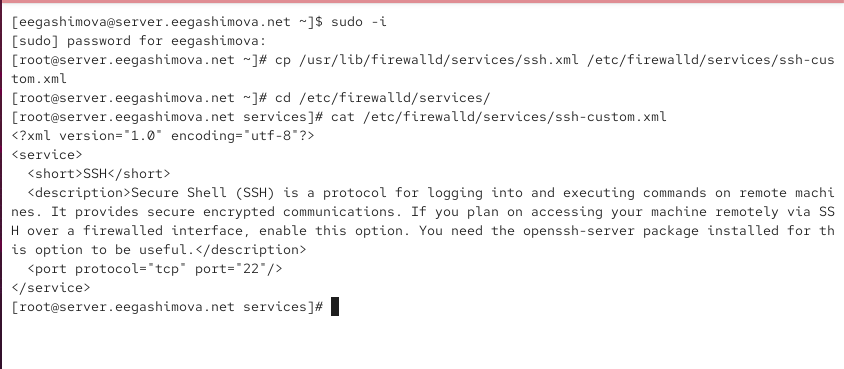
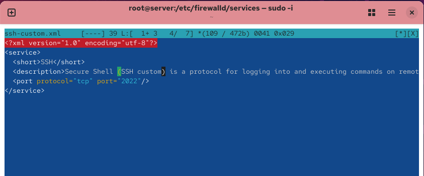
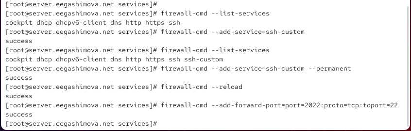
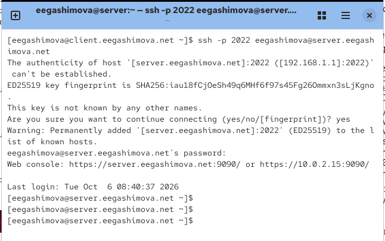
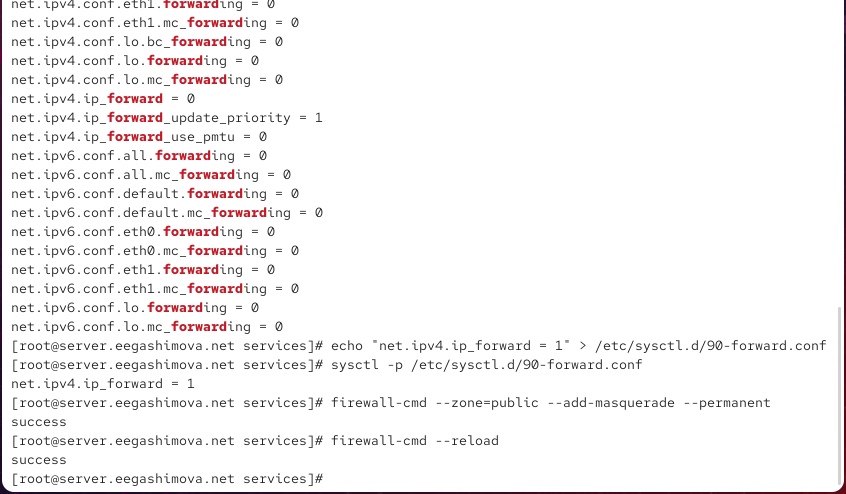
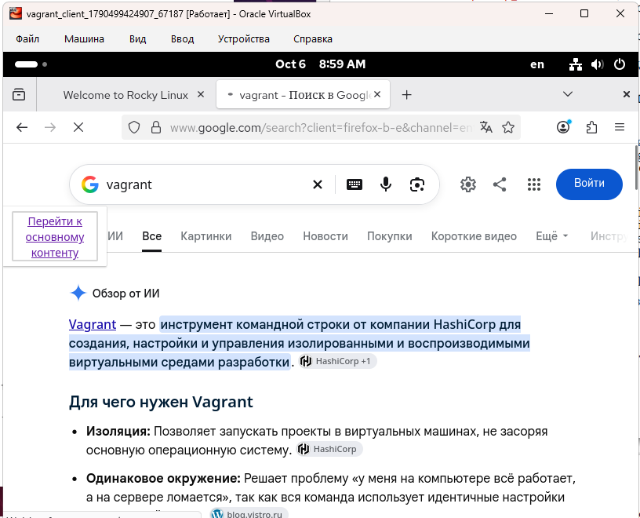

---
## Author
author:
  name: Гашимова Эсма Эльшан кызы
  email: 1132247520@rudn.ru
  affiliation:
    - name: Российский университет дружбы народов
      country: Российская Федерация
      postal-code: 117198
      city: Москва
      address: ул. Миклухо-Маклая, д. 6

## Title
title: Лабораторная работа №7
subtitle: Расширенные настройки межсетевого экрана
license: CC BY
date: today
date-format: "YYYY-MM-DD"
---

# Цели и задачи работы

## Цель лабораторной работы

Настроить межсетевой экран виртуальной машины `server` для доступа к SSH через порт `2022`.

Также необходимо настроить перенаправление портов, включить маскарадинг для доступа клиента к сети Интернет и сохранить выполненные настройки в проекте Vagrant.

# Процесс выполнения лабораторной работы

## Создание пользовательской службы FirewallD

{ #fig:001 width=70% height=70% }

## Редактирование службы ssh-custom

{ #fig:002 width=70% height=70% }

## Просмотр доступных служб FirewallD

{ #fig:003 width=70% height=70% }

## Перезагрузка конфигурации FirewallD

{ #fig:004 width=70% height=70% }

## Активация службы ssh-custom

{ #fig:005 width=70% height=70% }

## Проверка SSH через порт 2022

{ #fig:006 width=70% height=70% }

## Настройка IPv4 Forwarding и Masquerading

{ #fig:007 width=70% height=70% }

## Проверка доступа клиента к Интернету

{ #fig:008 width=70% height=70% }

## Подготовка конфигурации для Vagrant

{ #fig:009 width=70% height=70% }

## Создание скрипта firewall.sh

{ #fig:010 width=70% height=70% }

# Результаты работы

## Пользовательская служба FirewallD

На сервере был создан файл пользовательской службы:

```text
/etc/firewalld/services/ssh-custom.xml
```

## Перенаправление порта SSH

На сервере было настроено перенаправление порта `2022` на стандартный порт SSH `22`:

```text
firewall-cmd --add-forward-port=port=2022:proto=tcp:toport=22
```

## Настройка IPv4 Forwarding

Для включения маршрутизации IPv4-пакетов был создан файл: /etc/sysctl.d/90-forward.conf

В файл была добавлена строка: net.ipv4.ip_forward = 1

## Настройка маскарадинга

Для организации доступа клиента к сети Интернет через сервер был включён маскарадинг в зоне `public`:

```text
firewall-cmd --zone=public --add-masquerade --permanent
firewall-cmd --reload
```

После этого на клиентской машине была выполнена проверка доступа к Интернету.

## Вывод

В ходе лабораторной работы была выполнена расширенная настройка межсетевого экрана `firewalld`.

Была создана пользовательская служба `ssh-custom`, настроен доступ к SSH через порт `2022`, выполнено перенаправление портов и включён маскарадинг.

Также была проверена возможность выхода клиентской виртуальной машины в Интернет через сервер.

В завершение настройки были сохранены в проекте Vagrant, что позволяет автоматически воспроизводить конфигурацию межсетевого экрана при повторном развёртывании виртуальной машины.