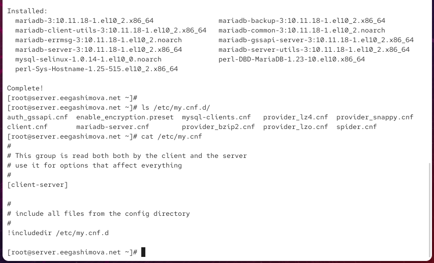
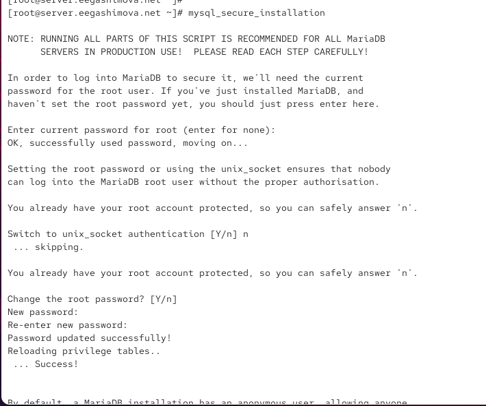
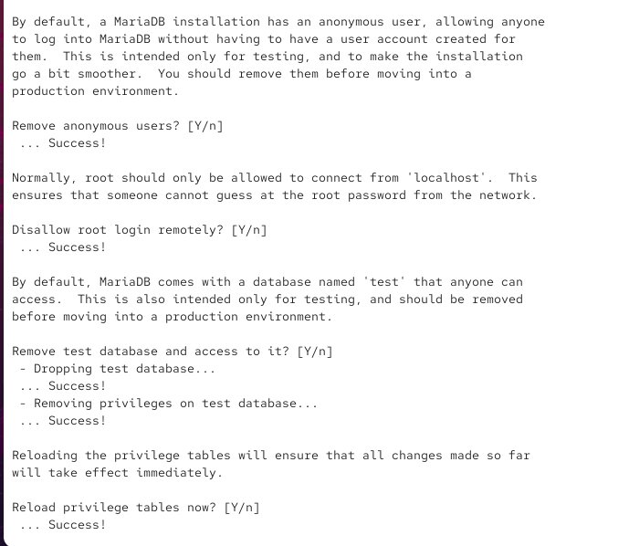
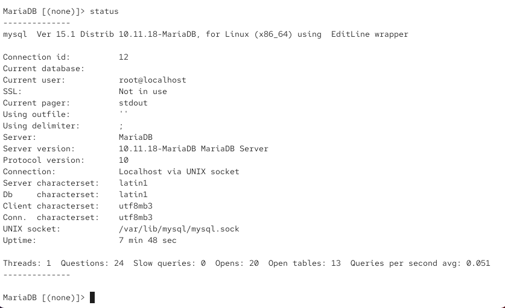
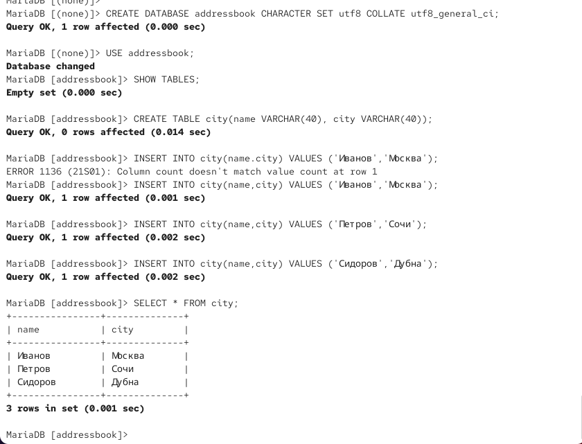
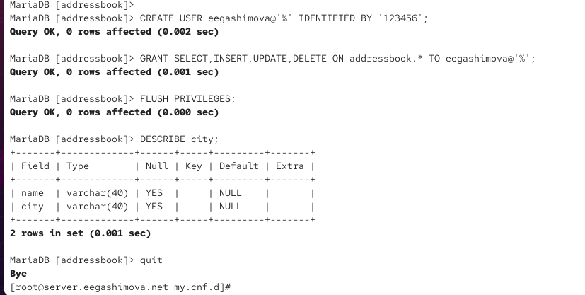

---
## Author
author:
  name: Гашимова Эсма Эльшан кызы
  email: 1132247520@rudn.ru
  affiliation:
    - name: Российский университет дружбы народов
      country: Российская Федерация
      postal-code: 117198
      city: Москва
      address: ул. Миклухо-Маклая, д. 6

## Title
title: "Отчёт по лабораторной работе №7"
subtitle: "Расширенные настройки межсетевого экрана"
license: "CC BY"
---

# Цель работы

Получить навыки настройки межсетевого экрана в Linux в части переадресации портов и настройки Masquerading

# Выполнение лабораторной работы

## Создание пользовательской службы FirewallD

На виртуальной машине `server` перехожу в режим суперпользователя командой `sudo -i`. На основе стандартного описания службы SSH создаю собственный файл службы `ssh-custom.xml`, копируя файл `/usr/lib/firewalld/services/ssh.xml` в каталог `/etc/firewalld/services/`. После этого перехожу в каталог со службами FirewallD и просматриваю содержимое созданного файла командой `cat` (см. рис. [@fig-001]).

{ #fig-001 width=70% }

Файл `ssh-custom.xml` имеет формат XML. Первая строка `<?xml version="1.0" encoding="utf-8"?>` является XML-декларацией: параметр `version="1.0"` указывает используемую версию XML, а `encoding="utf-8"` задаёт кодировку файла.

Строка `<service>` открывает корневой элемент описания службы FirewallD. Все параметры службы располагаются внутри этого элемента.

Элемент `<short>SSH</short>` задаёт краткое имя службы, которое используется для её краткого текстового представления.

Элемент `<description>...</description>` содержит развёрнутое текстовое описание назначения службы. В исходном файле указывается, что SSH предназначен для защищённого удалённого входа в систему и выполнения команд.

Строка `<port protocol="tcp" port="22"/>` определяет сетевой порт службы. Атрибут `protocol="tcp"` указывает использование транспортного протокола TCP, а `port="22"` задаёт стандартный порт SSH. Символы `/>` означают, что элемент является самозакрывающимся и не содержит вложенных элементов.

Строка `</service>` закрывает корневой элемент описания службы.

Открываю `/etc/firewalld/services/ssh-custom.xml` на редактирование. Изменяю описание службы, добавляя обозначение `SSH custom`, а стандартный порт `22` заменяю на `2022`. В результате в файле присутствует строка `<port protocol="tcp" port="2022"/>` (см. рис. [@fig-002]).

{ #fig-002 width=70% }

## Регистрация пользовательской службы в FirewallD

До перезагрузки конфигурации FirewallD просматриваю список известных служб командой `firewall-cmd --get-services`. Созданная служба `ssh-custom` в списке пока отсутствует, поскольку FirewallD ещё не перечитал файлы конфигурации из каталога `/etc/firewalld/services/` (см. рис. [@fig-003]).

{ #fig-003 width=70% }

Выполняю команду `firewall-cmd --reload`, чтобы FirewallD перечитал конфигурационные файлы. Повторно выполняю `firewall-cmd --get-services`. После перезагрузки служба `ssh-custom` появляется в списке доступных служб FirewallD (см. рис. [@fig-004]).

{ #fig-004 width=70% }

Командой `firewall-cmd --list-services` проверяю активные службы. Первоначально среди них присутствуют `cockpit`, `dhcp`, `dhcpv6-client`, `dns`, `http`, `https` и `ssh`, а служба `ssh-custom` ещё не активирована.

Добавляю пользовательскую службу командой `firewall-cmd --add-service=ssh-custom`. После успешного выполнения команды повторная проверка показывает `ssh-custom` в списке активных служб. Чтобы настройка сохранялась после перезапуска системы и FirewallD, добавляю службу в постоянную конфигурацию командой `firewall-cmd --add-service=ssh-custom --permanent` и перезагружаю правила командой `firewall-cmd --reload` (см. рис. [@fig-005]).

{ #fig-005 width=70% }

## Перенаправление порта SSH

SSH-сервер продолжает принимать соединения на стандартном внутреннем порту `22`, поэтому для доступа через новый порт на межсетевом экране настраиваю перенаправление TCP-порта `2022` на порт `22`:

`firewall-cmd --add-forward-port=port=2022:proto=tcp:toport=22`

Команда завершается сообщением `success`, что подтверждает добавление правила перенаправления портов (см. рис. [@fig-005]).

После настройки перенаправления на виртуальной машине `client` проверяю подключение к серверу, явно указывая порт `2022`:

`ssh -p 2022 eegashimova@server.eegashimova.net`

При первом подключении подтверждаю добавление ключа сервера в список известных узлов, после чего ввожу пароль пользователя. Соединение успешно устанавливается, и командная строка меняется на `eegashimova@server.eegashimova.net`, что подтверждает возможность SSH-доступа через порт `2022` (см. рис. [@fig-006]).

{ #fig-006 width=70% }

## Настройка перенаправления IPv4-пакетов и маскарадинга

Для использования виртуальной машины `server` в качестве маршрутизатора проверяю состояние параметров перенаправления пакетов командой:

`sysctl -a | grep forward`

В выводе видно, что параметр `net.ipv4.ip_forward` имеет значение `0`, следовательно, перенаправление IPv4-пакетов первоначально отключено.

Создаю файл `/etc/sysctl.d/90-forward.conf` со строкой:

`net.ipv4.ip_forward = 1`

После этого применяю настройку без перезагрузки операционной системы командой:

`sysctl -p /etc/sysctl.d/90-forward.conf`

В результате система выводит `net.ipv4.ip_forward = 1`, что подтверждает включение маршрутизации IPv4-пакетов.

Для организации доступа клиентской виртуальной машины во внешнюю сеть включаю маскарадинг в зоне `public`:

`firewall-cmd --zone=public --add-masquerade --permanent`

Параметр `--zone=public` указывает зону FirewallD, `--add-masquerade` включает подмену исходного адреса пакетов при их выходе через сервер, а `--permanent` сохраняет настройку в постоянной конфигурации. После этого применяю изменения командой `firewall-cmd --reload` (см. рис. [@fig-007]).

{ #fig-007 width=70% }

После включения маршрутизации и маскарадинга на виртуальной машине `client` проверяю доступность сети Интернет. Открываю браузер и выполняю поисковый запрос в Google. Страница успешно загружается и отображает результаты поиска, что подтверждает наличие доступа клиента в Интернет через виртуальную машину `server` (см. рис. [@fig-008]).

{ #fig-008 width=70% }

## Подготовка файлов для автоматической настройки виртуальной машины

Для сохранения выполненной конфигурации в проекте Vagrant на виртуальной машине `server` перехожу в каталог `/vagrant/provision/server/`.

Создаю структуру каталогов для конфигурационных файлов FirewallD и `sysctl`:

{ #fig-009 width=70% }

## Создание скрипта настройки межсетевого экрана

В файле `/vagrant/provision/server/firewall.sh` создаю скрипт, который автоматически восстанавливает выполненные настройки межсетевого экрана при развёртывании виртуальной машины.

{ #fig-010 width=70% }

# Вывод

В ходе лабораторной работы выполнена расширенная настройка межсетевого экрана `firewalld` на виртуальной машине `server`. Создана пользовательская служба `ssh-custom`, использующая TCP-порт `2022`, и настроено перенаправление подключений с порта `2022` на стандартный порт SSH `22`.

Также на сервере включено перенаправление IPv4-пакетов и настроен маскарадинг в зоне `public`, благодаря чему виртуальная машина `client` получила доступ к сети Интернет через `server`.

В завершение создан скрипт `firewall.sh`, автоматизирующий настройку пользовательской службы, перенаправления портов и маскарадинга. Необходимые конфигурационные файлы сохранены в проекте Vagrant, а в `Vagrantfile` добавлен provisioner для автоматического запуска скрипта при развёртывании виртуальной машины.

# Контрольные вопросы

**1. Где хранятся пользовательские файлы firewalld?**

Пользовательские конфигурационные файлы `firewalld` хранятся в каталоге `/etc/firewalld/`. Пользовательские описания служб располагаются в каталоге `/etc/firewalld/services/`.

**2. Какую строку надо включить в пользовательский файл службы, чтобы указать порт TCP 2022?**

Для указания TCP-порта `2022` в XML-файл описания службы необходимо добавить строку:

`<port protocol="tcp" port="2022"/>`

**3. Какая команда позволяет перечислить все службы, доступные в настоящее время на сервере?**

Для просмотра всех служб, известных `firewalld`, используется команда:

`firewall-cmd --get-services`

**4. В чём разница между трансляцией сетевых адресов (NAT) и маскарадингом (masquerading)?**

NAT — общий механизм преобразования сетевых адресов и портов пакетов. Он может использоваться как для изменения адреса источника (`SNAT`), так и для изменения адреса назначения (`DNAT`).

Маскарадинг является разновидностью `SNAT`, при которой исходный IP-адрес пакета автоматически заменяется адресом выходного сетевого интерфейса. Маскарадинг особенно удобен при использовании динамического внешнего IP-адреса, поскольку не требует заранее указывать конкретный адрес.

**5. Какая команда разрешает входящий трафик на порт 4404 и перенаправляет его в службу SSH по IP-адресу 10.0.0.10?**

Для перенаправления входящих TCP-соединений с порта `4404` на порт SSH `22` узла с IP-адресом `10.0.0.10` используется команда:

`firewall-cmd --add-forward-port=port=4404:proto=tcp:toport=22:toaddr=10.0.0.10`

Для сохранения правила после перезагрузки необходимо добавить параметр `--permanent`:

`firewall-cmd --add-forward-port=port=4404:proto=tcp:toport=22:toaddr=10.0.0.10 --permanent`

**6. Какая команда используется для включения маскарадинга IP-пакетов для всех пакетов, выходящих в зону public?**

Для включения маскарадинга в зоне `public` используется команда:

`firewall-cmd --zone=public --add-masquerade`

Для постоянного сохранения настройки используется команда:

`firewall-cmd --zone=public --add-masquerade --permanent`

После изменения постоянной конфигурации необходимо применить настройки:

`firewall-cmd --reload`

# Список литературы

1. [Документация firewalld](https://firewalld.org/documentation/index.html)
2. [firewalld.service — описание конфигурационных файлов служб](https://firewalld.org/documentation/man-pages/firewalld.service.html)
3. [firewall-cmd — руководство по работе с командой](https://firewalld.org/documentation/man-pages/firewall-cmd.html)
4. [Firewalld: создание и добавление пользовательской службы](https://firewalld.org/documentation/howto/add-a-service.html)
5. [Red Hat Enterprise Linux — настройка перенаправления портов в firewalld](https://docs.redhat.com/en/documentation/red_hat_enterprise_linux/7/html/security_guide/sec-port_forwarding)
6. [Red Hat Enterprise Linux — настройка firewalld, NAT и IP Masquerading](https://docs.redhat.com/en/documentation/red_hat_enterprise_linux/9/html/configuring_firewalls_and_packet_filters/using-and-configuring-firewalld_firewall-packet-filters)
7. [Linux Kernel Documentation — параметры IPv4 и IP Forwarding](https://kernel.org/doc/html/latest/networking/ip-sysctl.html)
8. [HashiCorp Vagrant — Provisioning](https://developer.hashicorp.com/vagrant/docs/provisioning)
9. [HashiCorp Vagrant — Shell Provisioner](https://developer.hashicorp.com/vagrant/docs/provisioning/shell)