---
## Author
author:
  name: Гашимова Эсма Эльшан кызы
  email: 1132247520@rudn.ru
  affiliation:
    - name: Российский университет дружбы народов
      country: Российская Федерация
      postal-code: 117198
      city: Москва
      address: ул. Миклухо-Маклая, д. 6

## Title
title: Лабораторная работа №8
subtitle: Настройка SMTP-сервера
license: CC BY
date: today
date-format: "YYYY-MM-DD"
---

# Цели и задачи работы

## Цель лабораторной работы

Приобретение практических навыков установки, настройки и администрирования почтового сервера `Postfix` в операционной системе Rocky Linux.

Настроить отправку электронной почты между виртуальными машинами `server` и `client`, обеспечить доставку сообщений на доменные адреса и автоматизировать настройку Postfix с помощью Vagrant.

# Процесс выполнения лабораторной работы

## Установка и запуск Postfix

{ #fig:001 width=70% height=70% }

## Просмотр конфигурации Postfix

{ #fig:002 width=70% height=70% }

## Изменение параметров myorigin и mydomain

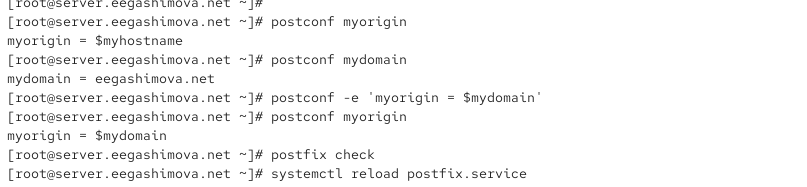{ #fig:003 width=70% height=70% }

## Просмотр изменённых параметров Postfix

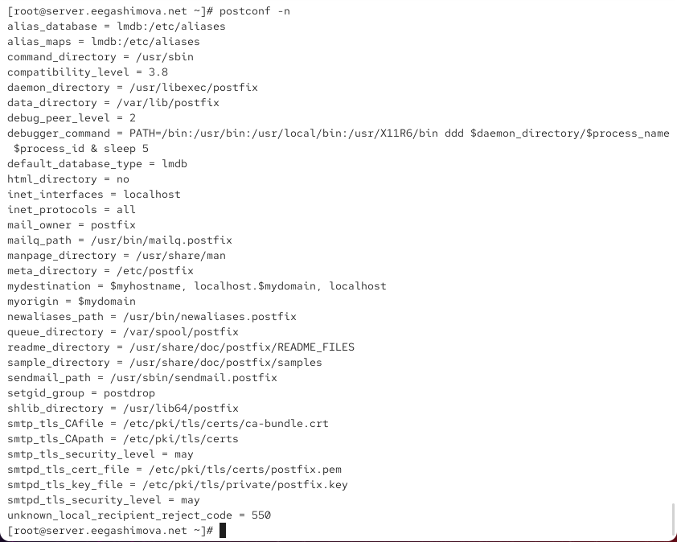{ #fig:004 width=70% height=70% }

## Настройка домена и протокола IPv4

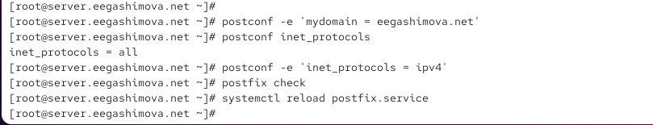{ #fig:005 width=70% height=70% }

## Проверка доставки почты на сервере

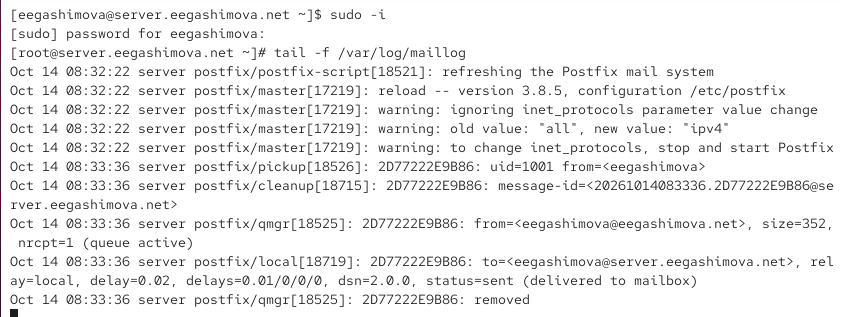{ #fig:006 width=70% height=70% }

## Просмотр локального почтового ящика

{ #fig:007 width=70% height=70% }

## Установка Postfix на клиенте

{ #fig:008 width=70% height=70% }

## Отправка почты с клиента

{ #fig:009 width=70% height=70% }

## Настройка сетевых интерфейсов Postfix

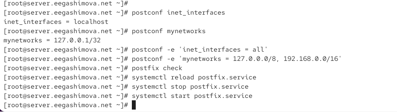{ #fig:010 width=70% height=70% }

## Проверка доставки письма с клиента

{ #fig:011 width=70% height=70% }

## Просмотр полученного сообщения

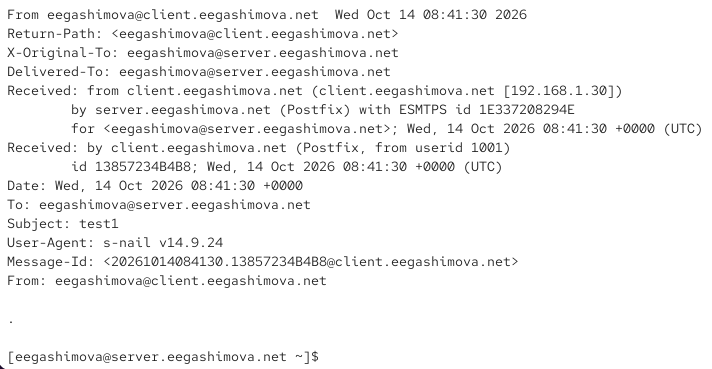{ #fig:012 width=70% height=70% }

## Отправка почты на доменный адрес

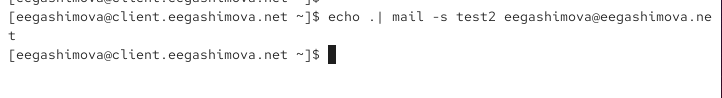{ #fig:013 width=70% height=70% }

## Проверка доставки на доменный адрес

{ #fig:014 width=70% height=70% }

## Настройка прямой DNS-зоны

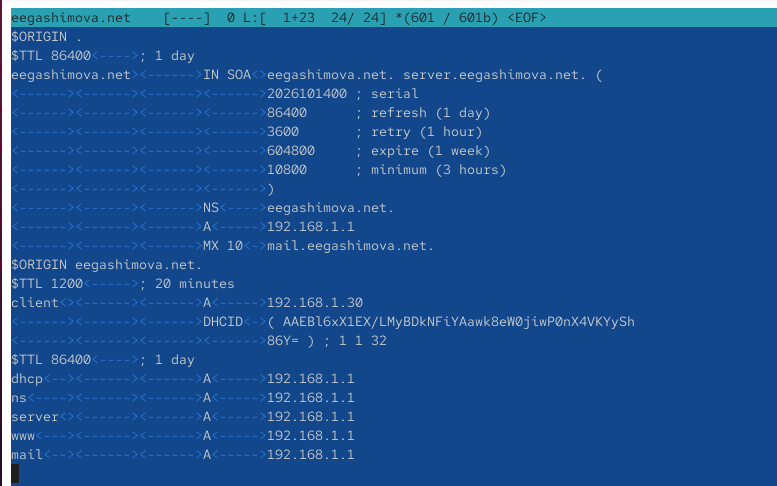{ #fig:015 width=70% height=70% }

## Настройка обратной DNS-зоны

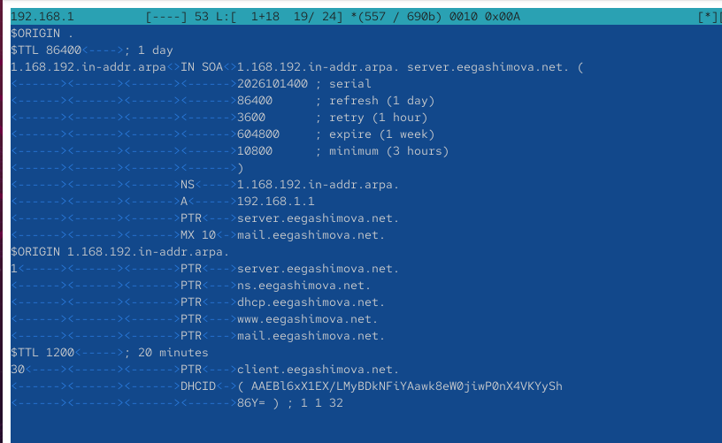{ #fig:016 width=70% height=70% }

## Настройка локальных доменов Postfix

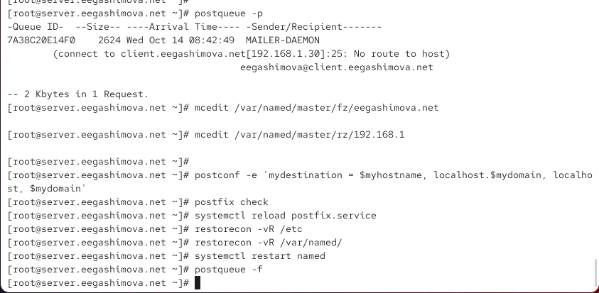{ #fig:017 width=70% height=70% }

## Проверка доставки после настройки DNS

{ #fig:018 width=70% height=70% }

## Просмотр письма с доменного адреса

{ #fig:019 width=70% height=70% }

## Подготовка конфигурации для Vagrant

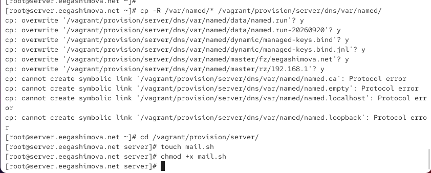{ #fig:020 width=70% height=70% }

## Создание сценария mail.sh на сервере

{ #fig:021 width=70% height=70% }

## Подготовка сценария на клиенте

{ #fig:022 width=70% height=70% }

## Создание сценария mail.sh на клиенте

{ #fig:023 width=70% height=70% }

# Результаты работы

## Настройка почтового домена

На сервере настроена работа с доменом `eegashimova.net`.

Основные параметры Postfix:

```
mydomain = eegashimova.net
myorigin = $mydomain
inet_protocols = ipv4
inet_interfaces = all
mynetworks = 127.0.0.0/8, 192.168.0.0/16
```

## Проверка отправки электронной почты


После настройки DNS и Postfix успешно проверена доставка на доменный адрес:

```
echo . | mail -s test2 eegashimova@eegashimova.net
```

В журнале `/var/log/maillog` подтверждена успешная доставка сообщений:

```
status=sent (delivered to mailbox)
```

# Вывод

В ходе лабораторной работы был установлен и настроен почтовый сервер `Postfix` на виртуальных машинах `server` и `client`.

Были настроены параметры SMTP, сетевые интерфейсы, доверенные сети и DNS-записи для домена `eegashimova.net`.

Проверена отправка электронной почты между виртуальными машинами и успешная доставка сообщений на доменный адрес.
