---
## Author
author:
  name: Гашимова Эсма Эльшан кызы
  email: 1132247520@rudn.ru
  affiliation:
    - name: Российский университет дружбы народов
      country: Российская Федерация
      postal-code: 117198
      city: Москва
      address: ул. Миклухо-Маклая, д. 6

## Title
title: "Отчёт по лабораторной работе №8"
subtitle: "Настройка SMTP-сервера"
license: "CC BY"
---

# Цель работы

Приобретение практических навыков по установке и конфигурированию SMTP сервера.

# Выполнение лабораторной работы

## Установка Postfix

На виртуальной машине `server` перехожу в режим суперпользователя командой `sudo -i`. Устанавливаю пакеты `postfix` и `s-nail` с помощью `dnf -y install postfix` и `dnf -y install s-nail`. Разрешаю работу SMTP в межсетевом экране командами `firewall-cmd --add-service=smtp` и `firewall-cmd --add-service=smtp --permanent`. Проверяю список служб командой `firewall-cmd --list-services`, восстанавливаю контексты SELinux с помощью `restorecon -vR /etc`. Затем включаю автозапуск и запускаю Postfix командами `systemctl enable postfix` и `systemctl start postfix` (см. рис. [@fig-001]).

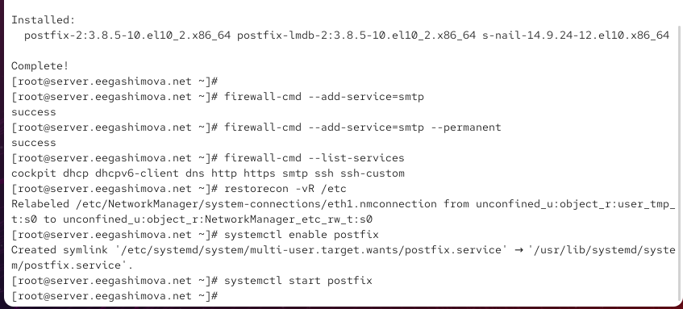{ #fig-001 width=70% }

## Изменение параметров Postfix с помощью postconf

Для просмотра текущей конфигурации Postfix выполняю команду `postconf`. В выводе отображаются параметры работы почтового сервера, включая сетевые настройки, доменные имена и каталоги хранения сообщений (см. рис. [@fig-002]).

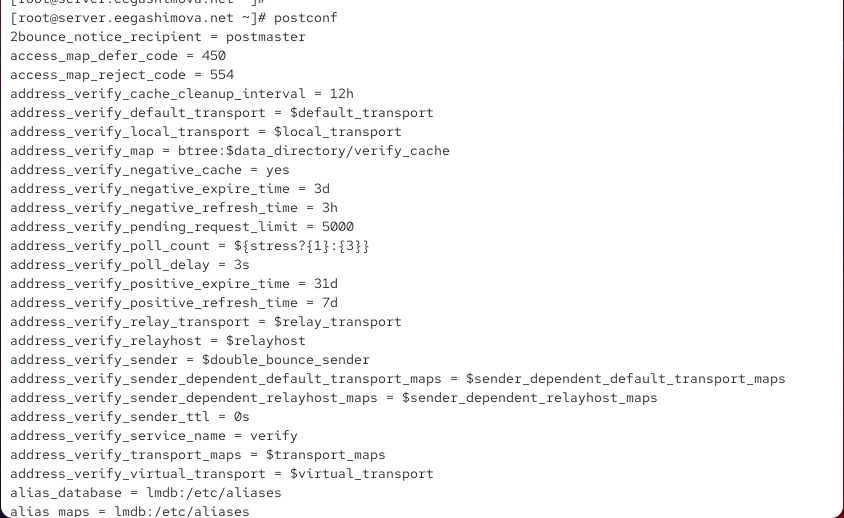{ #fig-002 width=70% }

Проверяю параметры `myorigin` и `mydomain` командами `postconf myorigin` и `postconf mydomain`. Параметр `myorigin` определяет доменную часть адреса отправителя, а `mydomain` — домен почтового сервера. Устанавливаю `myorigin = $mydomain` командой `postconf -e 'myorigin = $mydomain'`. Проверяю конфигурацию с помощью `postfix check` и перечитываю её командой `systemctl reload postfix.service` (см. рис. [@fig-003]).

{ #fig-003 width=70% }

Командой `postconf -n` просматриваю параметры, отличающиеся от значений по умолчанию. В текущей конфигурации `inet_interfaces = localhost`, поэтому Postfix принимает соединения только через локальный интерфейс, а `inet_protocols = all` разрешает использование IPv4 и IPv6 (см. рис. [@fig-004]).

{ #fig-004 width=70% }

Задаю домен командой `postconf -e 'mydomain = eegashimova.net'`. Затем отключаю IPv6, выполнив `postconf -e 'inet_protocols = ipv4'`. Проверяю конфигурацию командой `postfix check` и перечитываю настройки с помощью `systemctl reload postfix.service` (см. рис. [@fig-005]).

{ #fig-005 width=70% }

## Проверка работы Postfix

На сервере отправляю тестовое письмо командой `echo . | mail -s test1 eegashimova@server.eegashimova.net`. Для проверки доставки просматриваю журнал командой `tail -f /var/log/maillog`. Запись `status=sent (delivered to mailbox)` подтверждает успешную доставку письма, а `removed` означает удаление обработанного сообщения из очереди (см. рис. [@fig-006]).

{ #fig-006 width=70% }

Дополнительно просматриваю файл `/var/spool/mail/eegashimova`, содержащий локальную почту пользователя. В заголовках письма присутствуют адрес получателя и тема `test1`, что подтверждает получение отправленного сообщения (см. рис. [@fig-007]).

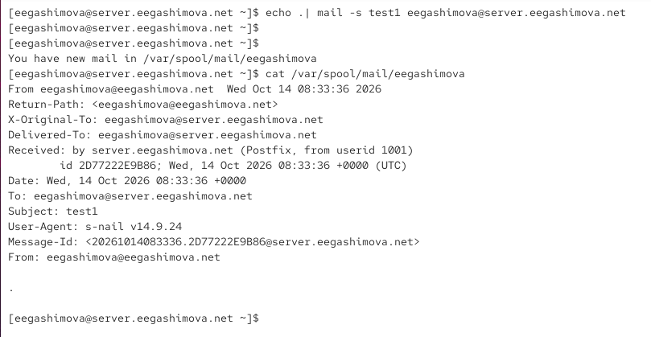{ #fig-007 width=70% }

Перехожу на виртуальную машину `client`, устанавливаю пакеты `postfix` и `s-nail`. Командой `postconf -e 'inet_protocols = ipv4'` разрешаю использование только IPv4. Включаю автозапуск и запускаю службу командами `systemctl enable postfix` и `systemctl start postfix` (см. рис. [@fig-008]).

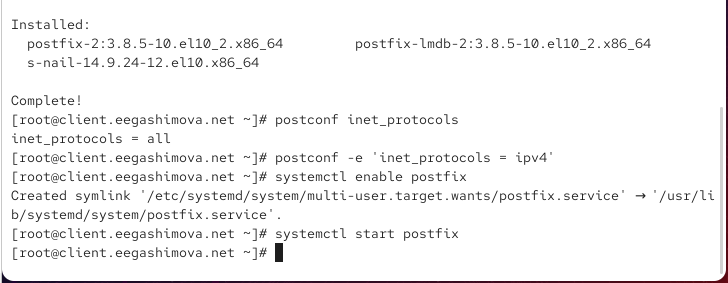{ #fig-008 width=70% }

С клиента отправляю письмо на сервер командой `echo . | mail -s test1 eegashimova@server.eegashimova.net`. Проверяю возможность передачи сообщения между виртуальными машинами (см. рис. [@fig-009]).

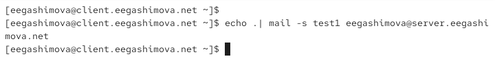{ #fig-009 width=70% }

На сервере проверяю параметры `inet_interfaces` и `mynetworks`. Для приёма соединений со всех сетевых интерфейсов выполняю `postconf -e 'inet_interfaces = all'`, а командой `postconf -e 'mynetworks = 127.0.0.0/8, 192.168.0.0/16'` добавляю внутреннюю сеть в список доверенных. Проверяю конфигурацию и перезапускаю Postfix (см. рис. [@fig-010]).

{ #fig-010 width=70% }

Повторно отправляю письмо с клиента. В журнале сервера появляется запись подключения `client.eegashimova.net[192.168.1.30]`. Строка `status=sent (delivered to mailbox)` подтверждает успешную доставку сообщения по SMTP (см. рис. [@fig-011]).

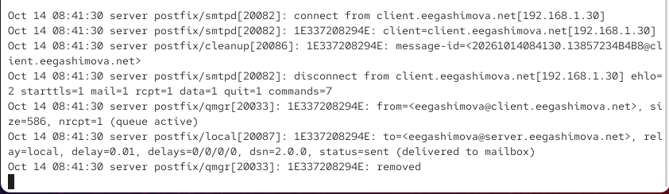{ #fig-011 width=70% }

Просматриваю содержимое почтового ящика `/var/spool/mail/eegashimova`. В заголовках письма указан отправитель `eegashimova@client.eegashimova.net` и получатель `eegashimova@server.eegashimova.net`, что подтверждает передачу сообщения между виртуальными машинами (см. рис. [@fig-012]).

{ #fig-012 width=70% }

## Конфигурация Postfix для домена

Для проверки отправки почты на доменный адрес с клиента выполняю команду `echo . | mail -s test2 eegashimova@eegashimova.net`. Теперь в адресе получателя используется домен без указания конкретного сервера (см. рис. [@fig-013]).

{ #fig-013 width=70% }

Проверяю журнал Postfix. При попытке доставки возникает ошибка `mail for eegashimova.net loops back to myself`, поскольку домен ещё не добавлен в список локально обслуживаемых. Postfix формирует уведомление о недоставке, которое также не удаётся передать клиенту из-за ошибки `No route to host` (см. рис. [@fig-014]).

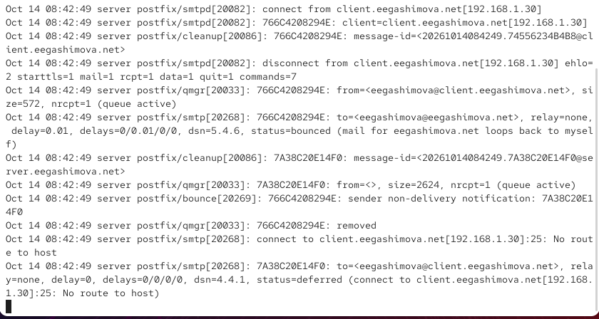{ #fig-014 width=70% }

Для настройки почтового домена открываю файл прямой DNS-зоны `/var/named/master/fz/eegashimova.net`. Добавляю MX-запись `MX 10 mail.eegashimova.net.`, указывающую почтовый сервер домена, и A-запись `mail A 192.168.1.1`, связывающую его имя с IP-адресом (см. рис. [@fig-015]).

{ #fig-015 width=70% }

Далее редактирую файл обратной DNS-зоны `/var/named/master/rz/192.168.1`. Добавляю PTR-запись для имени `mail.eegashimova.net`, обеспечивающую обратное разрешение IP-адреса почтового сервера (см. рис. [@fig-016]).

{ #fig-016 width=70% }

Командой `postqueue -p` проверяю очередь почтовых сообщений. Для разрешения локальной доставки на доменный адрес выполняю `postconf -e 'mydestination = $myhostname, localhost.$mydomain, localhost, $mydomain'`. Затем проверяю настройки Postfix, восстанавливаю контексты SELinux, перезапускаю DNS-сервер командой `systemctl restart named` и повторно обрабатываю очередь с помощью `postqueue -f` (см. рис. [@fig-017]).

{ #fig-017 width=70% }

Повторно отправляю письмо с клиента на адрес `eegashimova@eegashimova.net`. В журнале сервера отображается `status=sent (delivered to mailbox)`, подтверждающая успешную доставку сообщения после настройки DNS и параметра `mydestination` (см. рис. [@fig-018]).

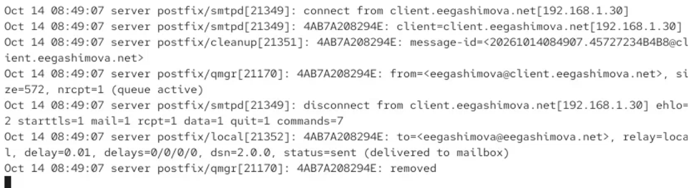{ #fig-018 width=70% }

Проверяю содержимое локального почтового ящика. В полученном письме указаны адрес `eegashimova@eegashimova.net` и тема `test2`. Следовательно, почтовый сервер корректно принимает сообщения, адресованные домену `eegashimova.net` (см. рис. [@fig-019]).

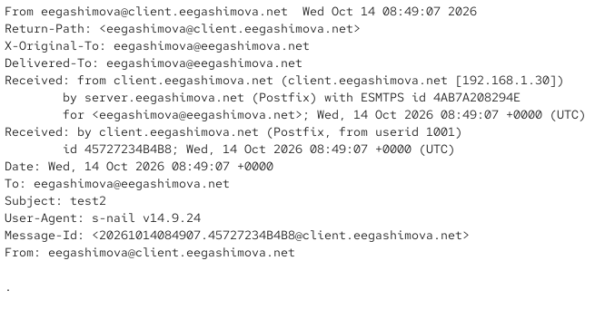{ #fig-019 width=70% }

## Внесение изменений в настройки внутреннего окружения виртуальной машины

Для автоматизации настройки Postfix копирую файлы DNS в каталог `/vagrant/provision/server/dns/var/named/` и создаю исполняемые сценарии `mail.sh` для виртуальных машин `server` и `client` (см. рис. [@fig-020]–[@fig-023]).

{ #fig-020 width=70% }

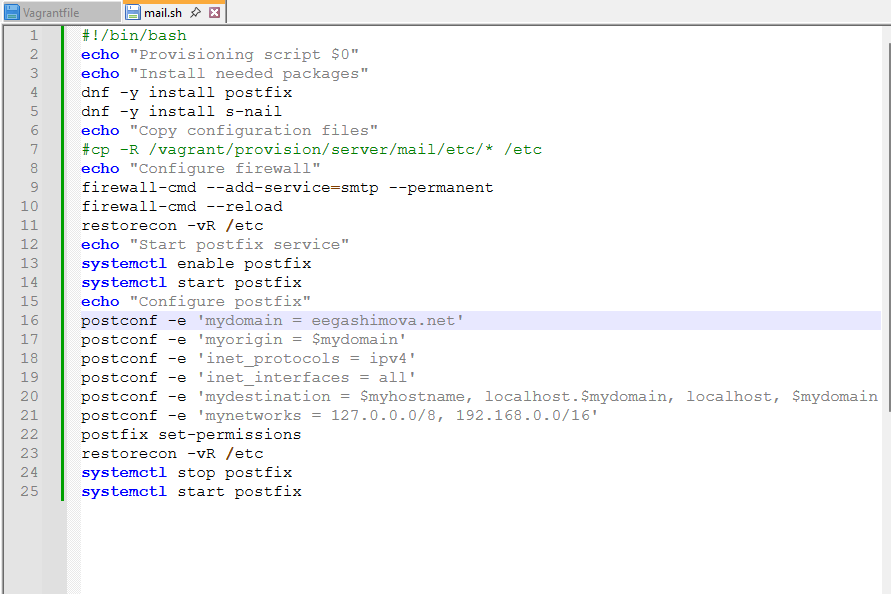{ #fig-021 width=70% }

{ #fig-022 width=70% }

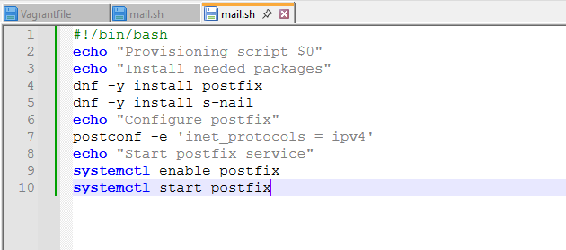{ #fig-023 width=70% }

В сценариях указываю команды установки пакетов, настройки Postfix и запуска службы, а для их автоматического выполнения при подготовке виртуальных машин предусматриваю подключение файлов `provision/server/mail.sh` и `provision/client/mail.sh` в `Vagrantfile`.

# Вывод

В ходе лабораторной работы я установила и настроила почтовый сервер Postfix на виртуальных машинах `server` и `client`. Настроила работу SMTP, параметры сетевых интерфейсов, доверенные сети и DNS-записи почтового домена. Проверила отправку сообщений между виртуальными машинами и доставку почты на доменный адрес `eegashimova.net`. Также создала сценарии для автоматизации установки и настройки Postfix в окружении Vagrant.

# Контрольные вопросы

**1. В каком каталоге и в каком файле следует смотреть конфигурацию Postfix?**

Основной конфигурационный файл Postfix находится в каталоге `/etc/postfix/` и называется `main.cf`. В нём содержатся основные параметры работы почтового сервера.

Дополнительный файл `master.cf` определяет настройки служб и процессов Postfix.

Для просмотра конфигурации используется команда:

`cat /etc/postfix/main.cf`

**2. Каким образом можно проверить корректность синтаксиса в конфигурационном файле Postfix?**

Для проверки корректности конфигурации Postfix используется команда:

`postfix check`

Она проверяет конфигурационные файлы, а также некоторые права доступа и каталоги. Для просмотра параметров, отличающихся от значений по умолчанию, используется команда:

`postconf -n`

После изменения настроек можно перечитать конфигурацию командой:

`systemctl reload postfix`

**3. В каких параметрах конфигурации Postfix требуется внести изменения для настройки возможности отправки писем не на локальный хост, а на доменные адреса?**

Для настройки работы Postfix с доменными адресами необходимо изменить следующие параметры:

- `mydomain` — задаёт доменное имя почтового сервера.
- `myorigin` — определяет доменную часть адреса отправителя.
- `mydestination` — указывает домены, для которых сервер выполняет локальную доставку.
- `inet_interfaces` — определяет сетевые интерфейсы, на которых сервер принимает соединения.
- `mynetworks` — задаёт список доверенных сетей.

Пример настройки:

`postconf -e 'mydomain = eegashimova.net'`

`postconf -e 'myorigin = $mydomain'`

`postconf -e 'mydestination = $myhostname, localhost.$mydomain, localhost, $mydomain'`

Дополнительно в DNS необходимо настроить MX-запись почтового сервера и соответствующую A-запись.

**4. Приведите примеры работы с утилитой mail по отправке письма, просмотру имеющихся писем, удалению письма.**

Утилита `mail` позволяет отправлять, просматривать и удалять электронные сообщения.

Для отправки письма используется команда:

`echo "Test message" | mail -s "Test" eegashimova@eegashimova.net`

Для просмотра списка полученных сообщений:

`mail`

Для просмотра конкретного письма в интерактивном режиме вводится его номер, например:

`1`

Для удаления первого письма используется команда:

`d 1`

Для выхода с сохранением изменений:

`q`

**5. Приведите примеры работы с утилитой postqueue. Как посмотреть очередь сообщений? Как определить число сообщений в очереди? Как отправить все сообщения, находящиеся в очереди? Как удалить письмо из очереди?**

Утилита `postqueue` используется для просмотра и управления очередью почтовых сообщений Postfix.

Для просмотра очереди сообщений используется команда:

`postqueue -p`

Для определения количества сообщений в очереди можно посмотреть итоговую строку вывода:

`postqueue -p | tail -n 1`

Для повторной попытки отправки всех сообщений из очереди:

`postqueue -f`

Для повторной попытки отправки конкретного сообщения:

`postqueue -i ID`

Для удаления отдельного сообщения из очереди используется утилита `postsuper`:

`postsuper -d ID`

Для удаления всех сообщений из очереди:

`postsuper -d ALL`

Здесь `ID` — идентификатор почтового сообщения, который можно узнать с помощью команды `postqueue -p`.

# Список литературы

1. [Postfix — официальная документация почтового сервера](https://www.postfix.org/documentation.html)
2. [Postfix — руководство по первоначальной настройке почтового сервера](https://www.postfix.org/BASIC_CONFIGURATION_README.html)
3. [Postfix — примеры стандартной конфигурации почтового сервера](https://www.postfix.org/STANDARD_CONFIGURATION_README.html)
4. [Postfix — руководство по работе с утилитой postconf](https://www.postfix.org/postconf.1.html)
5. [Postfix — управление очередью почтовых сообщений с помощью postqueue](https://www.postfix.org/postqueue.1.html)
6. [Postfix — управление и удаление сообщений из очереди с помощью postsuper](https://www.postfix.org/postsuper.1.html)
7. [S-nail — руководство по отправке и получению электронной почты](https://manpages.ubuntu.com/manpages/noble/man1/s-nail.1.html)
8. [BIND 9 — настройка DNS-зон и почтовых MX-записей](https://bind9.readthedocs.io/en/latest/chapter3.html)
9. [firewalld — руководство по настройке сетевых служб и портов](https://firewalld.org/documentation/man-pages/firewall-cmd.html)
10. [HashiCorp Vagrant — автоматизация настройки виртуальных машин](https://developer.hashicorp.com/vagrant/docs/provisioning)
11. [HashiCorp Vagrant — использование Shell Provisioner для выполнения скриптов](https://developer.hashicorp.com/vagrant/docs/provisioning/shell)