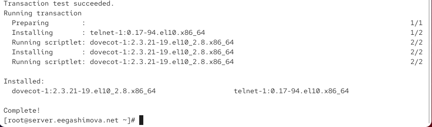
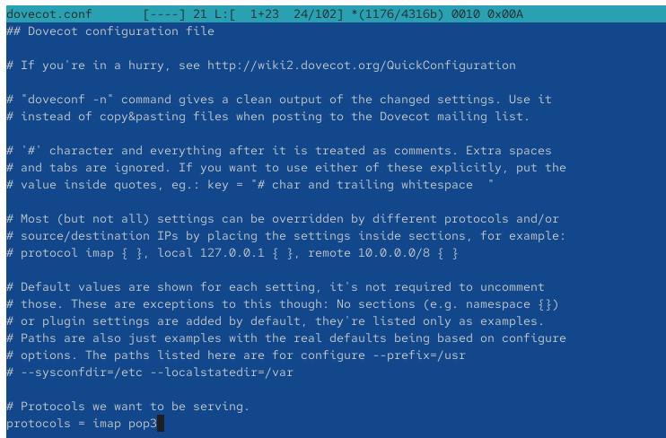
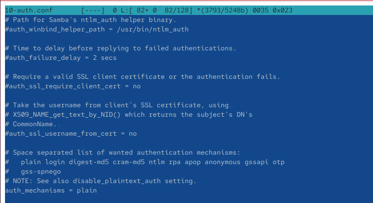
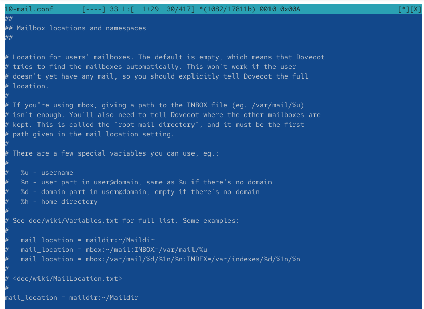
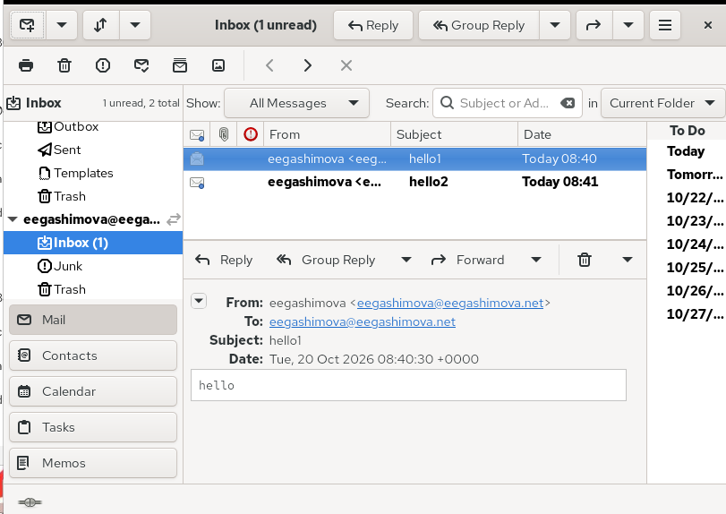
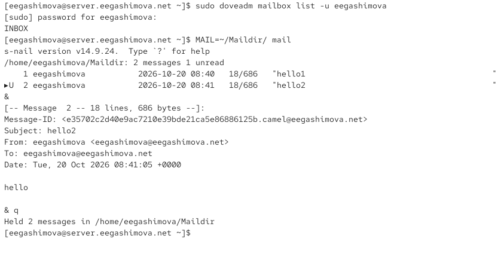
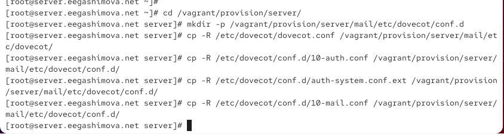
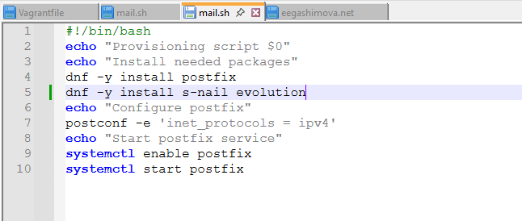

---
## Author
author:
  name: Гашимова Эсма Эльшан кызы
  email: 1132247520@rudn.ru
  affiliation:
    - name: Российский университет дружбы народов
      country: Российская Федерация
      postal-code: 117198
      city: Москва
      address: ул. Миклухо-Маклая, д. 6

## Title
title: Лабораторная работа №9
subtitle: Настройка POP3/IMAP сервера
license: CC BY
date: today
date-format: "YYYY-MM-DD"
---

# Цели и задачи работы

## Цель лабораторной работы

Приобретение практических навыков установки, настройки и администрирования почтового сервера `Dovecot` в операционной системе Rocky Linux.

Настроить работу протоколов POP3 и IMAP, обеспечить получение и отправку электронной почты с помощью клиента Evolution, проверить работу почтовых служб через Telnet и автоматизировать настройку с помощью Vagrant.

# Процесс выполнения лабораторной работы

## Установка Dovecot и Telnet

{ #fig:001 width=70% height=70% }

## Настройка почтовых протоколов Dovecot

{ #fig:002 width=70% height=70% }

## Настройка механизма аутентификации

{ #fig:003 width=70% height=70% }

## Настройка аутентификации через PAM

{ #fig:004 width=70% height=70% }

## Настройка базы пользователей passwd

{ #fig:005 width=70% height=70% }

## Настройка хранения почтовых сообщений

{ #fig:006 width=70% height=70% }

## Настройка Postfix и межсетевого экрана

{ #fig:007 width=70% height=70% }

## Настройка почтового клиента Evolution

{ #fig:008 width=70% height=70% }

## Отправка тестового сообщения

{ #fig:009 width=70% height=70% }

## Мониторинг работы почтового сервера

{ #fig:010 width=70% height=70% }

## Проверка получения электронной почты

{ #fig:011 width=70% height=70% }

## Проверка почтового ящика на сервере

{ #fig:012 width=70% height=70% }

## Проверка протокола POP3 через Telnet

{ #fig:013 width=70% height=70% }

## Подготовка конфигурационных файлов Dovecot

{ #fig:014 width=70% height=70% }

## Изменение сценария mail.sh на сервере

{ #fig:015 width=70% height=70% }

## Изменение сценария mail.sh на клиенте

{ #fig:016 width=70% height=70% }

# Результаты работы

## Настройка почтового сервера

На виртуальной машине `server` установлен и настроен Dovecot с поддержкой протоколов IMAP и POP3. Настроены аутентификация пользователей и хранение почты в формате Maildir.

## Проверка работы почтовой службы

На виртуальной машине `client` настроен почтовый клиент Evolution. Успешно проверены отправка и получение тестовых писем, а также работа POP3 через Telnet. Доставка сообщений подтверждена записями в `/var/log/maillog`.

# Вывод

В ходе лабораторной работы был установлен и настроен почтовый сервер `Dovecot` на виртуальной машине `server`.

Настроены протоколы POP3 и IMAP, аутентификация пользователей и хранение электронных сообщений в формате Maildir.

На виртуальной машине `client` установлен и настроен почтовый клиент Evolution. Проверены отправка и получение тестовых сообщений, работа почтового сервера через Telnet и просмотр сообщений с помощью `doveadm` и `mail`.
