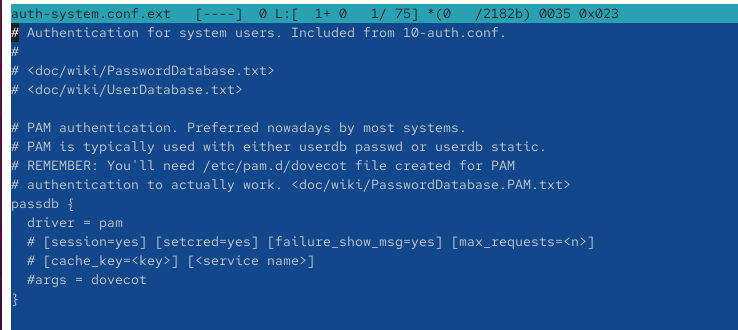
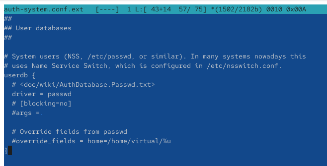
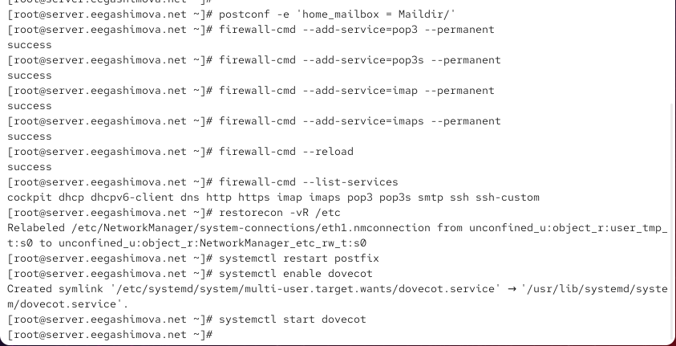
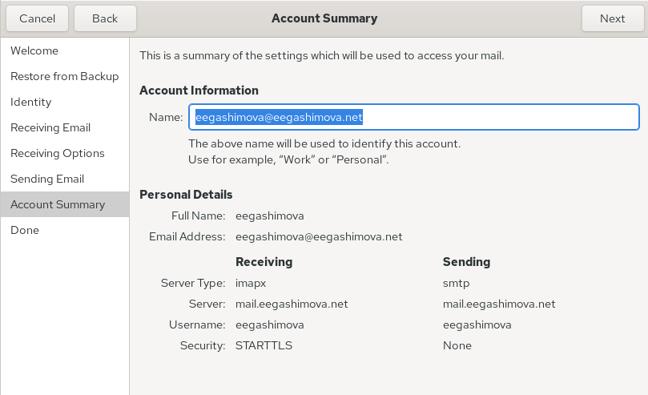
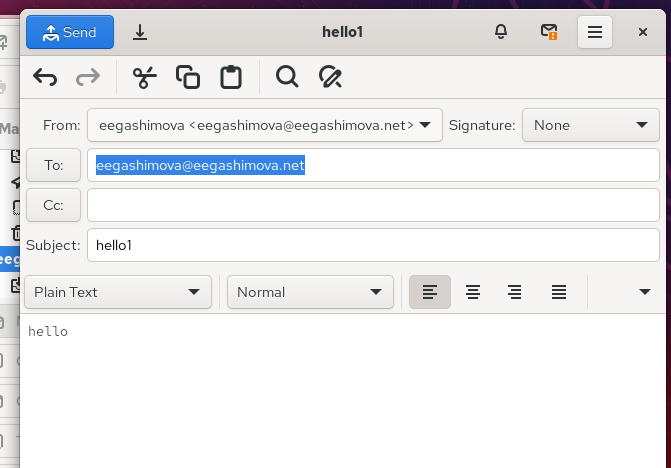
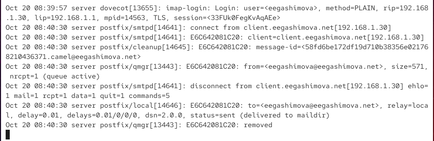
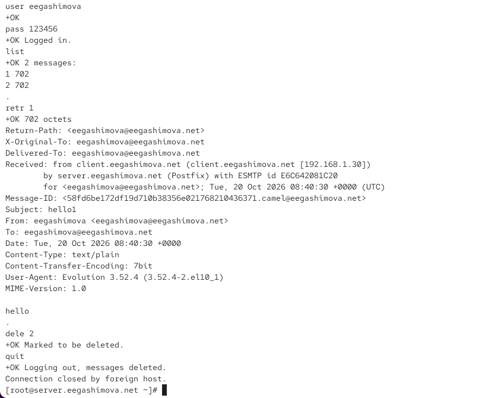
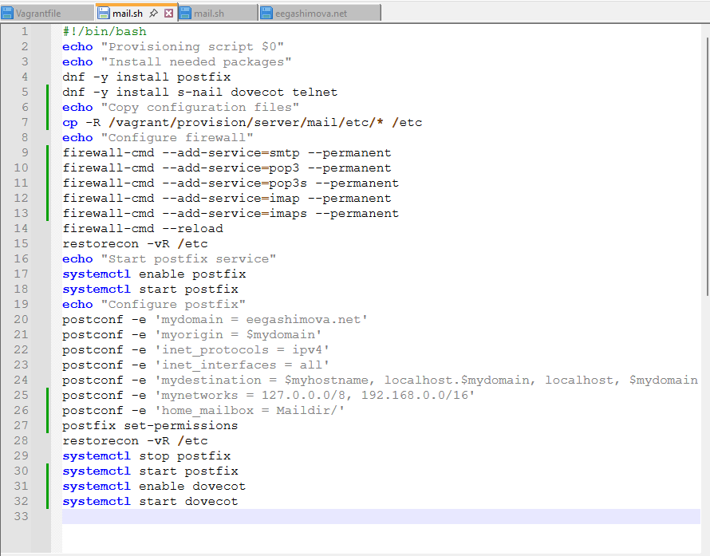

---
## Author
author:
  name: Гашимова Эсма Эльшан кызы
  email: 1132247520@rudn.ru
  affiliation:
    - name: Российский университет дружбы народов
      country: Российская Федерация
      postal-code: 117198
      city: Москва
      address: ул. Миклухо-Маклая, д. 6

## Title
title: "Отчёт по лабораторной работе №9"
subtitle: "Настройка POP3/IMAP сервера"
license: "CC BY"
---

# Цель работы

Приобретение практических навыков по установке и простейшему конфигурированию POP3/IMAP-сервера.

# Выполнение лабораторной работы

## Установка Dovecot и Telnet

На виртуальной машине `server` перехожу в режим суперпользователя командой `sudo -i`. Устанавливаю почтовый сервер Dovecot и утилиту Telnet командой `dnf -y install dovecot telnet`. Dovecot необходим для предоставления доступа к почтовым ящикам по протоколам IMAP и POP3, а Telnet используется для проверки работы почтовых протоколов через терминал. После выполнения команды проверяю успешное завершение установки пакетов (см. рис. [@fig-001]).

{ #fig-001 width=70% }

## Настройка Dovecot

Открываю конфигурационный файл `/etc/dovecot/dovecot.conf` и указываю параметр `protocols = imap pop3`. Он определяет список почтовых протоколов, по которым Dovecot будет обслуживать подключения клиентов. В результате разрешаю использование протоколов IMAP и POP3 (см. рис. [@fig-002]).

{ #fig-002 width=70% }

В конфигурационном файле `/etc/dovecot/conf.d/10-auth.conf` проверяю параметр `auth_mechanisms = plain`. Указанный механизм позволяет выполнять аутентификацию пользователей с передачей имени и пароля. При использовании защищённого соединения STARTTLS данные аутентификации передаются внутри шифрованного канала (см. рис. [@fig-003]).

{ #fig-003 width=70% }

Перехожу к файлу `/etc/dovecot/conf.d/auth-system.conf.ext` и проверяю настройки базы паролей пользователей. В блоке `passdb` установлен параметр `driver = pam`, который определяет использование механизма PAM для проверки учётных данных пользователей системы (см. рис. [@fig-004]).

{ #fig-004 width=70% }

В том же конфигурационном файле проверяю блок `userdb`, в котором задан параметр `driver = passwd`. Эта настройка позволяет Dovecot получать сведения о системных пользователях из базы учётных записей, связанной с файлом `/etc/passwd` (см. рис. [@fig-005]).

{ #fig-005 width=70% }

Открываю файл `/etc/dovecot/conf.d/10-mail.conf` и задаю параметр `mail_location = maildir:~/Maildir`. Он определяет расположение почтовых ящиков пользователей и устанавливает формат хранения сообщений Maildir. Почтовые сообщения будут храниться в каталоге `Maildir` домашнего каталога каждого пользователя (см. рис. [@fig-006]).

{ #fig-006 width=70% }

Для согласования настроек Postfix и Dovecot выполняю команду `postconf -e 'home_mailbox = Maildir/'`, определяющую каталог доставки локальных почтовых сообщений. Затем разрешаю работу почтовых протоколов в межсетевом экране командами `firewall-cmd --add-service=pop3 --permanent`, `firewall-cmd --add-service=pop3s --permanent`, `firewall-cmd --add-service=imap --permanent` и `firewall-cmd --add-service=imaps --permanent`. Применяю изменения командой `firewall-cmd --reload` и проверяю разрешённые службы с помощью `firewall-cmd --list-services`. В выводе присутствуют службы `imap`, `imaps`, `pop3` и `pop3s`. Восстанавливаю контексты SELinux командой `restorecon -vR /etc`. После этого перезапускаю Postfix командой `systemctl restart postfix`, включаю автозапуск Dovecot с помощью `systemctl enable dovecot` и запускаю его командой `systemctl start dovecot` (см. рис. [@fig-007]).

{ #fig-007 width=70% }

## Проверка работы Dovecot и почтового сервера

На виртуальной машине `client` устанавливаю почтовый клиент Evolution командой `dnf -y install evolution`. Запускаю программу и приступаю к настройке почтовой учётной записи пользователя `eegashimova`. Указываю адрес электронной почты `eegashimova@eegashimova.net`. Для получения и отправки сообщений задаю сервер `mail.eegashimova.net`. В качестве протокола получения почты выбираю IMAP с портом `143`, защитой `STARTTLS` и аутентификацией по обычному паролю. Для отправки сообщений использую SMTP с портом `25`, без шифрования и без аутентификации. На странице итоговых настроек проверяю указанные параметры учётной записи и перехожу к завершению настройки (см. рис. [@fig-008]).

{ #fig-008 width=70% }

Для проверки отправки сообщений создаю новое письмо в Evolution. В качестве отправителя и получателя указываю адрес `eegashimova@eegashimova.net`. В поле темы ввожу `hello1`, а в тексте сообщения — `hello`. Отправляю письмо с помощью кнопки `Send`. Аналогично создаю и отправляю второе тестовое сообщение с темой `hello2` (см. рис. [@fig-009]).

{ #fig-009 width=70% }

На виртуальной машине `server` запускаю мониторинг почтового журнала командой `tail -f /var/log/maillog`. В журнале отображаются события подключения почтового клиента, обработки сообщения сервером Postfix и его доставки в локальный почтовый ящик. Записи `postfix/smtpd` показывают подключение клиента `client.eegashimova.net` по SMTP, а запись `postfix/local` содержит результат `status=sent (delivered to maildir)`, подтверждающий успешную доставку сообщения в каталог Maildir. Также в журнале присутствуют сведения об успешной аутентификации пользователя в Dovecot по протоколу IMAP (см. рис. [@fig-010]).

{ #fig-010 width=70% }

Возвращаюсь в Evolution и открываю папку входящих сообщений. В списке отображаются два тестовых письма с темами `hello1` и `hello2`, отправленные с адреса `eegashimova@eegashimova.net`. Выбираю первое сообщение и проверяю его содержимое. В области просмотра отображается текст `hello`, соответствующий отправленному письму. Наличие обоих сообщений подтверждает корректную работу отправки через SMTP и получения почты через IMAP (см. рис. [@fig-011]).

{ #fig-011 width=70% }

На виртуальной машине `server` проверяю доступность почтового ящика пользователя командой `sudo doveadm mailbox list -u eegashimova`. В выводе отображается почтовый ящик `INBOX`. Затем выполняю команду `MAIL=~/Maildir/ mail` для просмотра сообщений непосредственно на сервере. Утилита `s-nail` показывает два письма, одно из которых отмечено как непрочитанное. Открываю второе письмо и проверяю его заголовки, включая отправителя, получателя и тему `hello2`, а также текст сообщения `hello`. Командой `q` завершаю работу с почтой. Результаты подтверждают наличие доставленных сообщений в каталоге `/home/eegashimova/Maildir` (см. рис. [@fig-012]).

{ #fig-012 width=70% }

Для дополнительной проверки работы Dovecot подключаюсь к серверу по протоколу POP3 с помощью команды `telnet mail.eegashimova.net 110`. После подключения ввожу команду `user eegashimova`, затем `pass` с паролем пользователя. Сервер отвечает сообщением `+OK Logged in`, подтверждающим успешную аутентификацию. Командой `list` получаю список писем, содержащий два сообщения. С помощью `retr 1` запрашиваю первое письмо и просматриваю его заголовки и содержимое, включая тему `hello1` и текст `hello`. Затем выполняю `dele 2` для пометки второго письма на удаление. Завершаю сеанс командой `quit`, после чего сервер сообщает об удалении помеченных сообщений и закрывает соединение. Полученные ответы `+OK` подтверждают корректную работу POP3-сервера и выполнение операций с почтовыми сообщениями (см. рис. [@fig-013]).

{ #fig-013 width=70% }

## Внесение изменений в настройки внутреннего окружения виртуальной машины

На виртуальной машине `server` перехожу в каталог `/vagrant/provision/server/`, создаю необходимые подкаталоги и копирую в них конфигурационные файлы Dovecot для последующего автоматического развёртывания почтового сервера (см. рис. [@fig-014]).

{ #fig-014 width=70% }

В скрипт `/vagrant/provision/server/mail.sh` добавляю команды установки Dovecot и Telnet, настройки Postfix и межсетевого экрана, а также запуска почтовых служб (см. рис. [@fig-015]).

{ #fig-015 width=70% }

На виртуальной машине `client` редактирую скрипт `/vagrant/provision/client/mail.sh`, добавляя команду `dnf -y install s-nail evolution` для автоматической установки почтового клиента Evolution (см. рис. [@fig-016]).

{ #fig-016 width=70% }

# Вывод

В ходе лабораторной работы я установила и настроила почтовый сервер Dovecot на виртуальной машине `server`, настроила протоколы IMAP и POP3, а также хранение сообщений в формате Maildir. На виртуальной машине `client` установила и настроила почтовый клиент Evolution, проверила отправку и получение писем, просмотрела почтовые журналы и выполнила проверку POP3 через Telnet. Также внесла изменения в скрипты Vagrant для автоматизации установки и настройки почтовых служб.

# Контрольные вопросы

**1. За что отвечает протокол SMTP?**

SMTP (Simple Mail Transfer Protocol) — протокол, предназначенный для отправки и передачи электронной почты. Он используется для передачи сообщений от почтового клиента на сервер, а также между почтовыми серверами.

Для работы SMTP обычно используются порты `25`, `587` и `465`. Порт `25` применяется преимущественно для передачи почты между серверами, `587` — для отправки сообщений клиентами, а `465` — для SMTP с шифрованием TLS с момента подключения.

**2. За что отвечает протокол IMAP?**

IMAP (Internet Message Access Protocol) — протокол для получения электронной почты и управления сообщениями непосредственно на почтовом сервере.

Он позволяет просматривать письма, создавать папки, отмечать сообщения как прочитанные и синхронизировать почту между несколькими устройствами. Для работы используются порт `143` с возможностью STARTTLS и порт `993` для защищённого соединения TLS.

**3. За что отвечает протокол POP3?**

POP3 (Post Office Protocol version 3) — протокол для получения электронной почты с почтового сервера.

Он предназначен преимущественно для загрузки сообщений на локальное устройство. После получения письма могут удаляться с сервера в зависимости от настроек клиента. Для работы используются порт `110`, в том числе с возможностью STARTTLS, и порт `995` для защищённого соединения TLS.

**4. В чём назначение Dovecot?**

Dovecot — почтовый сервер, обеспечивающий доступ пользователей к электронным сообщениям по протоколам IMAP и POP3.

Он отвечает за аутентификацию пользователей, доступ к почтовым ящикам и управление сообщениями. Dovecot может работать совместно с Postfix, который выполняет приём и отправку почты.

**5. В каких файлах обычно находятся настройки работы Dovecot? За что отвечает каждый из файлов?**

Основные настройки Dovecot располагаются в каталоге `/etc/dovecot/`.

- `/etc/dovecot/dovecot.conf` — основной конфигурационный файл, определяющий общие параметры работы сервера и используемые протоколы.
- `/etc/dovecot/conf.d/10-auth.conf` — настройки аутентификации пользователей, включая разрешённые механизмы проверки учётных данных.
- `/etc/dovecot/conf.d/auth-system.conf.ext` — настройки источников информации о пользователях и паролях, например PAM и passwd.
- `/etc/dovecot/conf.d/10-mail.conf` — параметры расположения почтовых ящиков и формата хранения сообщений.
- `/etc/dovecot/conf.d/10-master.conf` — настройки служб Dovecot, процессов и сетевых подключений.
- `/etc/dovecot/conf.d/10-ssl.conf` — параметры шифрования SSL/TLS и используемых сертификатов.

Для просмотра действующей конфигурации используется команда:

`doveconf -n`

**6. В чём назначение Postfix?**

Postfix — почтовый сервер, предназначенный для приёма, отправки, маршрутизации и доставки электронной почты с использованием протокола SMTP.

Он обрабатывает сообщения, определяет маршруты доставки и передаёт письма другим почтовым серверам или в локальные почтовые ящики. В сочетании с Dovecot обеспечивает работу почтовой системы для отправки и получения сообщений.

**7. Какие методы аутентификации пользователей можно использовать в Dovecot и в чём их отличие?**

Dovecot поддерживает несколько механизмов аутентификации пользователей:

- `PLAIN` — передаёт имя пользователя и пароль без собственного шифрования. Для защиты учётных данных рекомендуется использовать SSL/TLS.
- `LOGIN` — передаёт имя пользователя и пароль поэтапно. Также требует защищённого соединения.
- `CRAM-MD5` — использует механизм запроса и ответа с хешированием пароля, благодаря чему пароль не передаётся в открытом виде. Считается устаревшим.
- `DIGEST-MD5` — использует механизм проверки на основе хеширования, но является устаревшим и редко поддерживается современными клиентами.
- `SCRAM-SHA-256` — использует более современный механизм проверки пароля без его непосредственной передачи серверу.

Также Dovecot поддерживает проверку пользователей через PAM, LDAP, SQL и другие источники учётных данных. В лабораторной работе используется механизм `PLAIN` с проверкой паролей через PAM и получением информации о пользователях через `passwd`.

**8. Приведите пример заголовка письма с пояснениями его полей.**

Пример заголовка электронного письма:

    From: eegashimova@eegashimova.net
    To: eegashimova@eegashimova.net
    Subject: hello1
    Date: Tue, 20 Oct 2026 14:20:00 +0300
    Message-ID: <12345@mail.eegashimova.net>
    MIME-Version: 1.0
    Content-Type: text/plain; charset=UTF-8

Описание основных полей:

- `From` — адрес электронной почты отправителя.
- `To` — адрес получателя сообщения.
- `Subject` — тема электронного письма.
- `Date` — дата и время отправки сообщения.
- `Message-ID` — уникальный идентификатор письма.
- `MIME-Version` — версия стандарта MIME, используемого для представления содержимого сообщения.
- `Content-Type` — тип содержимого письма и используемая кодировка.

Заголовки позволяют определить отправителя, получателя, время отправки и основные характеристики электронного сообщения.

**9. Приведите примеры использования команд для работы с почтовыми протоколами через терминал (например через telnet).**

Для проверки работы почтовых протоколов можно использовать утилиту `telnet`.

Пример подключения по протоколу POP3:

    telnet mail.eegashimova.net 110
    user eegashimova
    pass password
    list
    retr 1
    dele 2
    quit

Здесь `user` и `pass` используются для аутентификации, `list` выводит список писем, `retr 1` показывает первое сообщение, `dele 2` помечает второе письмо на удаление, а `quit` завершает сеанс и подтверждает удаление.

Пример проверки SMTP:

    telnet mail.eegashimova.net 25
    HELO client.eegashimova.net
    MAIL FROM:<eegashimova@eegashimova.net>
    RCPT TO:<eegashimova@eegashimova.net>
    DATA
    Subject: Test

    Hello!
    .
    QUIT

Команда `HELO` представляет клиента серверу, `MAIL FROM` задаёт отправителя, `RCPT TO` определяет получателя, а `DATA` позволяет передать содержимое письма. Отдельная точка завершает передачу сообщения, команда `QUIT` закрывает соединение.

Пример подключения по протоколу IMAP:

    telnet mail.eegashimova.net 143
    a1 LOGIN eegashimova password
    a2 SELECT INBOX
    a3 FETCH 1 BODY[HEADER]
    a4 LOGOUT

Команда `LOGIN` выполняет аутентификацию, `SELECT INBOX` открывает папку входящих сообщений, `FETCH` получает заголовок первого письма, а `LOGOUT` завершает соединение.

В примерах `password` необходимо заменить паролем пользователя. Подключение через Telnet без TLS предназначено только для проверки в лабораторной среде, поскольку данные аутентификации передаются без шифрования.

**10. Приведите примеры с пояснениями по работе с doveadm.**

`doveadm` — утилита командной строки для администрирования Dovecot. Она позволяет управлять почтовыми ящиками, просматривать сообщения, проверять аутентификацию и получать информацию о пользователях.

Для просмотра списка почтовых ящиков пользователя используется команда:

`doveadm mailbox list -u eegashimova`

Она выводит доступные пользователю почтовые папки, например `INBOX`.

Для получения количества сообщений во входящем почтовом ящике используется команда:

`doveadm mailbox status -u eegashimova messages INBOX`

Для поиска всех сообщений во входящем почтовом ящике используется команда:

`doveadm search -u eegashimova mailbox INBOX ALL`

Команда выводит идентификаторы сообщений, находящихся в папке `INBOX`.

Для просмотра заголовков писем используется команда:

`doveadm fetch -u eegashimova 'hdr.subject hdr.from' mailbox INBOX ALL`

Она позволяет получить темы сообщений и адреса отправителей.

Для проверки аутентификации пользователя используется команда:

`doveadm auth test eegashimova`

Команда проверяет возможность аутентификации пользователя через настроенный механизм Dovecot. При необходимости запрашивается пароль.

Для просмотра информации о пользователе используется команда:

`doveadm user eegashimova`

Она отображает сведения из пользовательской базы Dovecot, включая домашний каталог и идентификаторы пользователя.

Для создания новой почтовой папки используется команда:

`doveadm mailbox create -u eegashimova Archive`

Эта команда создаёт почтовую папку `Archive` для пользователя `eegashimova`.

# Список литературы

1. [Dovecot — руководство по первоначальной настройке почтового сервера](https://doc.dovecot.org/2.3/configuration_manual/basic_configuration/)
2. [Dovecot — настройка аутентификации пользователей через PAM](https://doc.dovecot.org/2.3/configuration_manual/authentication/password_databases_passdb/)
3. [Dovecot — настройка хранения почтовых сообщений в формате Maildir](https://doc.dovecot.org/2.3/configuration_manual/mail_location/Maildir/)
4. [Dovecot — руководство по управлению почтовыми ящиками с помощью doveadm](https://doc.dovecot.org/2.3/admin_manual/doveadm_mailbox_commands/)
5. [Postfix — официальная документация по настройке и работе почтового сервера](https://www.postfix.org/documentation.html)
6. [GNOME Evolution — руководство по настройке почтовых учётных записей IMAP и SMTP](https://help.gnome.org/evolution/mail-account-manage-imap-plus.html)
7. [RFC 1939 — описание протокола POP3 и команд для работы с электронной почтой](https://www.rfc-editor.org/rfc/rfc1939.html)
8. [firewalld — руководство по настройке межсетевого экрана с помощью firewall-cmd](https://firewalld.org/documentation/man-pages/firewall-cmd.html)
9. [HashiCorp Vagrant — автоматизация настройки виртуальных машин с помощью Shell Provisioner](https://developer.hashicorp.com/vagrant/docs/provisioning/shell)