---
## Author
author:
  name: Гашимова Эсма Эльшан кызы
  email: 1132247520@rudn.ru
  affiliation:
    - name: Российский университет дружбы народов
      country: Российская Федерация
      postal-code: 117198
      city: Москва
      address: ул. Миклухо-Маклая, д. 6

## Title
title: Лабораторная работа №10
subtitle: Расширенные настройки SMTP-сервера
license: CC BY
date: today
date-format: "YYYY-MM-DD"
---

# Цели и задачи работы

## Цель лабораторной работы

Приобретение практических навыков расширенной настройки и администрирования SMTP-сервера Postfix и почтового сервера Dovecot в операционной системе Rocky Linux.

Настроить доставку почтовых сообщений по протоколу LMTP, реализовать SASL-аутентификацию пользователей и защищённое SMTP-соединение с использованием TLS. Проверить работу почтовых служб через Telnet, OpenSSL и Evolution, а также автоматизировать настройку с помощью Vagrant.

# Процесс выполнения лабораторной работы

## Настройка протокола LMTP в Dovecot

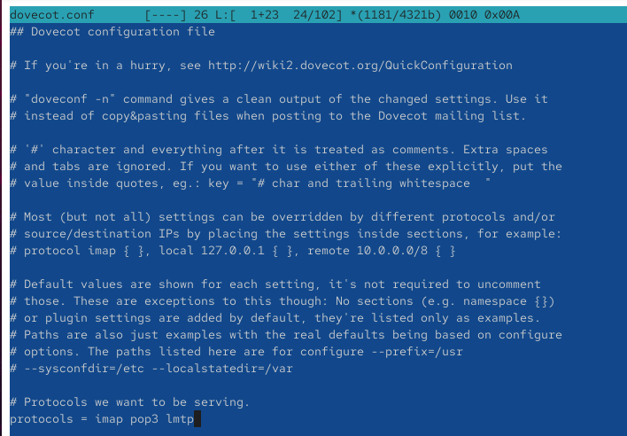{ #fig:001 width=70% height=70% }

## Настройка службы LMTP

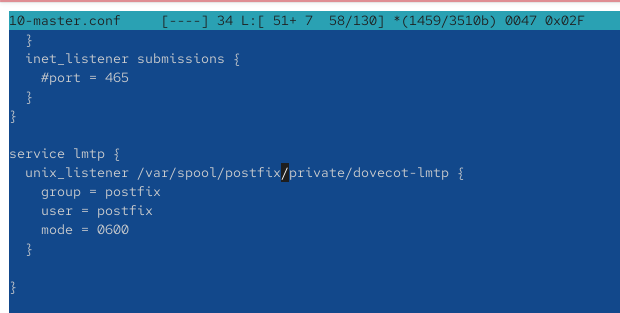{ #fig:002 width=70% height=70% }

## Настройка формата имени пользователя

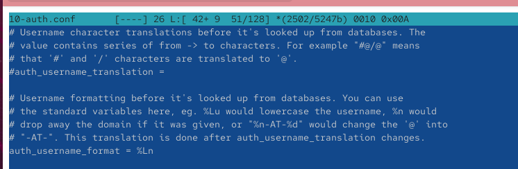{ #fig:003 width=70% height=70% }

## Проверка отправки сообщения через LMTP

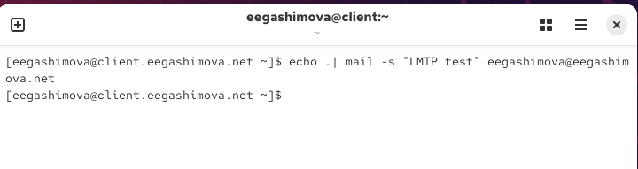{ #fig:004 width=70% height=70% }

## Мониторинг доставки почтовых сообщений

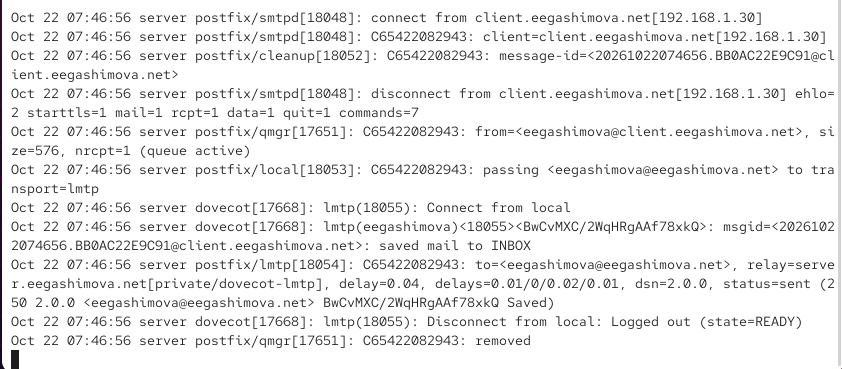{ #fig:005 width=70% height=70% }

## Проверка почтового ящика на сервере

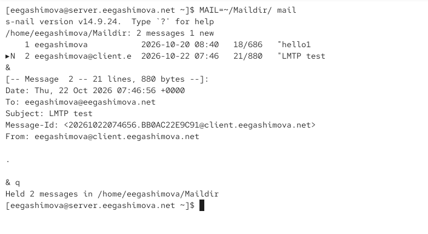{ #fig:006 width=70% height=70% }

## Настройка службы SASL-аутентификации

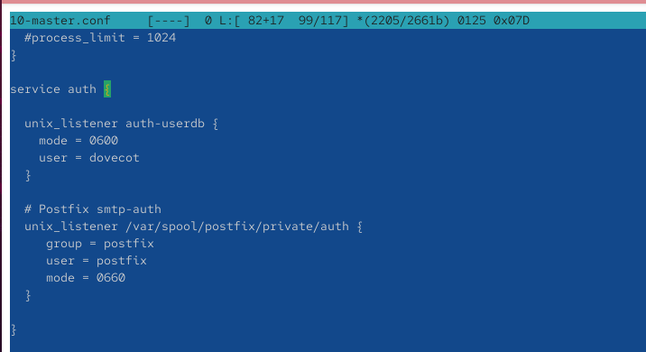{ #fig:007 width=70% height=70% }

## Настройка SASL в Postfix

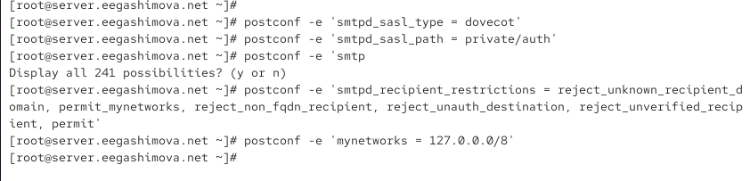{ #fig:008 width=70% height=70% }

## Настройка параметров SMTP-сервера

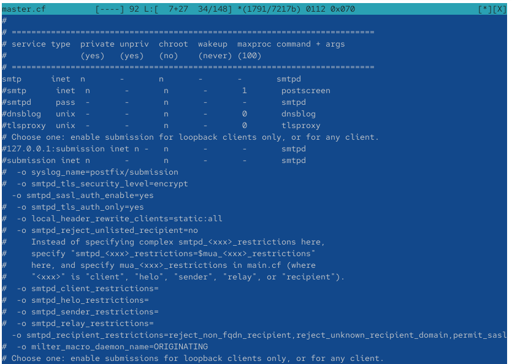{ #fig:009 width=70% height=70% }

## Проверка SMTP-аутентификации через Telnet

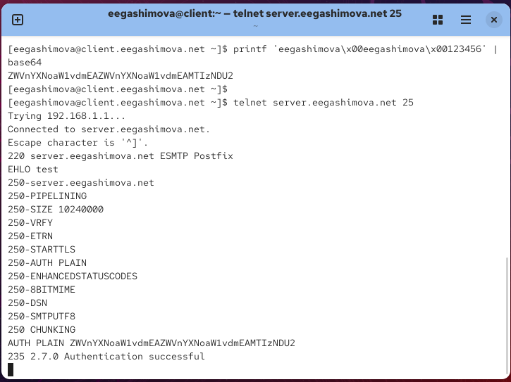{ #fig:010 width=70% height=70% }

## Настройка TLS для SMTP-сервера

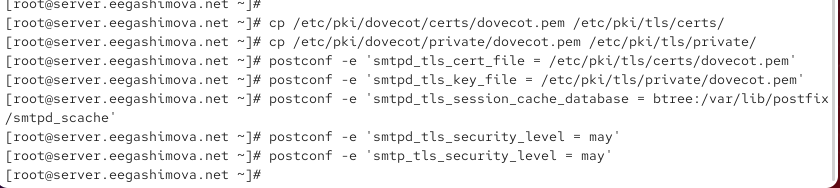{ #fig:011 width=70% height=70% }

## Настройка SMTP Submission

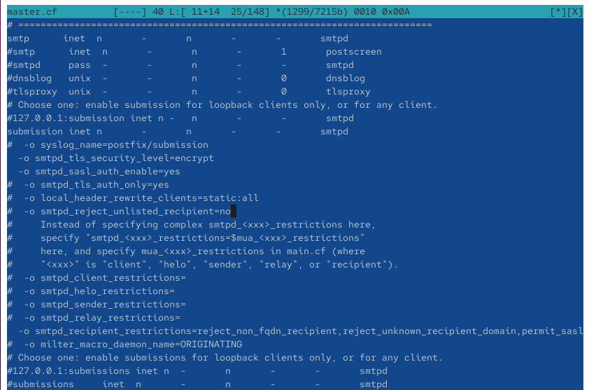{ #fig:012 width=70% height=70% }

## Настройка межсетевого экрана

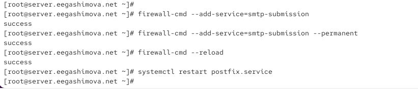{ #fig:013 width=70% height=70% }

## Проверка защищённого SMTP-соединения

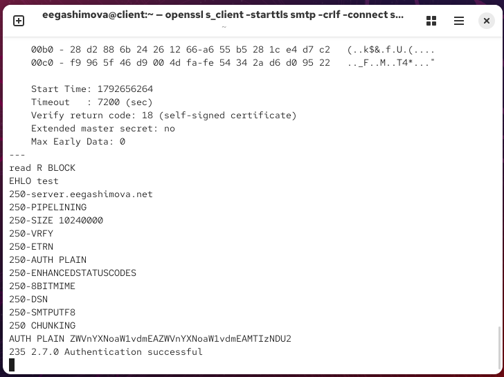{ #fig:014 width=70% height=70% }

## Настройка почтового клиента Evolution

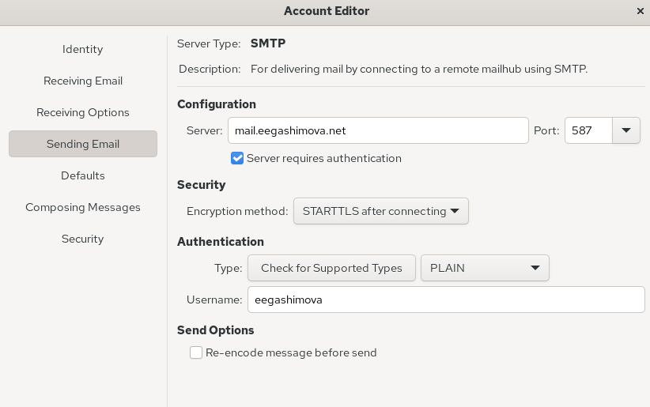{ #fig:015 width=70% height=70% }

## Проверка получения электронной почты

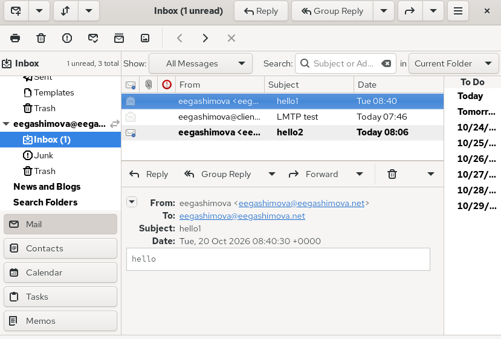{ #fig:016 width=70% height=70% }

## Анализ журнала почтового сервера

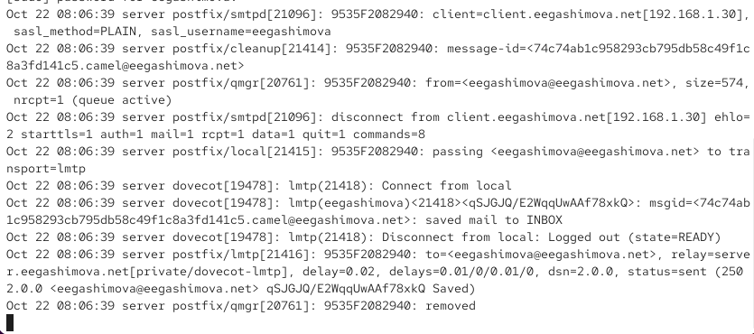{ #fig:017 width=70% height=70% }

## Подготовка конфигурационных файлов

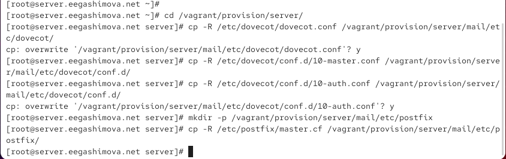{ #fig:018 width=70% height=70% }

## Изменение сценария mail.sh на сервере

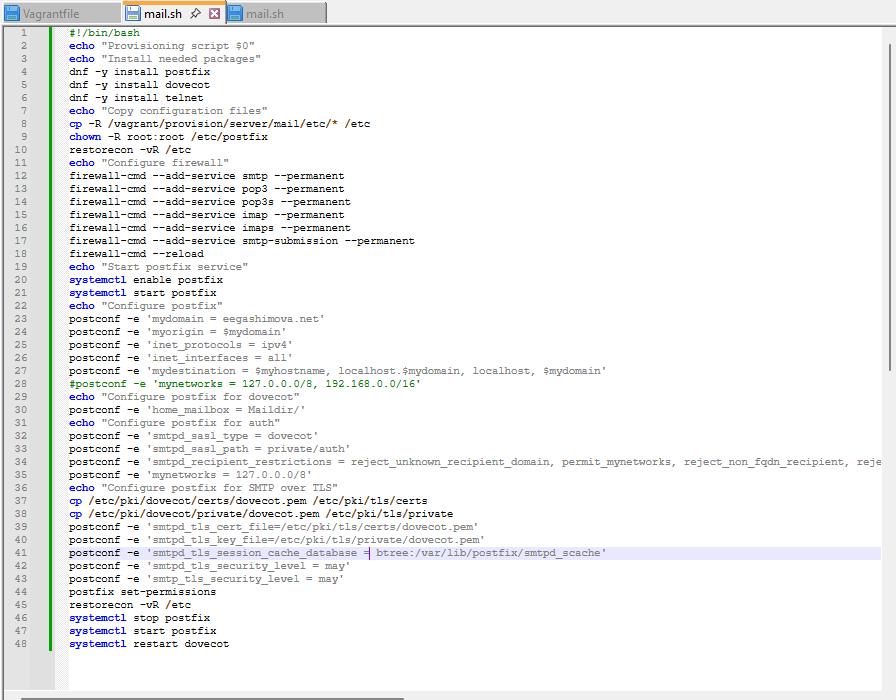{ #fig:019 width=70% height=70% }

## Изменение сценария mail.sh на клиенте

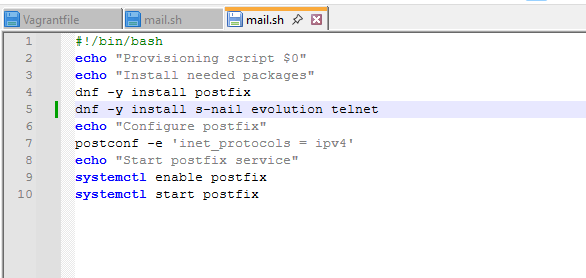{ #fig:020 width=70% height=70% }

# Результаты работы

## Настройка LMTP и SASL-аутентификации

На виртуальной машине `server` настроено взаимодействие Postfix и Dovecot по протоколу LMTP. Реализована SASL-аутентификация пользователей и установлены ограничения на пересылку почтовых сообщений для предотвращения несанкционированного использования SMTP-сервера.

## Настройка защищённого SMTP-соединения

Настроено TLS-шифрование и служба SMTP Submission на порту `587`. Проверена возможность установления защищённого соединения через OpenSSL и выполнения SASL-аутентификации. В почтовом клиенте Evolution настроена отправка сообщений с использованием STARTTLS.

## Проверка работы почтовой службы

Успешно проверены отправка и получение тестовых сообщений через Evolution, а также аутентификация пользователей через Telnet и OpenSSL. Доставка почты посредством LMTP подтверждена записями в журнале `/var/log/maillog`.

# Вывод

В ходе лабораторной работы была выполнена расширенная настройка SMTP-сервера Postfix и почтового сервера Dovecot на виртуальной машине `server`.

Настроена доставка сообщений по протоколу LMTP, реализована SASL-аутентификация пользователей и обеспечена защищённая передача почты с использованием TLS через порт `587`.

На виртуальной машине `client` проверена работа SMTP-аутентификации через Telnet и OpenSSL, настроен почтовый клиент Evolution и подтверждена успешная отправка и получение тестовых сообщений.
