---
## Author
author:
  name: Гашимова Эсма Эльшан кызы
  email: 1132247520@rudn.ru
  affiliation:
    - name: Российский университет дружбы народов
      country: Российская Федерация
      postal-code: 117198
      city: Москва
      address: ул. Миклухо-Маклая, д. 6

## Title
title: "Отчёт по лабораторной работе №10"
subtitle: "Расширенные настройки SMTP-сервера"
license: "CC BY"
---

# Цель работы

Приобретение практических навыков по конфигурированию SMTP-сервера в части настройки аутентификации.

# Выполнение лабораторной работы

## Настройка LMTP в Dovecot

На виртуальной машине `server` открываю терминал и перехожу в режим суперпользователя командой `sudo -i`. Для наблюдения за работой почтовой службы в дополнительном терминале запускаю команду `tail -f /var/log/maillog`, которая позволяет отслеживать события, связанные с обработкой и доставкой почтовых сообщений.

Открываю конфигурационный файл `/etc/dovecot/dovecot.conf` и изменяю параметр `protocols = imap pop3 lmtp`. Помимо протоколов IMAP и POP3, добавляю поддержку LMTP, который используется для передачи сообщений от почтового сервера Postfix к Dovecot. Применение LMTP позволяет передать обработку доставки сообщений непосредственно Dovecot, обеспечивая их сохранение в почтовых ящиках пользователей (см. рис. [@fig-001]).

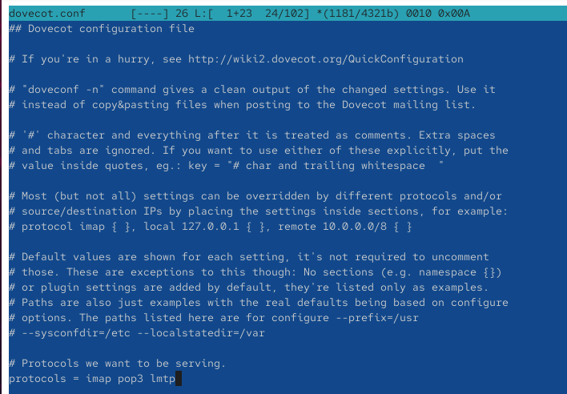{ #fig-001 width=70% }

Перехожу к конфигурационному файлу `/etc/dovecot/conf.d/10-master.conf` и настраиваю службу `lmtp`. В блоке `service lmtp` задаю параметр `unix_listener /var/spool/postfix/private/dovecot-lmtp`, определяющий расположение Unix-сокета, через который Postfix будет передавать сообщения Dovecot. Для сокета указываю параметры `group = postfix`, `user = postfix` и `mode = 0600`. Они определяют принадлежность сокета пользователю и группе `postfix`, а также устанавливают права чтения и записи только для владельца. Данная конфигурация обеспечивает взаимодействие двух почтовых служб через локальный Unix-сокет (см. рис. [@fig-002]).

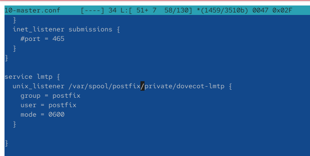{ #fig-002 width=70% }

Для передачи сообщений через настроенный сокет изменяю параметр Postfix командой `postconf -e 'mailbox_transport = lmtp:unix:private/dovecot-lmtp'`. Параметр `mailbox_transport` определяет транспорт доставки сообщений в локальные почтовые ящики. Значение `lmtp:unix:private/dovecot-lmtp` указывает на использование протокола LMTP и соответствующего Unix-сокета Dovecot вместо непосредственной доставки сообщений средствами Postfix.

Открываю файл `/etc/dovecot/conf.d/10-auth.conf` и устанавливаю параметр `auth_username_format = %Ln`. Он задаёт формат имени пользователя при аутентификации: преобразует имя в нижний регистр и удаляет доменную часть почтового адреса. В результате адрес вида `eegashimova@eegashimova.net` преобразуется в системное имя пользователя `eegashimova`. Это необходимо для корректного сопоставления адреса получателя с локальной учётной записью (см. рис. [@fig-003]).

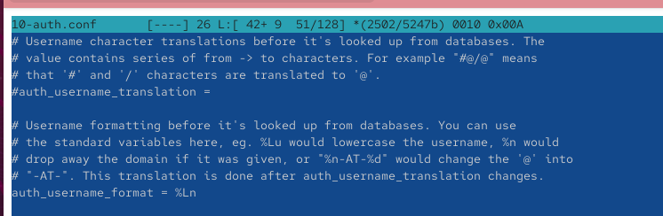{ #fig-003 width=70% }

После внесения изменений перезапускаю службы командами `systemctl restart postfix` и `systemctl restart dovecot`. Перезапуск необходим для применения обновлённых параметров конфигурации и запуска LMTP-службы с заданными настройками.

На виртуальной машине `client` отправляю тестовое почтовое сообщение командой `echo . | mail -s "LMTP test" eegashimova@eegashimova.net`. Параметр `-s` задаёт тему сообщения `LMTP test`, а адрес `eegashimova@eegashimova.net` определяет получателя. Команда позволяет проверить прохождение почтового сообщения через Postfix и его последующую доставку посредством LMTP в почтовый ящик пользователя на сервере (см. рис. [@fig-004]).

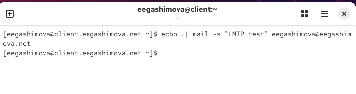{ #fig-004 width=70% }

На сервере анализирую сообщения журнала `/var/log/maillog`, полученные при мониторинге работы почтовой службы. В журнале фиксируется подключение клиента `client.eegashimova.net` с IP-адресом `192.168.1.30` к SMTP-серверу Postfix. После получения сообщения Postfix присваивает ему идентификатор очереди и передаёт сообщение менеджеру очереди `qmgr`.

Далее в журнале отображается передача сообщения транспортной службе LMTP. Запись `postfix/local` указывает на перенаправление сообщения для дальнейшей доставки, а запись `dovecot: lmtp` подтверждает получение сообщения службой Dovecot. Сообщение сохраняется в папке `INBOX` пользователя `eegashimova`, о чём свидетельствует запись `saved mail to INBOX`. Запись `postfix/lmtp` содержит результат доставки `status=sent` и код `dsn=2.0.0`, подтверждающие успешную передачу сообщения. Завершающая запись `postfix/qmgr: removed` означает удаление доставленного сообщения из очереди Postfix. На основании журнала устанавливаю, что взаимодействие Postfix и Dovecot посредством LMTP работает корректно (см. рис. [@fig-005]).

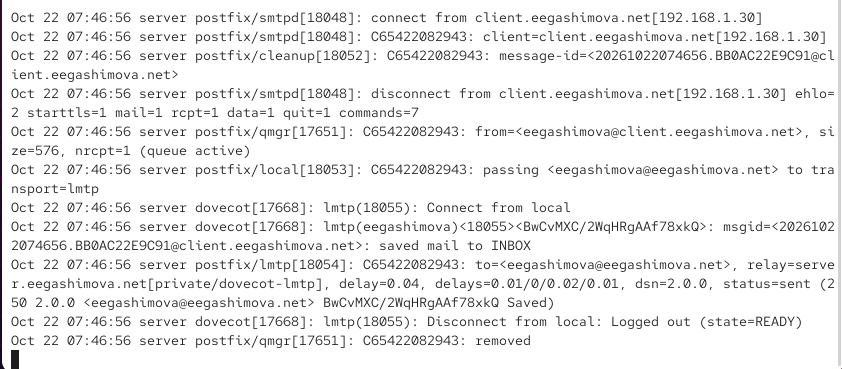{ #fig-005 width=70% }

Для проверки содержимого почтового ящика на сервере выполняю команду `MAIL=~/Maildir/ mail` от имени пользователя `eegashimova`. Переменная `MAIL` задаёт расположение почтового ящика в каталоге `Maildir` домашнего каталога пользователя. В открывшемся почтовом клиенте обнаруживаю сообщение с темой `LMTP test`, выбираю его и просматриваю заголовки. В сообщении указаны адрес получателя `eegashimova@eegashimova.net` и адрес отправителя `eegashimova@client.eegashimova.net`. Наличие тестового сообщения подтверждает успешную доставку почты через LMTP в почтовый ящик на сервере. После проверки завершаю работу почтового клиента командой `q` (см. рис. [@fig-006]).

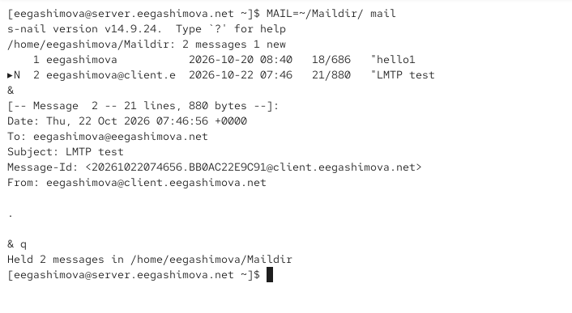{ #fig-006 width=70% }

## Настройка SMTP-аутентификации

Для организации аутентификации пользователей SMTP-сервера с помощью Dovecot открываю конфигурационный файл `/etc/dovecot/conf.d/10-master.conf` и редактирую блок `service auth`. Данный блок определяет службу аутентификации Dovecot и параметры Unix-сокетов, используемых для взаимодействия с другими компонентами почтовой системы.

Внутри блока задаю `unix_listener auth-userdb`, который создаёт Unix-сокет для доступа к базе данных пользователей Dovecot. Параметр `mode = 0600` разрешает чтение и запись только владельцу сокета, а `user = dovecot` назначает владельцем системного пользователя `dovecot`.

Дополнительно создаю сокет `unix_listener /var/spool/postfix/private/auth`, предназначенный для передачи запросов аутентификации от Postfix к Dovecot. Параметр `group = postfix` назначает сокету группу `postfix`, а `user = postfix` определяет его владельца. Значение `mode = 0660` предоставляет права чтения и записи владельцу и группе, запрещая доступ остальным пользователям системы. Настроенные сокеты обеспечивают возможность проверки учётных данных SMTP-клиентов с использованием механизмов аутентификации Dovecot (см. рис. [@fig-007]).

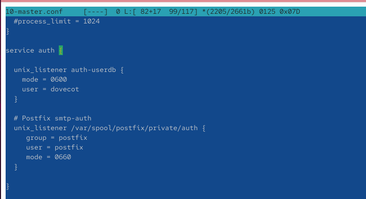{ #fig-007 width=70% }

Перехожу к настройке SMTP-сервера Postfix. Командой `postconf -e 'smtpd_sasl_type = dovecot'` задаю использование Dovecot в качестве поставщика механизма SASL-аутентификации. Командой `postconf -e 'smtpd_sasl_path = private/auth'` определяю относительный путь к Unix-сокету, через который Postfix будет передавать запросы проверки имени пользователя и пароля.

Для ограничения приёма и пересылки сообщений настраиваю параметр `smtpd_recipient_restrictions`, задавая последовательность правил `reject_unknown_recipient_domain, permit_mynetworks, reject_non_fqdn_recipient, reject_unauth_destination, reject_unverified_recipient, permit`. Первое правило `reject_unknown_recipient_domain` отклоняет сообщения, домен получателя которых не удаётся корректно определить посредством DNS. Правило `permit_mynetworks` разрешает обработку запросов от клиентов, входящих в список доверенных сетей. Параметр `reject_non_fqdn_recipient` отклоняет адреса получателей, не содержащие полностью определённого доменного имени. Правило `reject_unauth_destination` запрещает неразрешённую пересылку сообщений на сторонние домены, предотвращая использование сервера в качестве открытого SMTP-ретранслятора. Параметр `reject_unverified_recipient` отклоняет получателей, существование адресов которых не удалось подтвердить. Завершающее правило `permit` разрешает обработку сообщений, успешно прошедших предыдущие проверки.

Дополнительно выполняю команду `postconf -e 'mynetworks = 127.0.0.0/8'`, ограничивая список доверенных клиентов локальной сетью обратной петли. Это исключает автоматическое предоставление привилегий доверенного клиента удалённым узлам. Настройки позволяют контролировать допустимые направления доставки сообщений и предотвращать несанкционированную ретрансляцию почты (см. рис. [@fig-008]).

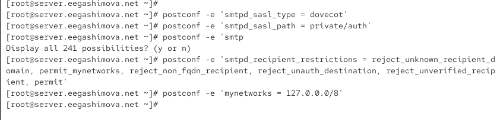{ #fig-008 width=70% }

Открываю конфигурационный файл `/etc/postfix/master.cf` и перехожу к описанию службы `smtp`, использующей TCP-порт 25. Для временной проверки SASL-аутентификации на данном порту предусматриваю параметр `-o smtpd_sasl_auth_enable=yes`, разрешающий SMTP-клиентам проходить аутентификацию. Дополнительно задаю ограничения получателей `smtpd_recipient_restrictions=reject_non_fqdn_recipient,reject_unknown_recipient_domain,permit_sasl_authenticated,reject`. Параметр `permit_sasl_authenticated` разрешает обработку сообщений от успешно аутентифицированных пользователей, а завершающее правило `reject` отклоняет запросы, не соответствующие установленным условиям. Просматриваю описание службы SMTP и расположенный ниже блок `submission`, который будет использоваться при последующей настройке защищённой отправки почты (см. рис. [@fig-009]).

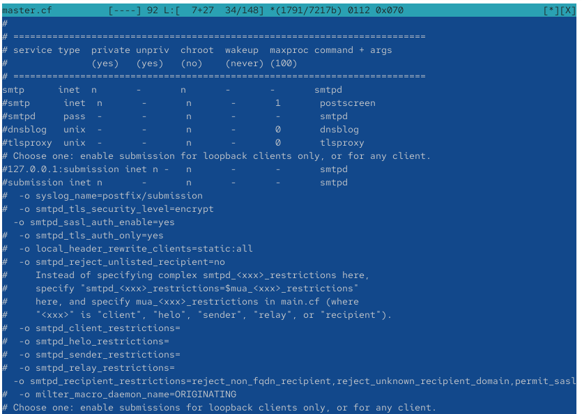{ #fig-009 width=70% }

После внесения изменений перезапускаю почтовые службы командами `systemctl restart postfix` и `systemctl restart dovecot`. На виртуальной машине `client` перехожу в режим суперпользователя командой `sudo -i` и устанавливаю утилиту Telnet командой `dnf -y install telnet`. Она необходима для проверки доступности SMTP-сервера и выполнения команд протокола SMTP непосредственно из терминала.

Для проверки аутентификации формирую строку Base64 командой `printf 'eegashimova\x00eegashimova\x00<пароль>' | base64`, подставляя пароль пользователя вместо заполнителя. Полученная строка содержит имя пользователя для авторизации, имя пользователя для аутентификации и пароль, разделённые нулевыми байтами. Кодирование Base64 требуется для передачи учётных данных с помощью механизма `AUTH PLAIN`, однако само по себе не обеспечивает их шифрование.

Подключаюсь к SMTP-серверу командой `telnet server.eegashimova.net 25`. После установления соединения отправляю команду `EHLO test`, запрашивая список возможностей сервера. В ответе присутствует строка `250-AUTH PLAIN`, подтверждающая поддержку механизма аутентификации PLAIN. Затем выполняю команду `AUTH PLAIN` с подготовленной строкой Base64. Сервер возвращает ответ `235 2.7.0 Authentication successful`, который подтверждает успешную проверку учётных данных пользователя через SASL и Dovecot (см. рис. [@fig-010]).

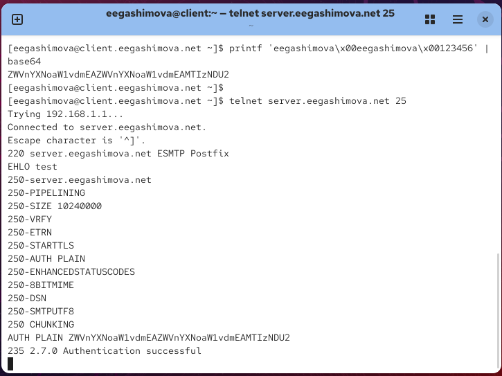{ #fig-010 width=70% }

## Настройка SMTP over TLS

На виртуальной машине `server` приступаю к настройке защищённого SMTP-соединения с использованием TLS. Для этого использую временный самоподписанный сертификат Dovecot. Копирую сертификат командой `cp /etc/pki/dovecot/certs/dovecot.pem /etc/pki/tls/certs` и закрытый ключ командой `cp /etc/pki/dovecot/private/dovecot.pem /etc/pki/tls/private`. Размещение файлов в стандартных каталогах `/etc/pki/tls/certs` и `/etc/pki/tls/private` позволяет Postfix использовать сертификат и ключ с учётом политики безопасности SELinux.

Командой `postconf -e 'smtpd_tls_cert_file=/etc/pki/tls/certs/dovecot.pem'` задаю путь к сертификату SMTP-сервера, а командой `postconf -e 'smtpd_tls_key_file=/etc/pki/tls/private/dovecot.pem'` указываю расположение его закрытого ключа.

Далее устанавливаю параметр `smtpd_tls_session_cache_database = btree:/var/lib/postfix/smtpd_scache`, определяющий базу данных для кеширования TLS-сессий. Кеширование позволяет повторно использовать параметры ранее установленных защищённых соединений и уменьшать накладные расходы при последующих подключениях.

Параметром `smtpd_tls_security_level = may` разрешаю использование TLS для входящих SMTP-соединений, а параметром `smtp_tls_security_level = may` — для исходящих соединений Postfix. Значение `may` означает, что TLS используется при наличии поддержки со стороны взаимодействующего сервера, но не является обязательным для всех соединений (см. рис. [@fig-011]).

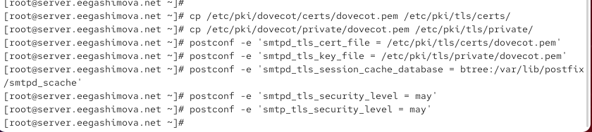{ #fig-011 width=70% }

Для организации защищённой отправки почты открываю файл `/etc/postfix/master.cf` и настраиваю службу `submission`, работающую на TCP-порту 587. Для стандартной службы `smtp` оставляю определение `smtp inet n - n - - smtpd`, а для службы `submission` использую строку `submission inet n - n - - smtpd`.

В параметрах службы `submission` активирую `-o smtpd_tls_security_level=encrypt`, требующий обязательного установления защищённого TLS-соединения перед передачей почтовых данных. Следующим параметром `-o smtpd_sasl_auth_enable=yes` включаю SASL-аутентификацию пользователей при отправке сообщений.

Для ограничения доступа к отправке почты предусмотрен параметр `smtpd_recipient_restrictions=reject_non_fqdn_recipient,reject_unknown_recipient_domain,permit_sasl_authenticated,reject`. Он позволяет отклонять некорректные адреса и разрешать дальнейшую обработку сообщений успешно аутентифицированным пользователям. В отображённом фрагменте конфигурации строка с этим ограничением остаётся закомментированной, поэтому для применения правила её необходимо активировать. При этом параметры обязательного TLS и SASL-аутентификации для службы `submission` уже указаны как активные директивы (см. рис. [@fig-012]).

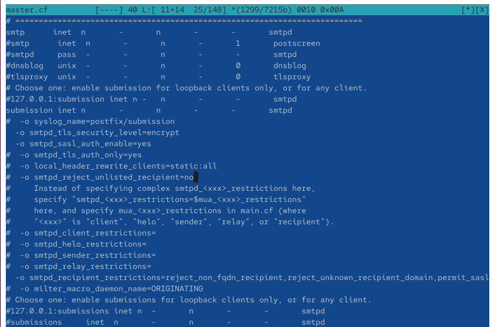{ #fig-012 width=70% }

После настройки Postfix изменяю правила межсетевого экрана на сервере. Выполняю команду `firewall-cmd --add-service=smtp-submission`, разрешающую подключения к службе SMTP Submission в текущей конфигурации firewalld. Затем выполняю `firewall-cmd --add-service=smtp-submission --permanent`, чтобы сохранить правило после перезагрузки системы. Командой `firewall-cmd --reload` применяю постоянные настройки межсетевого экрана.

В ответ на команды firewalld получаю сообщения `success`, подтверждающие успешное выполнение операций. После изменения правил перезапускаю Postfix командой `systemctl restart postfix.service`, чтобы применить параметры службы `submission` и настройки TLS (см. рис. [@fig-013]).

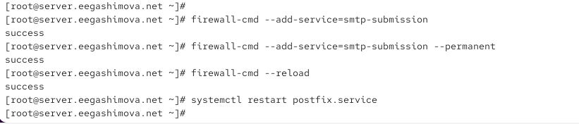{ #fig-013 width=70% }

На виртуальной машине `client` проверяю защищённое подключение к SMTP-серверу командой `openssl s_client -starttls smtp -crlf -connect server.eegashimova.net:587`. Параметр `-starttls smtp` инициирует переход к TLS после установления обычного SMTP-соединения, `-crlf` обеспечивает передачу переводов строк в формате протокола SMTP, а `-connect` определяет адрес сервера и порт подключения.

В процессе установления соединения OpenSSL получает сертификат сервера и выводит информацию о TLS-сессии. Сообщение `Verify return code: 18 (self-signed certificate)` указывает, что используется самоподписанный сертификат, доверие к которому не подтверждено внешним центром сертификации. Для лабораторной проверки это ожидаемая особенность временного сертификата.

После установления защищённого соединения выполняю команду `EHLO test` и проверяю наличие в ответе сервера возможности `AUTH PLAIN`. Затем передаю подготовленные учётные данные командой `AUTH PLAIN` с соответствующей строкой Base64. Сервер возвращает ответ `235 2.7.0 Authentication successful`, подтверждающий успешную SASL-аутентификацию внутри защищённого TLS-соединения. Результат проверки показывает, что служба SMTP Submission на порту 587 принимает защищённые подключения и поддерживает аутентификацию пользователей (см. рис. [@fig-014]).

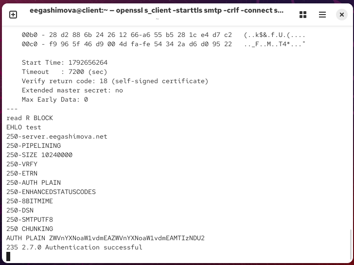{ #fig-014 width=70% }

Для проверки отправки почты через графический почтовый клиент открываю Evolution на виртуальной машине `client` и перехожу к редактированию параметров учётной записи. В разделе `Sending Email` выбираю тип сервера `SMTP` и указываю адрес `mail.eegashimova.net`. Для подключения устанавливаю порт `587` и включаю параметр `Server requires authentication`, который указывает на необходимость проверки учётных данных пользователя.

В разделе безопасности выбираю метод шифрования `STARTTLS after connecting`. Эта настройка позволяет почтовому клиенту сначала устанавливать SMTP-соединение, а затем переходить к защищённому обмену данными с помощью TLS. В параметрах аутентификации выбираю механизм `PLAIN` и указываю имя пользователя `eegashimova`. Использование механизма PLAIN в сочетании с обязательным STARTTLS позволяет передавать учётные данные внутри шифрованного соединения. После изменения параметров сохраняю настройки учётной записи (см. рис. [@fig-015]).

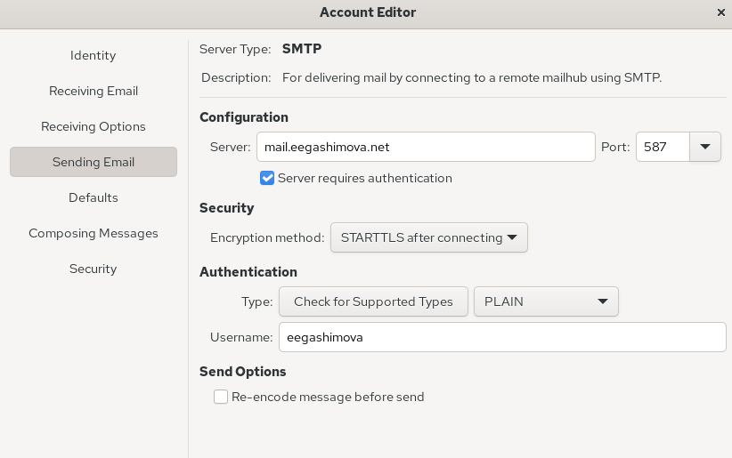{ #fig-015 width=70% }

После настройки Evolution выполняю отправку тестового письма с клиента на почтовый адрес `eegashimova@eegashimova.net`. Затем открываю папку `Inbox` и проверяю наличие доставленных сообщений. В списке почты отображаются ранее полученные письма `hello1` и `LMTP test`, а также новое сообщение с темой `hello2`.

Выбираю сообщение `hello2` и просматриваю его содержимое. В заголовках указаны адрес отправителя `eegashimova@eegashimova.net` и адрес получателя `eegashimova@eegashimova.net`, а в теле письма содержится текст `hello`. Успешное получение нового сообщения подтверждает возможность отправки почты через SMTP Submission с использованием STARTTLS и SASL-аутентификации, а также её последующей доставки в почтовый ящик пользователя (см. рис. [@fig-016]).

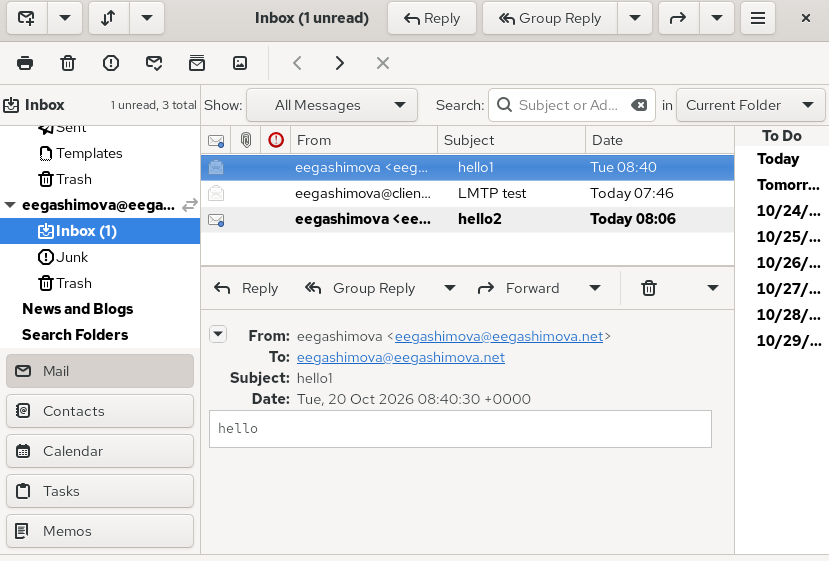{ #fig-016 width=70% }

На сервере дополнительно просматриваю журнал `/var/log/maillog` и анализирую записи, сформированные при отправке письма через Evolution. В журнале присутствует подключение от клиента `client.eegashimova.net` с адресом `192.168.1.30`. Запись `sasl_method=PLAIN, sasl_username=eegashimova` указывает, что SMTP-сервер успешно определил пользователя и выполнил его аутентификацию с использованием механизма SASL PLAIN.

После приёма сообщения Postfix присваивает ему идентификатор очереди и передаёт его процессу `qmgr`. В дальнейшем запись `postfix/local` показывает передачу сообщения на транспорт доставки, а `dovecot: lmtp` подтверждает подключение службы LMTP и сохранение сообщения в папке `INBOX`. Запись `postfix/lmtp` содержит результат `dsn=2.0.0, status=sent`, свидетельствующий об успешном завершении доставки. После этого менеджер очереди удаляет доставленное сообщение, о чём свидетельствует запись `postfix/qmgr: removed`. Полученные сведения подтверждают работу цепочки SMTP-аутентификации, приёма сообщения сервером Postfix и доставки почты посредством Dovecot LMTP (см. рис. [@fig-017]).

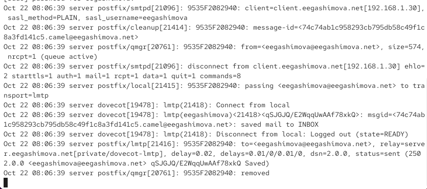{ #fig-017 width=70% }

## Внесение изменений в настройки внутреннего окружения виртуальной машины

На виртуальной машине `server` перехожу в каталог `/vagrant/provision/server/` и копирую обновлённые конфигурационные файлы Dovecot и Postfix в соответствующие подкаталоги `mail/etc/`. Это позволяет сохранить выполненные настройки для последующего автоматического развёртывания почтового сервера (см. рис. [@fig-018]).

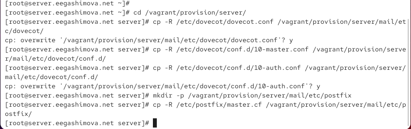{ #fig-018 width=70% }

Открываю файл `/vagrant/provision/server/mail.sh` и дополняю скрипт командами настройки SASL-аутентификации, TLS, межсетевого экрана и почтовых служб. Изменения обеспечивают автоматическое применение расширенной конфигурации SMTP-сервера при развёртывании виртуальной машины (см. рис. [@fig-019]).

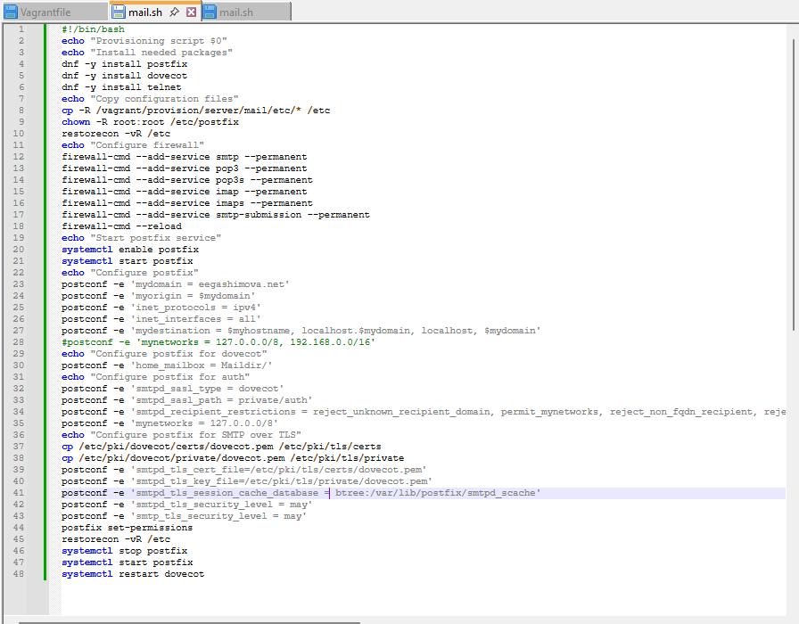{ #fig-019 width=70% }

В файле `/vagrant/provision/client/mail.sh` добавляю команду `dnf -y install telnet` для автоматической установки утилиты Telnet на клиентской виртуальной машине (см. рис. [@fig-020]).

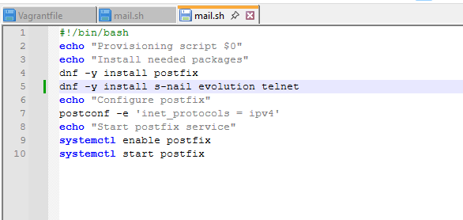{ #fig-020 width=70% }

# Вывод

В ходе лабораторной работы я настроила взаимодействие Postfix и Dovecot по протоколу LMTP для доставки почтовых сообщений, а также реализовала SASL-аутентификацию пользователей SMTP-сервера. Настроила защищённую передачу почты с использованием TLS и службу SMTP Submission на порту `587`. На виртуальной машине `client` проверила аутентификацию через Telnet и OpenSSL, настроила отправку сообщений через Evolution и убедилась в успешной доставке писем. Также проанализировала журналы почтовых служб и внесла изменения в скрипты Vagrant для автоматизации настройки почтового сервера.

# Контрольные вопросы

**1. Приведите пример задания формата аутентификации пользователя в Dovecot в форме логина с указанием домена.**

Для задания формата имени пользователя с указанием домена в конфигурационном файле `/etc/dovecot/conf.d/10-auth.conf` можно использовать параметр `auth_username_format = %Lu`.

Переменная `%u` обозначает полное имя пользователя, включая доменную часть, а модификатор `L` преобразует его в нижний регистр. Например, имя `User@Example.com` будет преобразовано в `user@example.com`.

Это позволяет выполнять аутентификацию с использованием полного почтового адреса вместо локального имени пользователя при условии, что клиент передаёт имя вместе с доменом.

**2. Какие функции выполняет почтовый Relay-сервер?**

Почтовый Relay-сервер — это SMTP-сервер, предназначенный для промежуточной передачи электронных писем между отправителем и сервером получателя.

Он принимает сообщения от почтовых клиентов или других серверов, определяет дальнейший маршрут доставки и пересылает письма на соответствующие SMTP-серверы. Также Relay-сервер может выполнять проверку отправителей, фильтрацию спама, контроль доступа и шифрование соединений с помощью TLS.

**3. Какие угрозы безопасности могут возникнуть в случае настройки почтового сервера как Relay-сервера?**

Основная угроза возникает при неправильной настройке Relay-сервера, когда он разрешает пересылку почты посторонним пользователям без аутентификации. Такой сервер называется открытым ретранслятором (Open Relay).

Злоумышленники могут использовать его для массовой рассылки спама, фишинговых писем и вредоносных вложений. Это приводит к повышенной нагрузке на сервер, расходованию сетевых ресурсов и попаданию IP-адреса сервера в чёрные списки почтовых систем.

Для предотвращения угроз необходимо использовать SASL-аутентификацию, ограничивать пересылку сообщений с помощью параметров `smtpd_recipient_restrictions` и `mynetworks`, а также применять TLS для защиты передаваемых данных.

# Список литературы

1. [Dovecot — руководство по настройке протокола LMTP для доставки почтовых сообщений](https://doc.dovecot.org/2.3/configuration_manual/protocols/lmtp_server/)
2. [Dovecot — настройка формата имени пользователя и аутентификации с указанием домена](https://doc.dovecot.org/2.3/configuration_manual/authentication/domain_lost/)
3. [Postfix — руководство по настройке SASL-аутентификации с использованием Dovecot](https://www.postfix.org/SASL_README.html)
4. [Postfix — настройка SMTP Relay и ограничений доступа для защиты от несанкционированной пересылки почты](https://www.postfix.org/SMTPD_ACCESS_README.html)
5. [Postfix — руководство по настройке TLS-шифрования для SMTP-сервера](https://www.postfix.org/TLS_README.html)
6. [RFC 3207 — описание расширения STARTTLS для защиты SMTP-соединений](https://www.rfc-editor.org/rfc/rfc3207.html)
7. [GNOME Evolution — руководство по настройке отправки электронной почты через SMTP](https://gnome.pages.gitlab.gnome.org/evolution/help/en_GB/intro-first-run.html)
8. [firewalld — руководство по настройке межсетевого экрана с помощью firewall-cmd](https://firewalld.org/documentation/man-pages/firewall-cmd.html)
9. [HashiCorp Vagrant — автоматизация настройки виртуальных машин с помощью Shell Provisioner](https://developer.hashicorp.com/vagrant/docs/provisioning/shell)