---
## Author
author:
  name: Гашимова Эсма Эльшан кызы
  email: 1132247520@rudn.ru
  affiliation:
    - name: Российский университет дружбы народов
      country: Российская Федерация
      postal-code: 117198
      city: Москва
      address: ул. Миклухо-Маклая, д. 6

## Title
title: Лабораторная работа №11
subtitle: Настройка безопасного удалённого доступа по протоколу SSH
license: CC BY
date: today
date-format: "YYYY-MM-DD"
---

# Цели и задачи работы

## Цель лабораторной работы

Приобретение практических навыков настройки и администрирования безопасного удалённого доступа к серверу по протоколу SSH в операционной системе Rocky Linux.

Настроить ограничения доступа пользователей, дополнительные порты SSH и аутентификацию по ключу. Организовать SSH-туннель с перенаправлением TCP-портов, проверить удалённый запуск консольных и графических приложений, а также подготовить скрипт автоматизации настройки SSH-сервера с помощью Vagrant.

# Процесс выполнения лабораторной работы

## Проверка SSH-подключения пользователя root

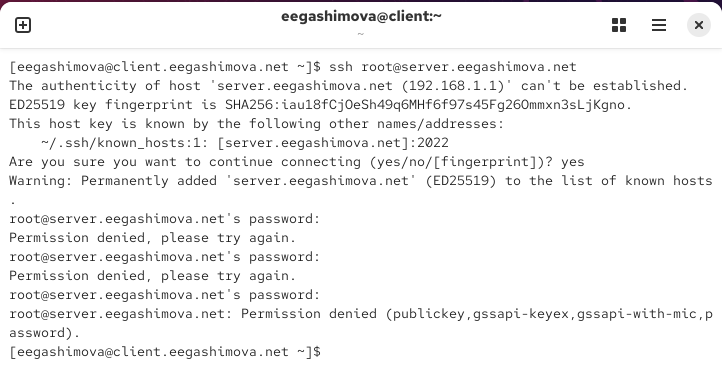{ #fig:001 width=70% height=70% }

## Запрет удалённого доступа пользователю root

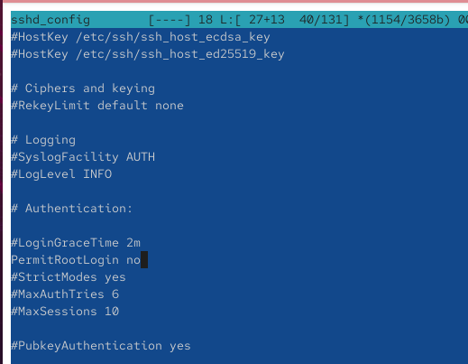{ #fig:002 width=70% height=70% }

## Проверка ограничения доступа пользователя root

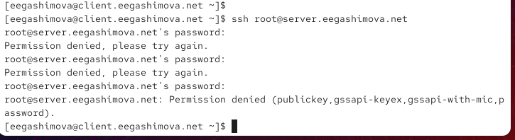{ #fig:003 width=70% height=70% }

## Проверка подключения обычного пользователя

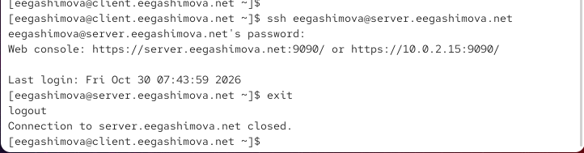{ #fig:004 width=70% height=70% }

## Ограничение списка пользователей SSH

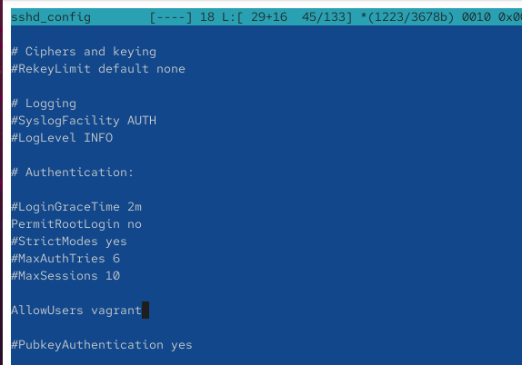{ #fig:005 width=70% height=70% }

## Проверка запрета доступа пользователя

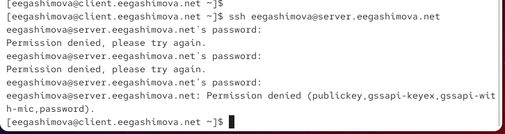{ #fig:006 width=70% height=70% }

## Добавление пользователя в список разрешённых

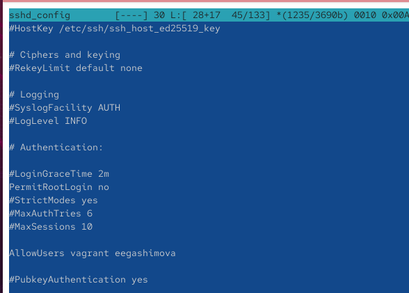{ #fig:007 width=70% height=70% }

## Проверка подключения разрешённого пользователя

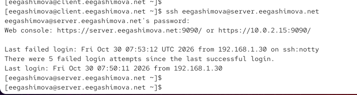{ #fig:008 width=70% height=70% }

## Настройка дополнительных портов SSH

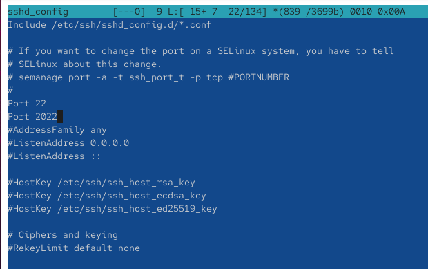{ #fig:009 width=70% height=70% }

## Проверка состояния SSH-службы

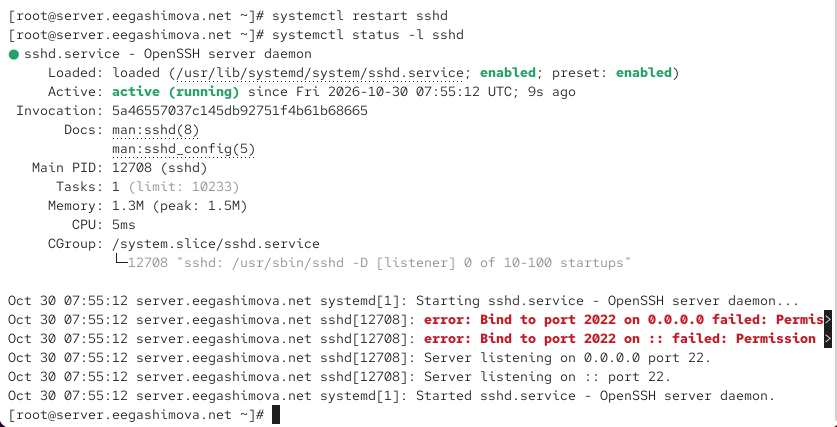{ #fig:010 width=70% height=70% }

## Анализ ограничений SELinux

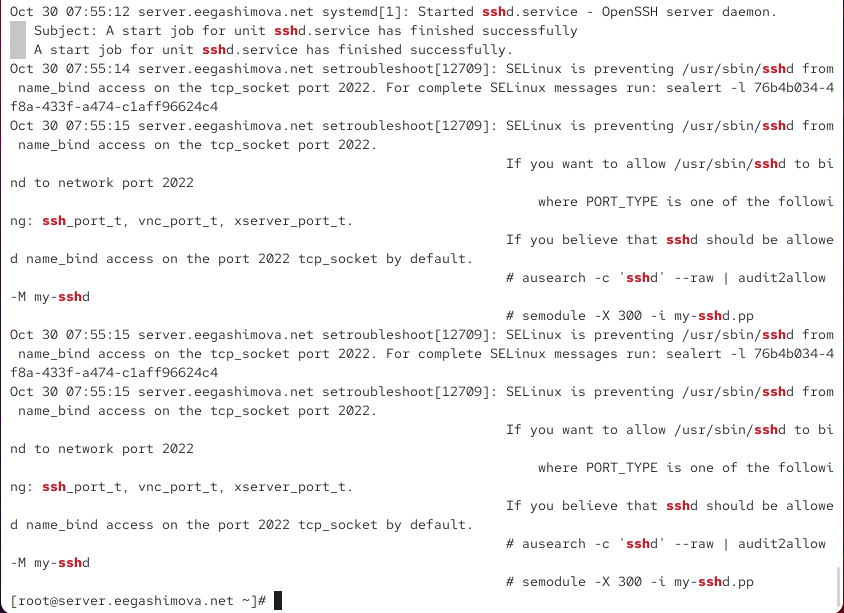{ #fig:011 width=70% height=70% }

## Настройка SELinux и межсетевого экрана

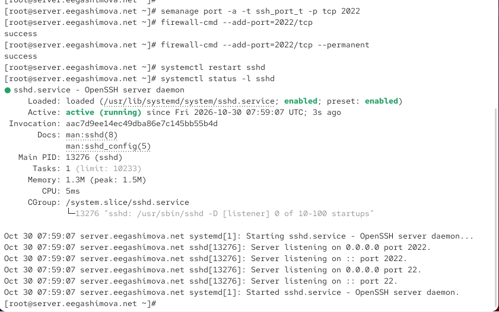{ #fig:012 width=70% height=70% }

## Проверка подключения через порты 22 и 2022

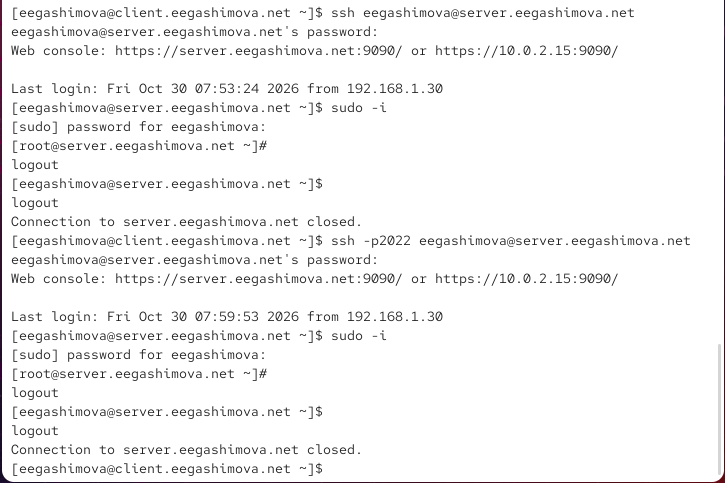{ #fig:013 width=70% height=70% }

## Настройка аутентификации по SSH-ключу

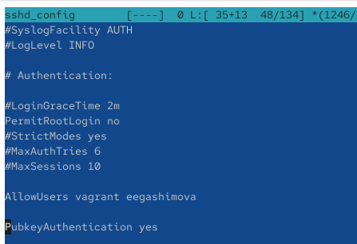{ #fig:014 width=70% height=70% }

## Генерация пары SSH-ключей

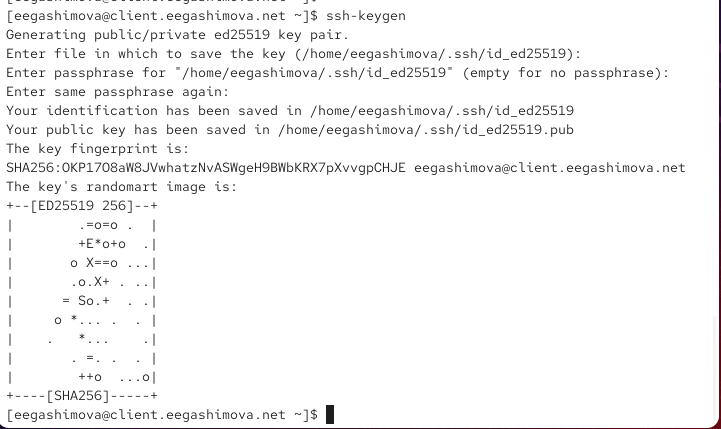{ #fig:015 width=70% height=70% }

## Копирование открытого ключа на сервер

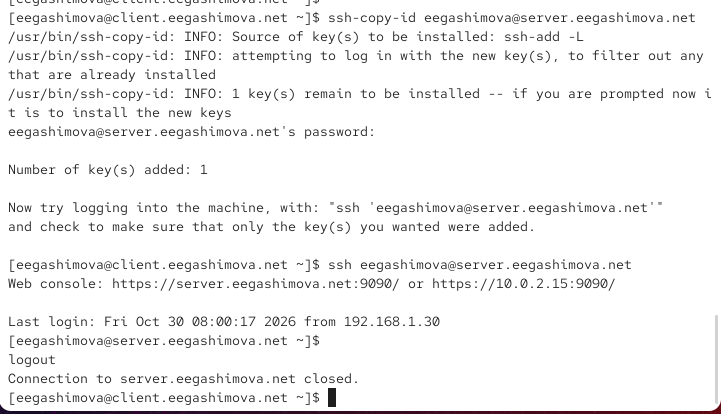{ #fig:016 width=70% height=70% }

## Организация SSH-туннеля

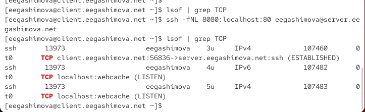{ #fig:017 width=70% height=70% }

## Проверка перенаправления TCP-портов

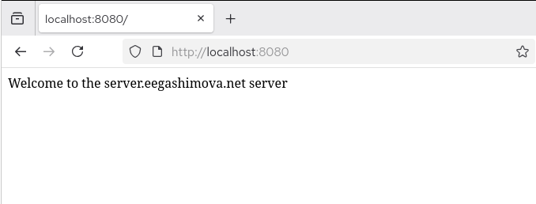{ #fig:018 width=70% height=70% }

## Выполнение удалённых консольных команд

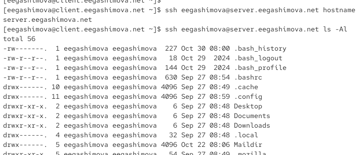{ #fig:019 width=70% height=70% }

## Запуск консольного почтового приложения

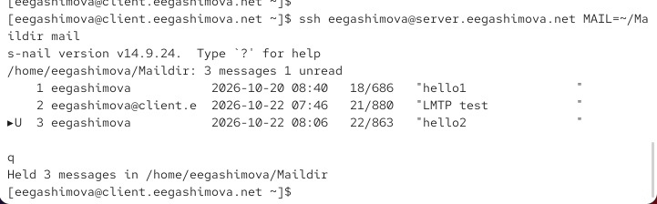{ #fig:020 width=70% height=70% }

## Настройка перенаправления графических приложений

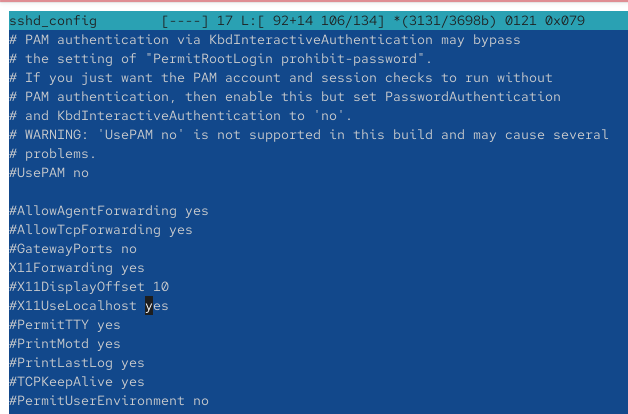{ #fig:021 width=70% height=70% }

## Проверка запуска графического приложения через SSH

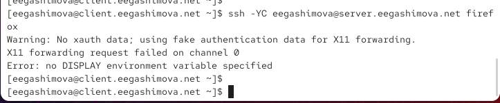{ #fig:022 width=70% height=70% }

## Подготовка конфигурационных файлов для Vagrant

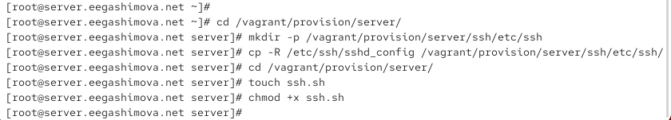{ #fig:023 width=70% height=70% }

## Создание скрипта автоматизации SSH

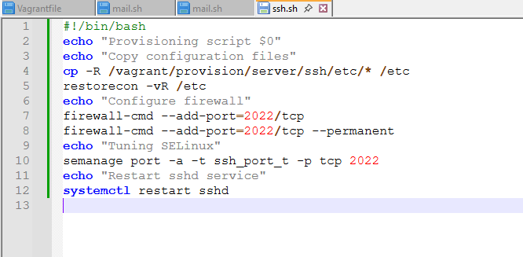{ #fig:024 width=70% height=70% }

# Результаты работы

## Настройка ограничений удалённого доступа

На виртуальной машине `server` настроен запрет удалённого подключения пользователя `root` с помощью параметра `PermitRootLogin no`. С использованием директивы `AllowUsers` доступ по SSH ограничен пользователями `vagrant` и `eegashimova`.

Проверена корректность установленных ограничений путём выполнения успешных и неуспешных попыток подключения с виртуальной машины `client`.

## Настройка дополнительных портов и аутентификации

SSH-сервер настроен для работы через TCP-порты `22` и `2022`. Для дополнительного порта изменены правила SELinux и межсетевого экрана `firewalld`. Успешное подключение через оба порта подтверждено проверками.

Настроена аутентификация по открытому ключу ED25519. Проверена возможность подключения пользователя `eegashimova` без ввода пароля учётной записи удалённого сервера.

## Организация SSH-туннеля

Создан защищённый SSH-туннель с перенаправлением соединений с локального порта `8080` на порт `80` удалённого сервера.

Работоспособность туннеля подтверждена открытием веб-страницы сервера через браузер по адресу `http://localhost:8080`.

## Удалённый запуск приложений

Успешно выполнены удалённые консольные команды `hostname` и `ls -Al`, а также запущено почтовое приложение `mail` для просмотра сообщений на сервере.

Настроен параметр `X11Forwarding yes` и выполнена попытка запуска Firefox через SSH. Запуск графического приложения завершился ошибкой перенаправления X11, требующей дополнительной настройки графического окружения.

# Вывод

В ходе лабораторной работы была выполнена настройка безопасного удалённого доступа по протоколу SSH на виртуальной машине `server`.

Реализованы ограничения доступа пользователей, настроена работа SSH через порты `22` и `2022`, а также организована аутентификация по криптографическому ключу ED25519.

На виртуальной машине `client` проверена работа SSH-туннеля с перенаправлением TCP-портов и выполнен запуск удалённых консольных приложений. При проверке X11Forwarding выявлена ошибка графического перенаправления.

