---
## Author
author:
  name: Гашимова Эсма Эльшан кызы
  email: 1132247520@rudn.ru
  affiliation:
    - name: Российский университет дружбы народов
      country: Российская Федерация
      postal-code: 117198
      city: Москва
      address: ул. Миклухо-Маклая, д. 6

## Title
title: "Отчёт по лабораторной работе №11"
subtitle: "Настройка безопасного удалённого доступа по протоколу SSH"
license: "CC BY"
---

# Цель работы

Приобретение практических навыков по настройке удалённого доступа к серверу с помощью SSH.

# Выполнение лабораторной работы

## Запрет удалённого доступа по SSH для пользователя root

На виртуальной машине `server` перехожу в режим суперпользователя командой `sudo -i` и задаю пароль для `root` с помощью `passwd root`. В дополнительном терминале запускаю мониторинг системных событий командой `journalctl -x -f`.

На клиенте пытаюсь подключиться к серверу командой `ssh root@server.eegashimova.net`. При первом подключении подтверждаю доверие к серверу, после чего система запрашивает пароль. После нескольких попыток аутентификации получаю сообщение `Permission denied`, указывающее на отказ в доступе (см. рис. [@fig-001]).

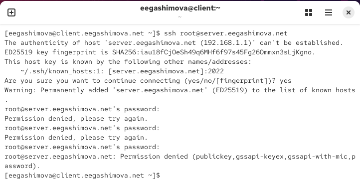{ #fig-001 width=70% }

На сервере открываю конфигурационный файл `/etc/ssh/sshd_config` и устанавливаю параметр `PermitRootLogin no`, запрещающий удалённый вход по SSH от имени суперпользователя `root` (см. рис. [@fig-002]).

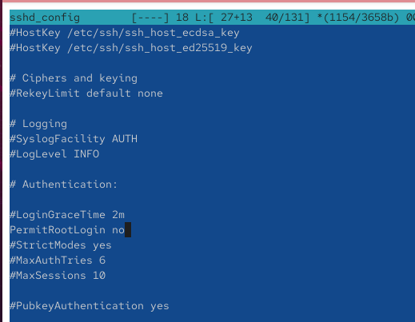{ #fig-002 width=70% }

Перезапускаю службу командой `systemctl restart sshd`. Повторно выполняю на клиенте команду `ssh root@server.eegashimova.net`. Подключение завершается сообщением `Permission denied`, что подтверждает действие установленного запрета (см. рис. [@fig-003]).

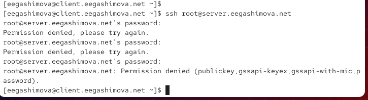{ #fig-003 width=70% }

## Ограничение списка пользователей для удалённого доступа по SSH

На клиенте выполняю команду `ssh eegashimova@server.eegashimova.net`. После ввода пароля успешно подключаюсь к серверу под пользователем `eegashimova`. Завершаю сеанс командой `exit` (см. рис. [@fig-004]).

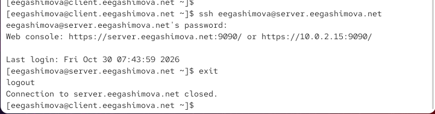{ #fig-004 width=70% }

На сервере открываю файл `/etc/ssh/sshd_config` и добавляю строку `AllowUsers vagrant`, разрешающую SSH-доступ только пользователю `vagrant`. После сохранения изменений перезапускаю службу `sshd` (см. рис. [@fig-005]).

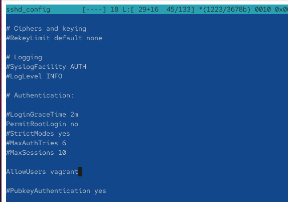{ #fig-005 width=70% }

Повторно пытаюсь подключиться с клиента под пользователем `eegashimova`. После ввода пароля получаю сообщение `Permission denied`, поскольку данный пользователь отсутствует в списке разрешённых (см. рис. [@fig-006]).

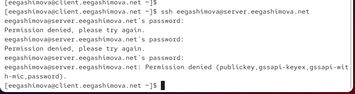{ #fig-006 width=70% }

Изменяю параметр на `AllowUsers vagrant eegashimova`, добавляя свою учётную запись в список пользователей, которым разрешён удалённый доступ (см. рис. [@fig-007]).

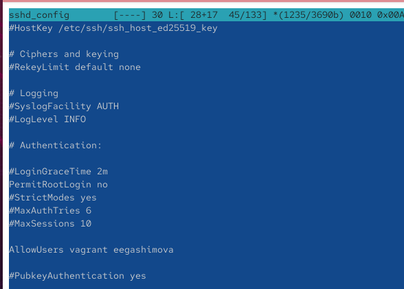{ #fig-007 width=70% }

Перезапускаю `sshd` и повторяю подключение командой `ssh eegashimova@server.eegashimova.net`. После ввода пароля успешно получаю доступ к серверу, что подтверждает правильность настройки (см. рис. [@fig-008]).

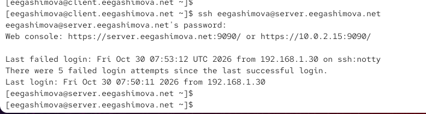{ #fig-008 width=70% }

## Настройка дополнительных портов для удалённого доступа по SSH

На сервере открываю файл `/etc/ssh/sshd_config` и добавляю параметры `Port 22` и `Port 2022`. Это позволяет SSH-серверу принимать подключения через стандартный порт `22` и дополнительный порт `2022` (см. рис. [@fig-009]).

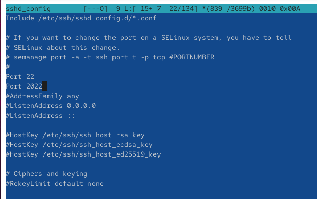{ #fig-009 width=70% }

Перезапускаю службу командой `systemctl restart sshd` и проверяю её состояние через `systemctl status -l sshd`. В выводе появляются ошибки `Bind to port 2022 failed: Permission denied`, указывающие на отсутствие разрешения для использования нового порта (см. рис. [@fig-010]).

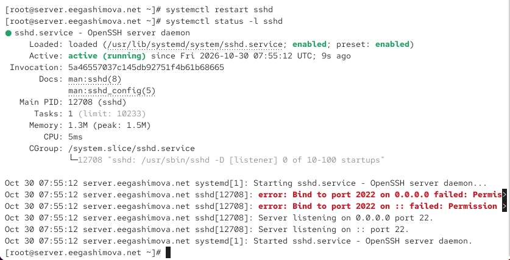{ #fig-010 width=70% }

В системном журнале `journalctl -x -f` обнаруживаю сообщения о блокировке порта `2022` механизмом SELinux. Ограничение связано с отсутствием у порта необходимой метки безопасности `ssh_port_t` (см. рис. [@fig-011]).

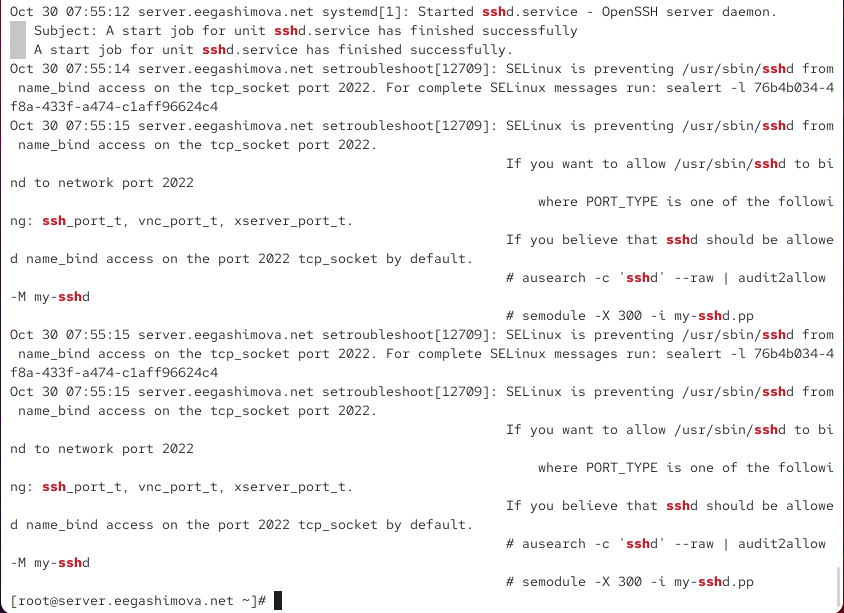{ #fig-011 width=70% }

Для исправления выполняю команду `semanage port -a -t ssh_port_t -p tcp 2022`. Затем открываю порт в межсетевом экране командами `firewall-cmd --add-port=2022/tcp` и `firewall-cmd --add-port=2022/tcp --permanent`. После перезапуска `sshd` проверяю состояние службы. В выводе отображается прослушивание портов `22` и `2022`, что подтверждает успешное применение настроек (см. рис. [@fig-012]).

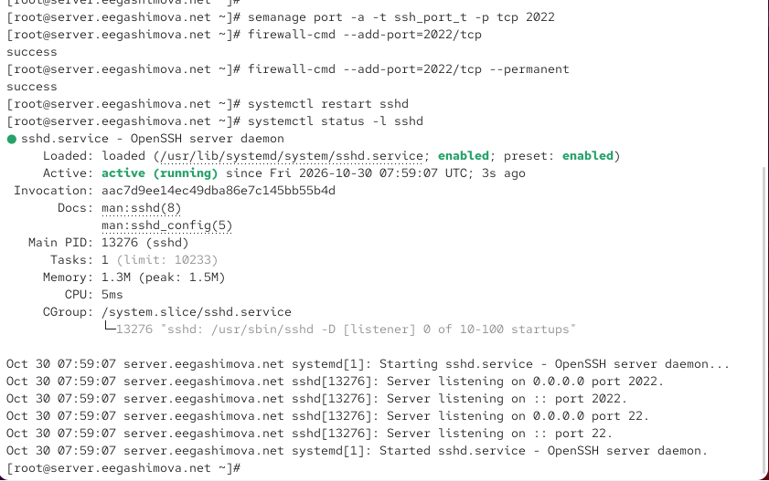{ #fig-012 width=70% }

На клиенте подключаюсь к серверу через стандартный порт командой `ssh eegashimova@server.eegashimova.net`. После входа выполняю `sudo -i` для получения прав суперпользователя и завершаю сеансы командами `logout`.

Затем подключаюсь через дополнительный порт командой `ssh -p2022 eegashimova@server.eegashimova.net`. Соединение успешно устанавливается, после чего снова проверяю переход в режим `root` и завершаю сеанс. Оба порта работают корректно (см. рис. [@fig-013]).

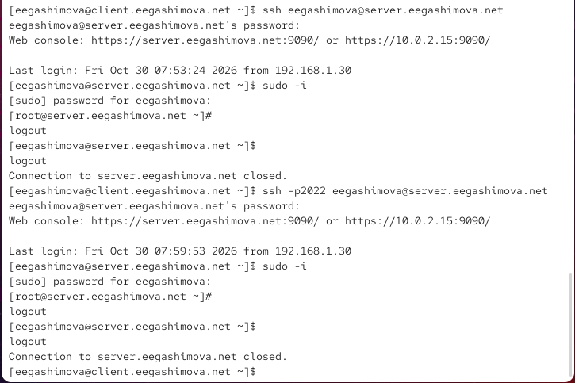{ #fig-013 width=70% }

## Настройка удалённого доступа по SSH по ключу

На сервере открываю файл `/etc/ssh/sshd_config` и устанавливаю параметр `PubkeyAuthentication yes`, разрешающий аутентификацию по открытому ключу. После сохранения изменений перезапускаю службу `sshd` (см. рис. [@fig-014]).

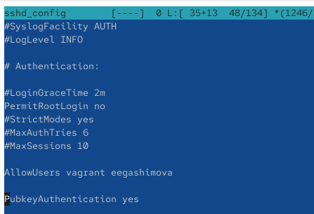{ #fig-014 width=70% }

На клиенте выполняю команду `ssh-keygen` для генерации пары SSH-ключей. При запросах принимаю путь сохранения по умолчанию и оставляю кодовую фразу пустой. В результате создаются закрытый ключ `~/.ssh/id_ed25519` и открытый ключ `~/.ssh/id_ed25519.pub`, используемые для аутентификации по алгоритму ED25519 (см. рис. [@fig-015]).

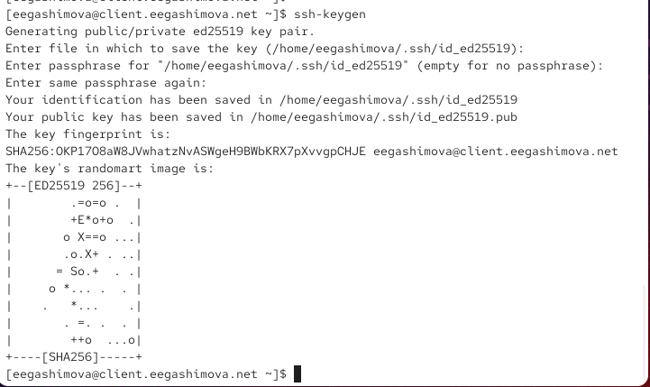{ #fig-015 width=70% }

Копирую открытый ключ на сервер командой `ssh-copy-id eegashimova@server.eegashimova.net`. После ввода пароля ключ добавляется в файл `~/.ssh/authorized_keys` удалённого пользователя. Проверяю подключение командой `ssh eegashimova@server.eegashimova.net`. Вход выполняется без запроса пароля учётной записи, что подтверждает работоспособность аутентификации по ключу (см. рис. [@fig-016]).

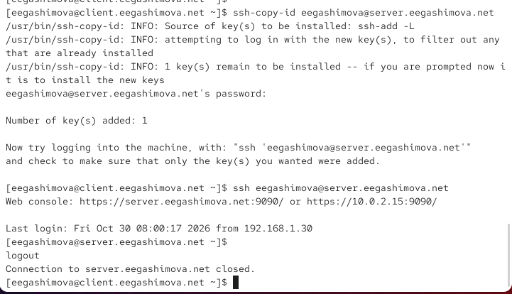{ #fig-016 width=70% }

## Организация SSH-туннеля и перенаправление TCP-портов

На клиенте выполняю команду `lsof | grep TCP` для просмотра открытых TCP-соединений. Затем создаю SSH-туннель командой `ssh -fNL 8080:localhost:80 eegashimova@server.eegashimova.net`. Параметр `-f` переводит процесс в фоновый режим, `-N` отключает выполнение удалённых команд, а `-L` перенаправляет подключения с локального порта `8080` на порт `80` сервера.

Повторно выполняю `lsof | grep TCP`. В выводе появляются записи процесса `ssh` со статусом `LISTEN` для порта `8080` и установленное соединение с сервером, подтверждающие создание туннеля (см. рис. [@fig-017]).

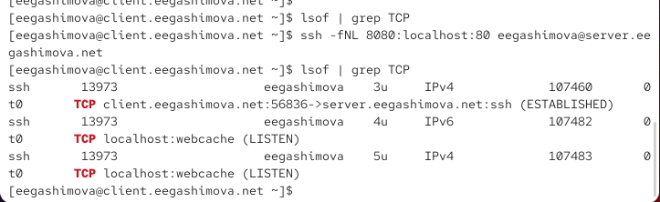{ #fig-017 width=70% }

На клиенте открываю браузер и перехожу по адресу `http://localhost:8080`. Отображается страница с сообщением `Welcome to the server.eegashimova.net server`. Это подтверждает, что запросы перенаправляются через SSH-туннель на веб-сервер, работающий на порту `80` (см. рис. [@fig-018]).

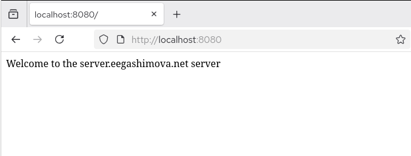{ #fig-018 width=70% }

## Запуск консольных приложений через SSH

На клиенте выполняю команду `ssh eegashimova@server.eegashimova.net hostname`, чтобы получить имя удалённого узла. В результате выводится `server.eegashimova.net`.

Затем выполняю `ssh eegashimova@server.eegashimova.net ls -Al`, получая подробный список файлов и каталогов в домашнем каталоге пользователя на сервере. Обе команды успешно выполняются через SSH без открытия постоянного интерактивного сеанса (см. рис. [@fig-019]).

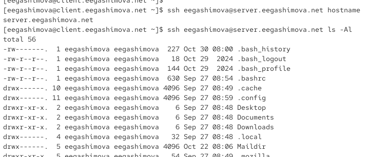{ #fig-019 width=70% }

Для просмотра почты на сервере запускаю команду `ssh eegashimova@server.eegashimova.net MAIL=~/Maildir/ mail`. В терминале открывается почтовая программа `s-nail`, отображающая сообщения с темами `hello1`, `LMTP test` и `hello2`. Полученный результат подтверждает возможность запуска консольных приложений на удалённом сервере через SSH (см. рис. [@fig-020]).

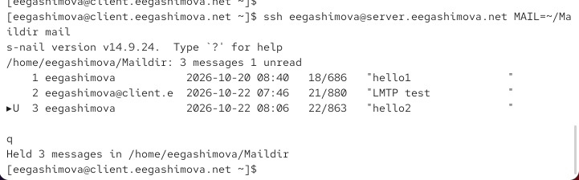{ #fig-020 width=70% }

## Запуск графических приложений через SSH с использованием X11Forwarding

На сервере открываю файл `/etc/ssh/sshd_config` и устанавливаю параметр `X11Forwarding yes`, разрешающий перенаправление графических интерфейсов X11 через SSH. После сохранения изменений перезапускаю службу `sshd` (см. рис. [@fig-021]).

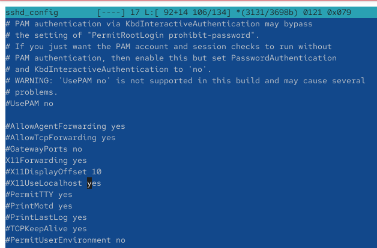{ #fig-021 width=70% }

На клиенте пытаюсь запустить браузер Firefox на сервере командой `ssh -YC eegashimova@server.eegashimova.net firefox`. Параметр `-Y` разрешает доверенное перенаправление X11, а `-C` включает сжатие передаваемых данных.

При выполнении команды появляются сообщения `X11 forwarding request failed on channel 0` и `Error: no DISPLAY environment variable specified`. Это указывает на отсутствие корректного перенаправления графического интерфейса. В результате Firefox не запускается, поэтому требуется дополнительная настройка X11 на клиенте и проверка механизма X11-аутентификации (см. рис. [@fig-022]).

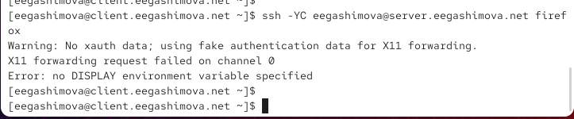{ #fig-022 width=70% }

## Внесение изменений в настройки внутреннего окружения виртуальной машины

На сервере перехожу в каталог `/vagrant/provision/server/`, создаю структуру каталогов для хранения конфигурации SSH и копирую файл `sshd_config`. Затем создаю исполняемый скрипт `ssh.sh`, предназначенный для автоматического применения настроек SSH-сервера (см. рис. [@fig-023]).

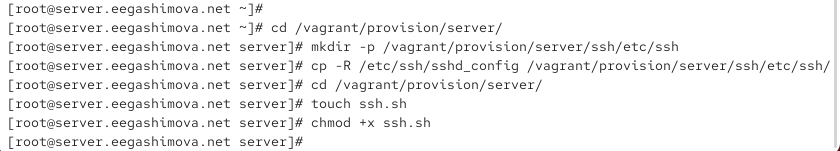{ #fig-023 width=70% }

В скрипт добавляю команды копирования конфигурационных файлов, восстановления контекстов SELinux, открытия порта `2022` в межсетевом экране и перезапуска `sshd`. Для автоматического выполнения скрипта при настройке виртуальной машины предусматриваю его подключение в `Vagrantfile` через `server.vm.provision` (см. рис. [@fig-024]).

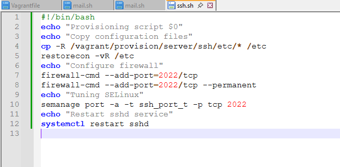{ #fig-024 width=70% }

# Вывод

В ходе лабораторной работы я настроила удалённый доступ к серверу по протоколу SSH, запретила подключение пользователю `root` и ограничила доступ пользователями `vagrant` и `eegashimova`. Настроила дополнительный порт `2022`, изменив параметры SELinux и межсетевого экрана. Реализовала аутентификацию по SSH-ключу и организовала защищённый туннель с перенаправлением TCP-портов. Также проверила выполнение удалённых консольных команд и попыталась запустить графическое приложение через X11Forwarding. Подготовила скрипт Vagrant для автоматизации настройки SSH-сервера.

# Контрольные вопросы

**1. Вы хотите запретить удалённый доступ по SSH на сервер пользователю root и разрешить доступ пользователю alice. Как это сделать?**

Для ограничения удалённого доступа необходимо открыть конфигурационный файл `/etc/ssh/sshd_config` и установить следующие параметры:

```bash
PermitRootLogin no
AllowUsers alice
```

Параметр `PermitRootLogin no` запрещает подключение по SSH от имени суперпользователя `root`, а `AllowUsers alice` разрешает удалённый доступ только пользователю `alice`.

После сохранения изменений необходимо перезапустить SSH-службу командой `systemctl restart sshd`.

**2. Как настроить удалённый доступ по SSH через несколько портов? Для чего это может потребоваться?**

Для настройки SSH-сервера на нескольких портах необходимо открыть файл `/etc/ssh/sshd_config` и указать:

```bash
Port 22
Port 2022
```

После этого необходимо разрешить использование дополнительного порта в SELinux, открыть его в межсетевом экране и перезапустить службу `sshd`.

Использование нескольких портов позволяет организовать альтернативные способы подключения, разделить доступ для различных сетевых окружений и сохранить возможность администрирования сервера при возникновении проблем с одним из портов.

**3. Какие параметры используются для создания туннеля SSH, когда команда ssh устанавливает фоновое соединение и не ожидает какой-либо конкретной команды?**

Для создания SSH-туннеля с фоновым соединением используются параметры `-f` и `-N`.

Параметр `-f` переводит SSH-процесс в фоновый режим, а `-N` запрещает выполнение удалённых команд. Для перенаправления локального порта дополнительно используется параметр `-L`.

Например:

```bash
ssh -fNL 8080:localhost:80 user@server.example.com
```

Данная команда создаёт SSH-туннель, перенаправляющий соединения с локального порта `8080` на порт `80` удалённого сервера.

**4. Как настроить локальную переадресацию с локального порта 5555 на порт 80 сервера server2.example.com?**

Для организации локальной переадресации необходимо выполнить команду:

```bash
ssh -fNL 5555:localhost:80 user@server2.example.com
```

Параметр `-L` задаёт перенаправление портов, `5555` обозначает локальный порт клиента, а `localhost:80` указывает адрес и порт назначения с точки зрения удалённого сервера.

После установки соединения обращение к адресу `http://localhost:5555` на клиенте будет перенаправляться через защищённый SSH-туннель на порт `80` сервера `server2.example.com`.

**5. Как настроить SELinux, чтобы позволить SSH связываться с портом 2022?**

Для разрешения SSH-серверу использовать дополнительный TCP-порт `2022` необходимо выполнить команду:

```bash
semanage port -a -t ssh_port_t -p tcp 2022
```

Параметр `-a` добавляет новое правило, `-t ssh_port_t` назначает порту тип безопасности SSH, а `-p tcp 2022` определяет протокол и номер порта.

После внесения изменений SELinux разрешит процессу `sshd` прослушивать порт `2022`. Для применения конфигурации SSH необходимо перезапустить службу командой `systemctl restart sshd`.

**6. Как настроить межсетевой экран на сервере, чтобы разрешить входящие подключения по SSH через порт 2022?**

Для разрешения входящих TCP-соединений через порт `2022` необходимо выполнить команды:

```bash
firewall-cmd --add-port=2022/tcp
firewall-cmd --add-port=2022/tcp --permanent
```

Первая команда открывает порт в текущей конфигурации межсетевого экрана, а вторая сохраняет правило для его автоматического применения после перезагрузки системы.

Проверить открытые порты можно командой:

```bash
firewall-cmd --list-ports
```

При корректной настройке в выводе должен присутствовать порт `2022/tcp`. Также необходимо убедиться, что SSH-сервер настроен на прослушивание этого порта и его использование разрешено политикой SELinux.

# Список литературы

1. [OpenSSH — руководство по настройке SSH-сервера, ограничению доступа пользователей и конфигурации sshd_config](https://man.openbsd.org/sshd_config)
2. [OpenSSH — руководство по использованию SSH, перенаправлению TCP-портов и организации защищённых туннелей](https://man.openbsd.org/ssh)
3. [OpenSSH — генерация криптографических ключей и настройка аутентификации с помощью ssh-keygen](https://man.openbsd.org/ssh-keygen)
4. [SELinux — руководство по настройке разрешённых TCP-портов для SSH с помощью semanage](https://man7.org/linux/man-pages/man8/semanage-port.8.html)
5. [firewalld — руководство по настройке межсетевого экрана и открытию портов с помощью firewall-cmd](https://firewalld.org/documentation/man-pages/firewall-cmd.html)
6. [HashiCorp Vagrant — автоматизация настройки виртуальных машин с помощью Shell Provisioner](https://developer.hashicorp.com/vagrant/docs/provisioning/shell)