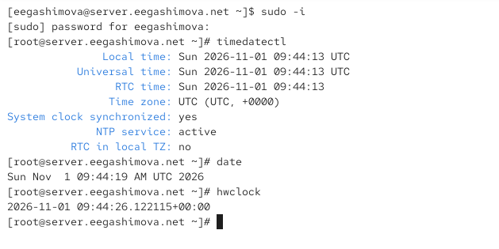
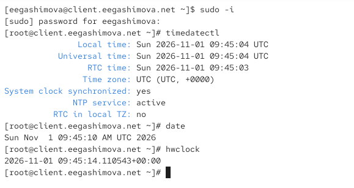
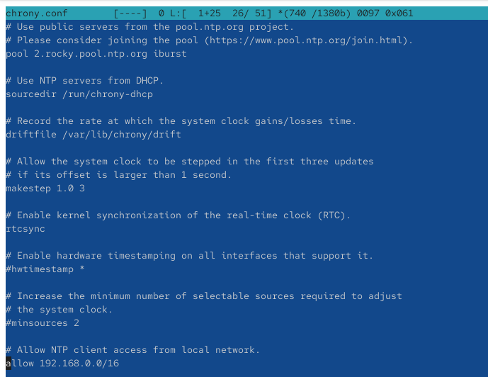
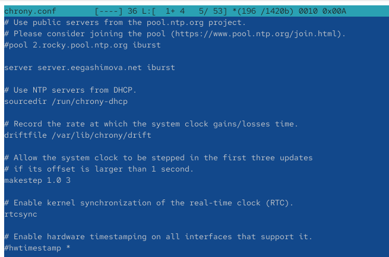
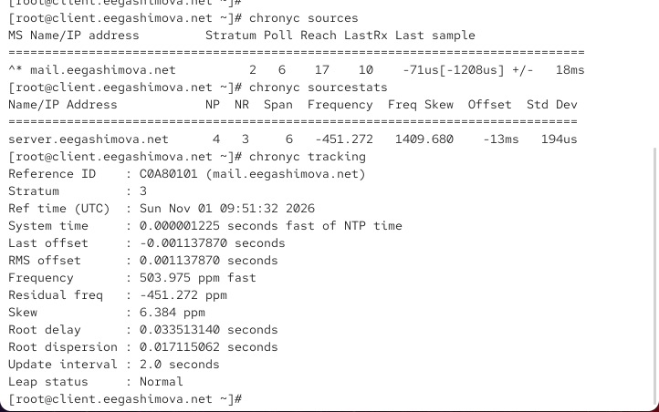
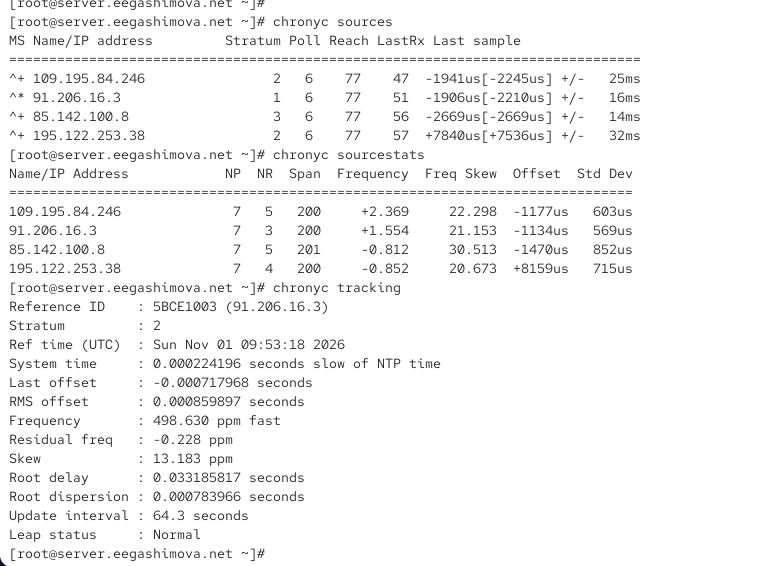
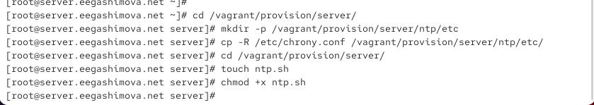
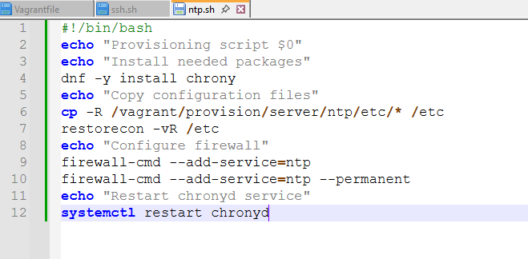
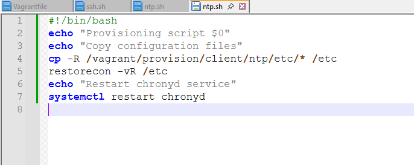

---
## Author
author:
  name: Гашимова Эсма Эльшан кызы
  email: 1132247520@rudn.ru
  affiliation:
    - name: Российский университет дружбы народов
      country: Российская Федерация
      postal-code: 117198
      city: Москва
      address: ул. Миклухо-Маклая, д. 6

## Title
title: Лабораторная работа №12
subtitle: Синхронизация времени
license: CC BY
date: today
date-format: "YYYY-MM-DD"
---

# Цели и задачи работы

## Цель лабораторной работы

Приобретение практических навыков настройки и администрирования синхронизации системного времени в операционной системе Rocky Linux с использованием службы `chronyd`.

Изучить команды управления системным и аппаратным временем, настроить сервер в качестве источника времени для локальной сети, организовать синхронизацию клиента с сервером и подготовить скрипты автоматизации настройки NTP с помощью Vagrant.

# Процесс выполнения лабораторной работы

## Проверка параметров времени на сервере

{ #fig:001 width=70% height=70% }

## Проверка параметров времени на клиенте

{ #fig:002 width=70% height=70% }

## Настройка NTP-сервера

{ #fig:003 width=70% height=70% }

## Настройка NTP-клиента

{ #fig:004 width=70% height=70% }

## Проверка синхронизации времени на клиенте

{ #fig:005 width=70% height=70% }

## Проверка синхронизации времени на сервере

{ #fig:006 width=70% height=70% }

## Подготовка конфигурационных файлов для Vagrant

{ #fig:007 width=70% height=70% }

## Создание скрипта автоматизации NTP-сервера

{ #fig:008 width=70% height=70% }

## Создание скрипта автоматизации NTP-клиента

{ #fig:009 width=70% height=70% }

# Результаты работы

## Настройка сервера синхронизации времени

На виртуальной машине `server` настроена служба `chronyd` для предоставления точного времени устройствам локальной сети.

В конфигурационный файл `/etc/chrony.conf` добавлена директива `allow 192.168.0.0/16`, разрешающая синхронизацию клиентам указанной сети.

В межсетевом экране `firewalld` разрешён доступ к службе NTP через UDP-порт `123`.

## Настройка синхронизации времени на клиенте

На виртуальной машине `client` настроена синхронизация времени с локальным сервером `server.eegashimova.net` с использованием параметра `iburst`.

После перезапуска службы `chronyd` выполнена проверка командами `chronyc sources`, `chronyc sourcestats` и `chronyc tracking`.

По результатам проверки клиент использует NTP-источник времени, а состояние синхронизации соответствует `Leap status: Normal`.

## Анализ источников времени

На сервере определены доступные внешние источники синхронизации времени. Выбранный источник отмечен символами `^*`, а дополнительные подходящие источники — символами `^+`.

Проверка команды `chronyc tracking` показала, что сервер имеет уровень `Stratum 2`, а клиент — `Stratum 3`, что соответствует иерархической организации синхронизации времени.

# Вывод

В ходе лабораторной работы были изучены основные команды управления системным и аппаратным временем в операционной системе Rocky Linux.

На виртуальной машине `server` настроена служба `chronyd` для синхронизации времени с внешними NTP-источниками и предоставления времени клиентам локальной сети. Настроены необходимые разрешения в конфигурации NTP и межсетевом экране.

На виртуальной машине `client` организована синхронизация времени с локальным сервером. С помощью утилиты `chronyc` проверены источники времени, статистика измерений и состояние синхронизации.

Подготовлены скрипты Vagrant для автоматизации настройки NTP-сервера и клиента.