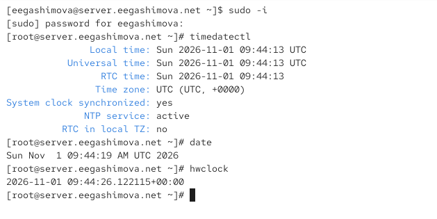
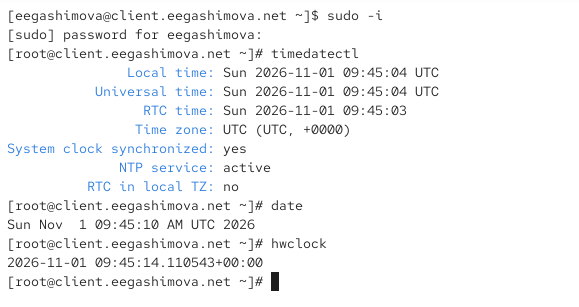
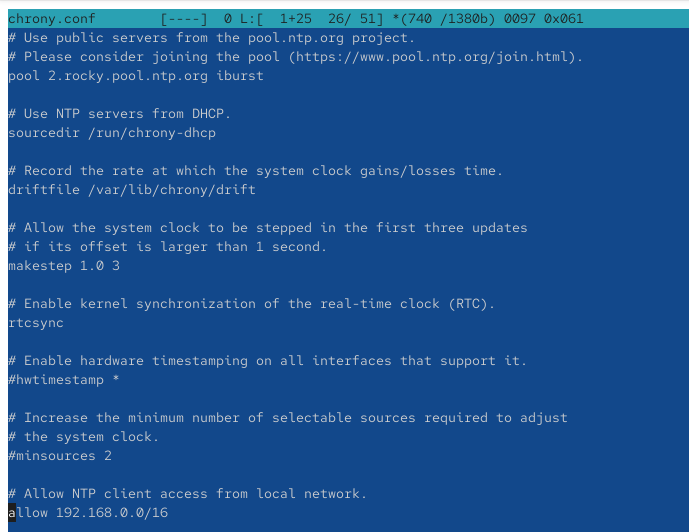
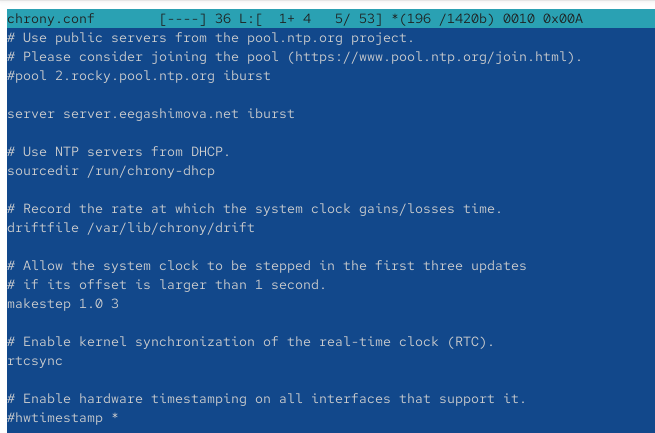
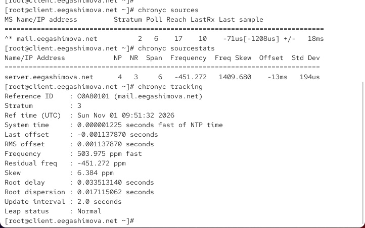
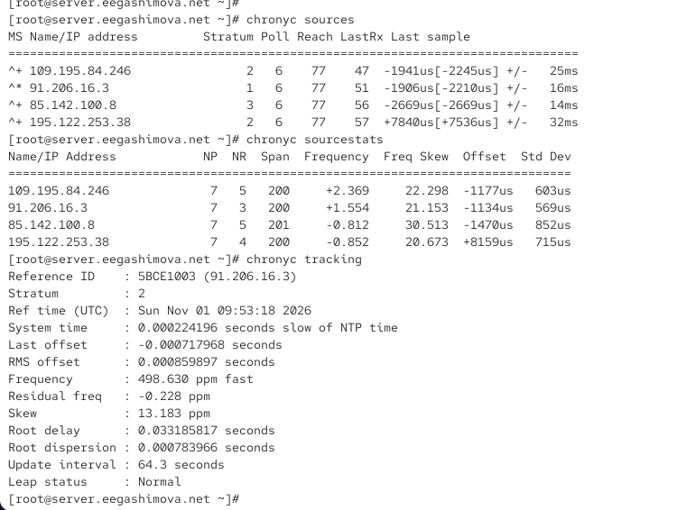
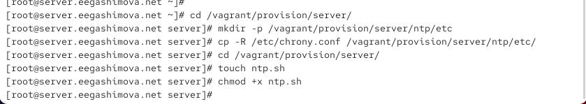
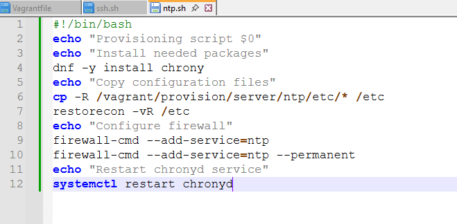
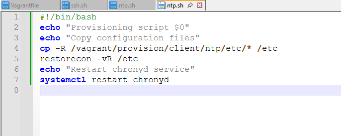

---
## Author
author:
  name: Гашимова Эсма Эльшан кызы
  email: 1132247520@rudn.ru
  affiliation:
    - name: Российский университет дружбы народов
      country: Российская Федерация
      postal-code: 117198
      city: Москва
      address: ул. Миклухо-Маклая, д. 6

## Title
title: "Отчёт по лабораторной работе №12"
subtitle: "Синхронизация времени"
license: "CC BY"
---

# Цель работы

Получение навыков по управлению системным временем и настройке синхронизации времени.

# Выполнение лабораторной работы

## Настройка параметров времени

На виртуальной машине `server` перехожу в режим суперпользователя командой `sudo -i`. Выполняю команду `timedatectl` для просмотра параметров даты и времени. По результатам проверки определяю, что сервер использует временную зону `UTC (UTC, +0000)`, системные часы синхронизированы (`System clock synchronized: yes`), а служба сетевой синхронизации времени активна (`NTP service: active`). Параметр `RTC in local TZ: no` указывает, что аппаратные часы работают по времени UTC.

С помощью команды `date` просматриваю текущие дату и системное время, а командой `hwclock` проверяю показания аппаратных часов. Значения времени соответствуют установленной временной зоне (см. рис. [@fig-001]).

{ #fig-001 width=70% }

На виртуальной машине `client` также перехожу в режим суперпользователя и последовательно выполняю команды `timedatectl`, `date` и `hwclock`. Устанавливаю, что клиент использует временную зону `UTC`, системные часы синхронизированы, а служба NTP активна. Аппаратные часы также используют время UTC, что соответствует настройкам сервера (см. рис. [@fig-002]).

{ #fig-002 width=70% }

## Управление синхронизацией времени

Для организации синхронизации времени используется служба `chronyd`, входящая в состав пакета `chrony`. При отсутствии необходимого программного обеспечения его можно установить командой `dnf -y install chrony`.

На сервере открываю конфигурационный файл `/etc/chrony.conf`. В конфигурации присутствует директива `pool 2.rocky.pool.ntp.org iburst`, определяющая внешние источники точного времени. Для разрешения клиентским устройствам локальной сети использовать сервер в качестве источника времени добавляю строку `allow 192.168.0.0/16`. Данная директива разрешает NTP-запросы от устройств сети с указанным диапазоном IP-адресов (см. рис. [@fig-003]).

{ #fig-003 width=70% }

После сохранения конфигурации перезапускаю службу командой `systemctl restart chronyd`. Для разрешения входящих NTP-запросов на сервере добавляю соответствующее правило межсетевого экрана командой `firewall-cmd --add-service=ntp --permanent` и применяю изменения с помощью `firewall-cmd --reload`. Это обеспечивает доступ клиентов к службе синхронизации времени по протоколу NTP через UDP-порт `123`.

На виртуальной машине `client` открываю файл `/etc/chrony.conf` и изменяю настройки источников времени. Комментирую директиву `pool 2.rocky.pool.ntp.org iburst` и добавляю строку `server server.eegashimova.net iburst`, указывающую на локальный сервер синхронизации времени. Параметр `iburst` ускоряет первоначальную синхронизацию за счёт отправки нескольких NTP-запросов при установлении связи с источником (см. рис. [@fig-004]).

{ #fig-004 width=70% }

После сохранения изменений перезапускаю службу на клиенте командой `systemctl restart chronyd`.

Для проверки синхронизации на клиенте выполняю команды `chronyc sources`, `chronyc sourcestats` и `chronyc tracking`. Команда `chronyc sources` отображает доступные источники времени и их состояние. В выводе присутствует источник `mail.eegashimova.net` с обозначением `^*`, которое указывает на выбранный сервер синхронизации. Значение `Stratum 2` показывает уровень источника в иерархии NTP, а `Reach` отражает успешность обмена пакетами с ним.

Команда `chronyc sourcestats` выводит статистику измерений для `server.eegashimova.net`, включая количество полученных измерений, оценку отклонения частоты часов и временное смещение. Команда `chronyc tracking` показывает подробные параметры текущей синхронизации. Значение `Stratum: 3` указывает на уровень клиента в иерархии NTP, а `Leap status: Normal` свидетельствует об отсутствии предупреждений о состоянии синхронизации. Системное время отличается от NTP-времени приблизительно на `0.000001225` секунды. В выводе команды `sources` и в информации `tracking` отображается имя `mail.eegashimova.net`, хотя в конфигурации указан `server.eegashimova.net`. Для уточнения соответствия этих имён необходима дополнительная проверка DNS (см. рис. [@fig-005]).

{ #fig-005 width=70% }

На сервере также выполняю команды `chronyc sources`, `chronyc sourcestats` и `chronyc tracking`. В выводе `chronyc sources` отображаются четыре внешних источника времени с IP-адресами `109.195.84.246`, `91.206.16.3`, `85.142.100.8` и `195.122.253.38`. Источник `91.206.16.3` отмечен символами `^*`, что означает его использование для синхронизации системных часов. Остальные источники имеют обозначение `^+` и рассматриваются как подходящие дополнительные источники.

Команда `chronyc sourcestats` показывает статистику измерений для каждого источника, включая смещение времени `Offset`, отклонение частоты `Frequency` и стандартное отклонение `Std Dev`. По результатам команды `chronyc tracking` сервер имеет уровень `Stratum: 2`, а значение `System time` показывает отставание системных часов от NTP-времени приблизительно на `0.000224196` секунды. Параметр `Leap status: Normal` подтверждает нормальное состояние синхронизации (см. рис. [@fig-006]).

{ #fig-006 width=70% }

## Внесение изменений в настройки внутреннего окружения виртуальных машин

На виртуальной машине `server` создаю каталог `/vagrant/provision/server/ntp/etc`, копирую в него конфигурационный файл `chrony.conf`, затем создаю исполняемый скрипт `ntp.sh` для автоматической установки и настройки службы синхронизации времени (см. рис. [@fig-007]–[@fig-008]).

{ #fig-007 width=70% }

{ #fig-008 width=70% }

На виртуальной машине `client` аналогично сохраняю конфигурацию `chrony.conf` и создаю скрипт `ntp.sh` для восстановления настроек синхронизации времени, после чего предусматриваю подключение созданных скриптов в конфигурационном файле `Vagrantfile` (см. рис. [@fig-009]).

{ #fig-009 width=70% }

# Вывод

В ходе лабораторной работы я изучила команды управления системным и аппаратным временем `timedatectl`, `date` и `hwclock`. Настроила сервер синхронизации времени с использованием службы `chronyd`, разрешила NTP-запросы из локальной сети и настроила межсетевой экран. На клиенте указала локальный сервер в качестве источника времени и проверила синхронизацию командами `chronyc sources`, `chronyc sourcestats` и `chronyc tracking`. Также подготовила скрипты Vagrant для автоматизации установки и настройки NTP-сервера и клиента.

# Контрольные вопросы

**1. Почему важна точная синхронизация времени для служб баз данных?**

Точная синхронизация времени необходима для правильного определения последовательности транзакций, согласованности данных и работы механизмов репликации. Расхождение времени между серверами может привести к ошибкам при обработке транзакций, нарушению порядка событий и проблемам с восстановлением данных. Кроме того, синхронизированное время позволяет корректно анализировать журналы событий и выполнять резервное копирование.

**2. Почему служба проверки подлинности Kerberos сильно зависит от правильной синхронизации времени?**

Протокол Kerberos использует временные метки для проверки подлинности пользователей и защиты от повторного использования перехваченных запросов. При значительном расхождении времени между клиентом и сервером контроллер аутентификации может отклонить запрос.

По умолчанию допустимое расхождение времени обычно составляет 5 минут. Если разница превышает установленный предел, аутентификация завершается ошибкой, поэтому для корректной работы Kerberos необходима синхронизация системных часов.

**3. Какая служба используется по умолчанию для синхронизации времени на RHEL 7?**

В RHEL 7 по умолчанию для синхронизации времени используется служба `chronyd`, входящая в состав пакета `chrony`. Она обеспечивает синхронизацию системных часов с NTP-серверами и поддерживает работу в условиях нестабильного сетевого соединения.

Проверить состояние службы можно командой:

```bash
systemctl status chronyd
```

**4. Какова страта по умолчанию для локальных часов?**

При использовании локальных часов в качестве источника времени в `chrony` значение страты по умолчанию составляет `10`. Оно применяется при включении локального режима директивой `local`.

Страта определяет уровень источника времени в иерархии NTP. Чем меньше значение, тем ближе источник находится к эталонным часам.

**5. Какой порт брандмауэра должен быть открыт, если вы настраиваете свой сервер как одноранговый узел NTP?**

Для работы NTP необходимо разрешить обмен данными через порт `123/UDP`. Этот порт используется для передачи запросов синхронизации времени между NTP-серверами и клиентами, а также между одноранговыми узлами.

Для открытия порта через межсетевой экран выполняются команды:

```bash
firewall-cmd --add-service=ntp --permanent
firewall-cmd --reload
```

**6. Какую строку вам нужно включить в конфигурационный файл chrony, если вы хотите быть сервером времени, даже если внешние серверы NTP недоступны?**

Для использования локальных часов в качестве резервного источника времени необходимо добавить в файл `/etc/chrony.conf` строку:

```bash
local stratum 10
```

Данная директива позволяет серверу продолжать предоставлять время клиентам даже при отсутствии связи с внешними NTP-серверами. При этом точность времени зависит от локальных часов сервера.

После изменения конфигурации необходимо перезапустить службу командой `systemctl restart chronyd`.

**7. Какую страту имеет хост, если нет текущей синхронизации времени NTP?**

В протоколе NTP значение страты `16` обозначает несинхронизированный источник времени. Хост с этим значением не считается надёжным источником и не должен использоваться другими устройствами для синхронизации.

При отсутствии синхронизации команда `chronyc tracking` может отображать `Stratum: 0` и состояние `Leap status: Not synchronised`. Если включён локальный режим `local stratum 10`, сервер может использовать собственные часы и объявлять страту `10`.

**8. Какую команду вы бы использовали на сервере с chrony, чтобы узнать, с какими серверами он синхронизируется?**

Для просмотра источников синхронизации времени используется команда:

```bash
chronyc sources
```

Она выводит список NTP-серверов, их страты, доступность и состояние синхронизации. Символ `^*` обозначает выбранный источник времени, а `^+` указывает на дополнительные источники, участвующие в синхронизации.

Для получения расширенной информации используется команда `chronyc sources -v`.

**9. Как вы можете получить подробную статистику текущих настроек времени для процесса chrony вашего сервера?**

Для просмотра подробной информации о состоянии синхронизации используется команда:

```bash
chronyc tracking
```

Она отображает текущий источник времени, страту, величину отклонения системных часов, частотную коррекцию и состояние синхронизации.

Дополнительную статистику по каждому источнику времени можно получить командой:

```bash
chronyc sourcestats
```

Она показывает количество измерений, оценку частотного отклонения, смещение времени и статистическую погрешность измерений.

# Список литературы

1. [Red Hat Enterprise Linux 7 — руководство по настройке системного и аппаратного времени с помощью timedatectl, date и hwclock](https://docs.redhat.com/en/documentation/red_hat_enterprise_linux/7/html/system_administrators_guide/chap-configuring_the_date_and_time)
2. [Chrony — руководство по настройке NTP-сервера и клиента с помощью конфигурационного файла chrony.conf](https://chrony-project.org/doc/latest/chrony.conf.html)
3. [Chrony — руководство по проверке синхронизации времени и диагностике с помощью chronyc sources, tracking и sourcestats](https://chrony-project.org/doc/latest/chronyc.html)
4. [HashiCorp Vagrant — автоматизация установки и настройки NTP-сервера и клиента с помощью Shell Provisioner](https://developer.hashicorp.com/vagrant/docs/provisioning/shell)